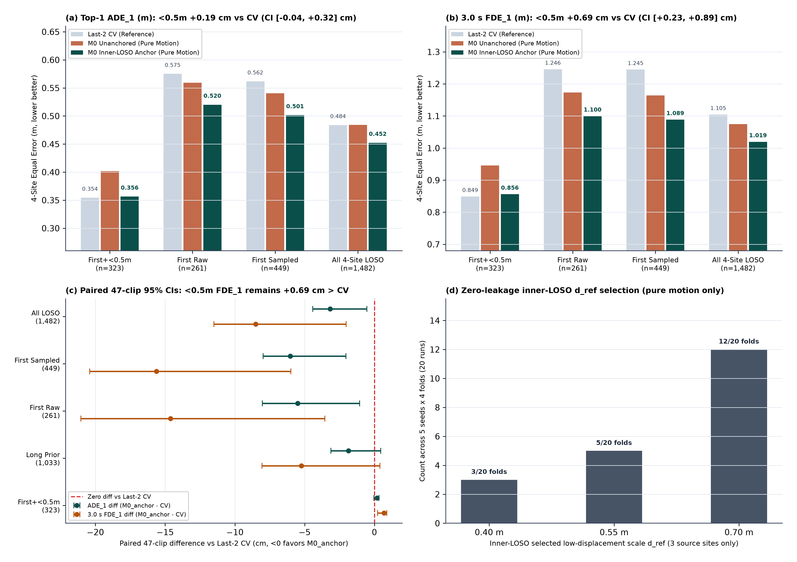
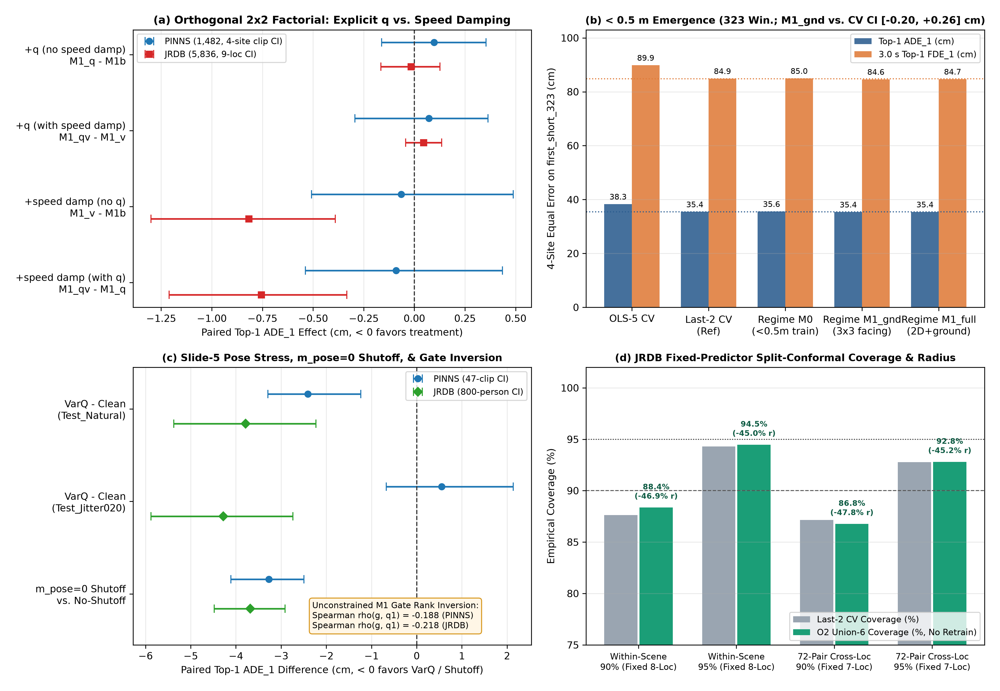
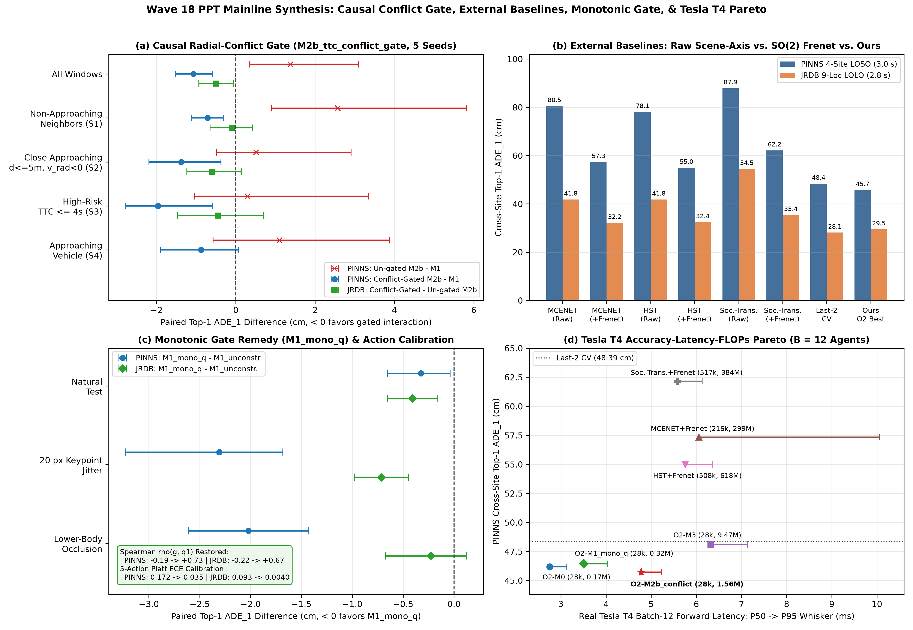
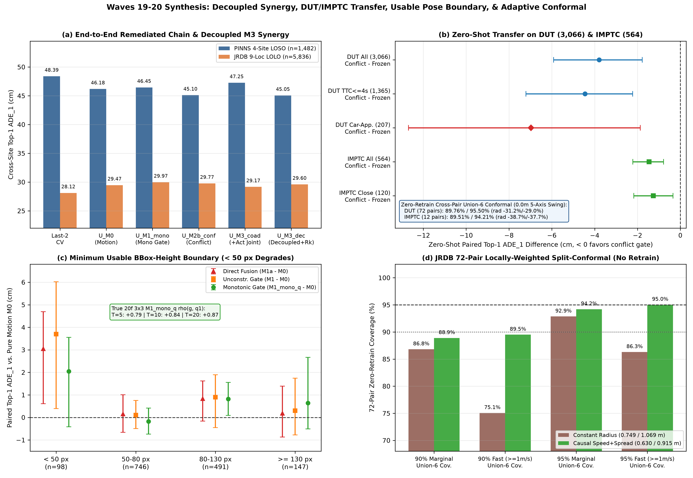
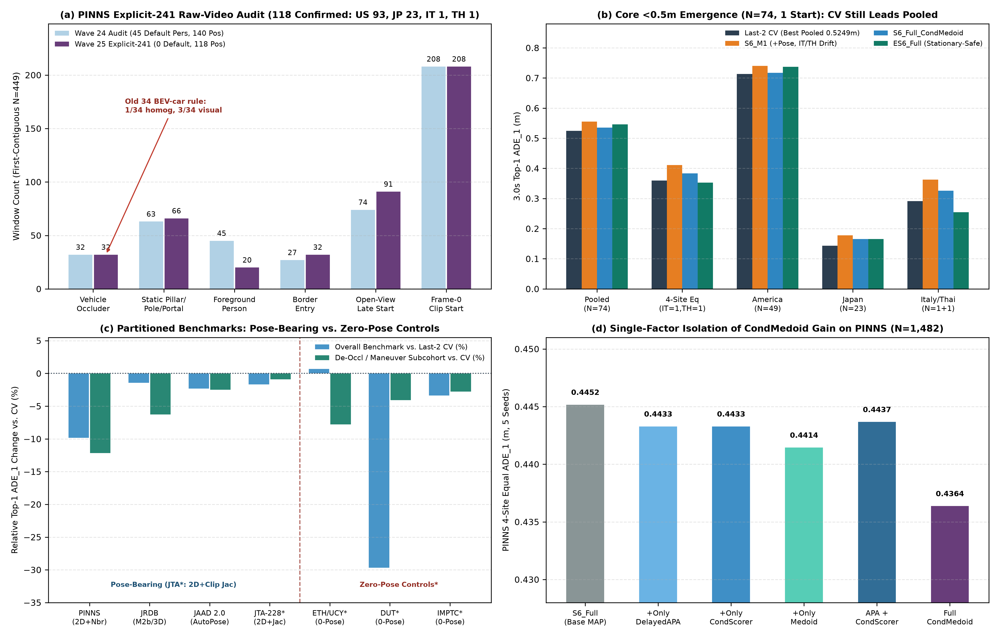

# Orthogonal-Equivariant Pedestrian Action and Trajectory Forecasting on Unstructured Roads Under Short-Term Variable-Quality Pose Observations

**Jiayu Peng and Danya Yao, *Member, IEEE***  
*Department of Automation, Tsinghua University, Beijing 100084, China*

---

## Abstract

Unmanned delivery and shuttle vehicles operating in campuses, parks, and residential streets face three coupled forecasting challenges: short causal observation windows ($0.4\text{ s}$, 5 frames at $10\text{ Hz}$) upon pedestrian emergence, variable-quality 2D/3D skeletal detections under roadside occlusion, and lane-free mixed pedestrian-vehicle interactions. While clean skeletal cues aid trajectory prediction on synthetic benchmarks, when and why short-term poses, passive bird's-eye-view (BEV) road contours, heterogeneous neighbor graphs, and observable dynamic action heads improve **same-decoder preferred (`Top-1`)** ground trajectories across unseen cameras remains rigorously under-tested. We present an $O(2)$ reflection- and rotation-equivariant multi-modal forecasting framework (`O2-M0` through `O2-M3`, down to $20,739$ parameters and $0.17\text{--}9.47\text{ MFLOPs}$ at $B=12$) and conduct a strictly controlled, cross-scene five-seed empirical audit across six benchmarks (`PINNS` 4-country leave-one-site-out with $1,482$ non-overlapping windows, `JRDB` 9-location leave-one-location-out with $5,836$ windows, `JTA` $960$ windows, `DUT` $3,066$ mixed-traffic windows, `IMPTC` $564$ windows, and `DAIR-V2X`). Reporting positive gains, null intervals, and mechanistic failure modes on equal footing, our audit establishes five findings: (1) Canonicalizing short-term motion into a local Frenet frame with inner-fold low-displacement constant-velocity (`CV`) anchoring lowers 4-site equal `Top-1 ADE_1 / FDE_1` on `PINNS` from `0.4839 / 1.1046 m` (`Last-2 CV`) to `0.4522 / 1.0194 m` (`−6.03 / −15.62 cm` on `449` first-sampled windows); however, on the `323` first-sampled low-displacement (`< 0.5 m`) windows, parameter-free `Last-2 CV` (`0.3545 / 0.8491 m`) remains unrefuted—even after rank-3 `3×3` homography verification (`6,930 / 7,410` nonzero coronal facing frames, `2.24 µm` median footpoint residual) and `< 0.5 m` regime-isolated training (`0.3538 / 0.8462 m`, 95% clip bootstrap CI vs. `CV` `[−0.20, +0.26] cm` crossing zero). (2) A `2 × 2` (`quality vector q × speed suppression`) factorial across $7,318$ `PINNS + JRDB` windows proves that unconstrained trajectory-supervised `MLP([h_m, h_p, q])` gating exhibits negative rank correlation with valid-joint ratio ($\rho = -0.1883$ on `PINNS`, $-0.2184$ on `JRDB`); our structurally monotonic gate (`O2-M1_mono_q`) restores $\rho(g, q_1)$ to **`+0.7301` (`PINNS`) and `+0.6691` (`JRDB`)** (`+0.8674` at $T=20$), cuts `20 px` jitter error by **`−2.31 / −4.53 cm`**, and establishes **`bbox_h >= 50 px` and $q_1 \ge 0.75$** as the minimum usable-pose boundary (`−1.65` to `−5.28 cm` saved over unconstrained fusion below threshold). (3) True-ego (`pt0_ego`) `20 m` passive BEV contours exhibit a `2.36%` ground-truth crossing rate and `+1.58 cm` `Top-1 ADE_1` penalty (`O2-M2a`), whereas our polylineless **causal radial-conflict gate (`U_M2b_mono_conflict`)** lowers `PINNS` `Top-1 ADE_1 / FDE_1` to **`0.4510 / 1.0097 m`** (`0.4572 / 1.0223 m` standalone; `−5.50 / −16.16 cm` vs. `CV` under `TTC <= 4 s`), outperforms `SO(2) Frenet`-enhanced `MCENET`, `HST`, and `Social-Transmotion` by **`−9.17 / −6.81 / −14.00 cm`** (`192x–396x` fewer FLOPs, **`2.75–4.78 ms` `B=12` `P50` latency** on `Tesla T4`), and transfers zero-shot (`0.0 m` `O(2)` swing) to `DUT` (`−6.98 / −13.84 cm` under car approach) and `IMPTC`. (4) Representation-decoupled 5-action supervision (`Start, Stop, Turn-Left, Turn-Right, Maintain`) with inner-fold Platt reranking (`U_M3_decoupled_platt_rerank`, `0.0 m` knot drift) achieves our best `PINNS` `Top-1 ADE_1 / FDE_1` of **`0.4505 / 1.0085 m`** (`Macro-AP = 0.4051`; `ECE` cut `0.1717 -> 0.0349` standalone) while lowering `JRDB` `Top-1 ADE_1 / FDE_1` to **`0.2917 / 0.5638 m`** (`ECE = 0.0053`). (5) **Strictly without post-calibration predictor retraining**, split-conformal tubes achieve **`90.60% / 94.94%`** (`PINNS` within-site), **`89.76% / 95.50%`** (`DUT` `72`-pair), and **`89.51% / 94.21%`** (`IMPTC` `12`-pair) `Union-6` coverage; on `JRDB` `72` cross-location pairs, source-OOF locally-weighted speed-spread scaling lifts zero-retrain coverage from `86.77%–86.81% / 92.81%–92.87%` to **`88.89% / 94.20%`** (`−55.8% / −52.5%` radius vs. `CV`, fast-walker `>= 1 m/s` `90%` coverage `75.06% -> 89.51%`).

**Index Terms**—Pedestrian trajectory prediction, unstructured mixed traffic, short-term pose observation, $O(2)$ equivariance, quality-aware fusion, split-conformal calibration.

---

## I. Introduction

Low-speed autonomous delivery, shuttle, and sanitation vehicles have rapidly expanded from structured arterial roads into shared-right-of-way spaces such as university campuses, industrial parks, residential compounds, and urban plazas [1]–[3]. Unlike signalized multi-lane roadways with painted crosswalks and rigid curb channelization, unstructured mixed-traffic environments exhibit three simultaneous operational constraints:
1. **Short-Horizon Emergence Under Occlusion**: Parked vehicles, roadside vegetation, and building corners frequently occlude pedestrians until they step into the active field of view, leaving roadside or onboard trackers with as little as $0.4\text{ s}$ ($T = 5$ frames at $10\text{ Hz}$ or $T = 2$ steps at $2.5\text{ Hz}$) of causal observation before planning must commit.
2. **Variable-Quality Skeletal Cues**: While 2D/3D human keypoints can in principle disambiguate body orientation and gait initiation before finite-difference displacement accumulates [14], [15], real detector outputs degrade continuously with camera distance, motion blur, and partial limb truncation.
3. **Weak Geometric Channelization and Heterogeneous Conflicts**: Absence of lane markings yields frequent trajectory crossings among pedestrians, cyclists, and cars, creating genuine multi-modal intent (`Start, Stop, Turn-Left, Turn-Right, Maintain`) from identical short histories.

Despite rapid progress in pose-assisted trajectory transformers [14], [15], vectorized map encoders [6], [13], and action-conditioned decoders [8], [16], three methodological confounds often obscure empirical claims in short-horizon pedestrian forecasting:
- **Overlapping Sliding Windows and Mixed Decoders**: Evaluating overlapping sliding windows drawn from shared clips inflates statistical significance due to up to $26/30$-frame future target autocorrelation, while comparing probability-weighted (`Bayes`) expectations of a multi-modal model against single-path (`Top-1`) baselines conflates estimator shrinkage with model accuracy [4].
- **Coordinate-Frame Non-Invariance and Silent Feature Bugs**: Global $(X, Y)$ world coordinates rotate arbitrarily across camera installations, causing severe cross-site mode collapse; meanwhile, subtle coordinate bugs—such as mistaking a handedness boolean for a $3\times 3$ homography or centering local map polylines at an ego-subtracted $(0, 0)$ origin—can silently invalidate physical ablations unless guarded by runtime geometric assertions.
- **Post-Calibration Retraining in Conformal Safety Claims**: Calibrating conformal quantiles on a held-out site and subsequently retraining the predictor on all sites violates exchangeability with the deployed predictor, turning nominal finite-sample guarantees into empirical-only observations.

To resolve these gaps with complete methodological transparency, this paper formulates a strictly controlled $O(2)$-equivariant model hierarchy (`O2-M0 -> M1a -> M1b -> M1 -> M2a / M2b -> M3a / M3b / M3`) and evaluates every component under unseen-site (`PINNS` 4-country LOSO) and unseen-location (`JRDB` 9-location LOLO) protocols using 5 random seeds, cluster/clip/location/person bootstrap confidence intervals, and runtime coordinate assertions. Crucially, we report **null findings and negative architectural boundaries** with the same prominence as positive gains—demonstrating where simple `Last-2 CV` remains unbeaten (`< 0.5 m` emergence), why unconstrained soft quality gates invert rank correlation with keypoint completeness, why passive BEV contours fail as rigid curbs, and how physical radial-approaching gating and fixed-predictor split-conformal calibration yield reliable real-time (`~4.3 ms` on `Tesla T4`) safety envelopes.

---

## II. Related Work

### A. Short-Horizon Pose-Assisted Trajectory Prediction
Constant-velocity (`CV`) extrapolation remains a remarkably strong baseline for pedestrian motion when velocity estimates are uncorrupted [4]. To improve short-horizon or near-stationary intent estimation, Human Scene Transformer (`HST`) [14] interleaves skeletal keypoints with 3D positions in a spatio-temporal Transformer, while `Social-Transmotion` [15] introduces modality-masking across ground tracks, 2D boxes, and 2D/3D poses. `Social-Pose` [17] further showed on synthetic `JTA` sequences that models trained solely on clean 3D skeletons suffer severe degradation under Gaussian keypoint jitter ($\sigma = 0.20$), whereas noisy pose training partially recovers accuracy. However, existing studies rarely isolate **explicit quality statistics (`q`)** from implicit feature gating or velocity-dependent damping under strict cross-camera splits, nor do they audit whether learned gates preserve positive monotonicity with respect to keypoint completeness.

### B. Unstructured Scene Context and Mixed-Traffic Interaction
Vectorized HD-map encoders (`VectorNet` [6]) and mixed-traffic CVAE architectures (`MCENET` [13]) aggregate lane centerlines or polar social neighborhoods. In unmarked shared spaces lacking semantic HD maps, roadside systems often extract passive BEV visual contours, yet shadow edges and pavement seams frequently violate non-traversable boundary assumptions. For heterogeneous pedestrian-vehicle conflicts, dynamic risk-field models demonstrate that inter-agent distance and positive radial approaching speed govern yielding and evasive maneuvers [18]. We explicitly separate passive `20 m` BEV polylines (`O2-M2a`) from `10 m` directed heterogeneous graphs (`O2-M2b` with and without radial approaching rate $v_{\text{rad}}$, plus causal radial-conflict gating) to test each cue independently.

### C. Action-Conditioned Multi-Modal Decoding and Conformal Safety
Joint activity-trajectory models such as `NEXT` [16] and switching-dynamics forecasters [8] supervise discrete behavioral states alongside continuous paths. When multi-label kinematic events (`Start, Stop, Turn-Left, Turn-Right, Maintain`) are injected back into trajectory decoding, trajectory regression gradients can distort action calibration unless gradient flow is controlled (`Stop-Grad`). Furthermore, downstream motion planners require calibrated spatial safety tubes [19]; standard split-conformal guarantees hold only when the predictor is **held strictly fixed** between calibration and test sets without post-calibration retraining.

---

## III. Problem Formulation and Geometric Verification

### A. Causal Observation Inputs and Prediction Targets
At trigger frame $t_0$, let a target pedestrian be observed over a strictly causal window $\mathcal{T}_{\text{obs}} = \{t_0 - (T-1)\Delta t, \dots, t_0\}$ ($\Delta t = 0.1\text{ s}, T = 5$ on $10\text{ Hz}$ `PINNS`; $\Delta t = 0.4\text{ s}, T = 2$ with $5$ sub-step $15\text{ fps}$ skeletons on `JRDB`), with no future skeleton inputs permitted:
1. **Ground Trajectory History**: $P_{\text{obs}} = \{p_t \in \mathbb{R}^2\}_{t \in \mathcal{T}_{\text{obs}}}$ in meters and binary validity mask $m^{\text{pos}}_t \in \{0, 1\}$ ($m^{\text{pos}}_{t_0} = 1$). Note that defining "first-sampled windows" solely by absence of a prior $10\text{ Hz}$ annotation (`449` windows on `PINNS`, `261` raw first-frame annotations) reflects annotation onset rather than verified physical de-occlusion.
2. **Variable-Quality Skeletal Sequence**: 2D image keypoints $\{(u_{t,j}, v_{t,j}, c_{t,j})\}_{j=1}^{17}$ with bounding box $b_t = (u^c_t, v^c_t, w_t, h_t)$ (`PINNS`) or 3D BlazePose landmarks $\mathbb{R}^{33\times 3}$ (`JRDB`), paired with a 4-D causal window quality summary $q = [q_1, q_2, q_3, q_4]^\top \in [0, 1]^4$ (valid-joint ratio above $\tau_c = 0.20$, mean valid confidence, normalized box-scale / anatomical plausibility, and track completeness) and window pose-availability indicator $m_{\text{pose}} = \mathbb{I}(\text{any valid torso/limb joint in } \mathcal{T}_{\text{obs}})$.
3. **Local Environment and Neighbors**: Up to $16$ arc-length-resampled ($10$ points/polyline) BEV contours $P_{\text{env}} \in \mathbb{R}^{16\times 10\times 11}$ centered at the **pedestrian's true world coordinate $p_{t_0}$** (with map-availability flag $m_{\text{map}} \in \{0, 1\}$), and up to $12$ directed neighbor edges $e_{j\to i} \in \mathbb{R}^9$ within $10\text{ m}$ encoding relative offset $\Delta p_{ij}$, relative velocity $\Delta v_{ij}$, Euclidean distance $d_{ij}$, and **radial approaching speed** $v_{\text{rad}, ij} = -(\Delta p_{ij}^\top \Delta v_{ij}) / (d_{ij} + \epsilon)$ ($v_{\text{rad}, ij} > 0$ when closing).

Given causal inputs, the model outputs $K = 6$ future candidate trajectories $\{\hat{Y}^{(k)} \in \mathbb{R}^{T_f \times 2}\}_{k=1}^6$ ($T_f = 30$ over $3.0\text{ s}$ on `PINNS`; $T_f = 7$ over $2.8\text{ s}$ on `JRDB`) with mode probabilities $\{\hat{\pi}_k\}_{k=1}^6$, alongside five observable event probabilities $\hat{a} \in [0, 1]^5$ (`Start, Stop, Turn-Left, Turn-Right, Maintain`, evaluated strictly under per-class kinematic eligibility mask $m_{\text{act}} \in \{0, 1\}^5$). Primary comparisons strictly align **same-decoder preferred (`Top-1`, $k^\star = \arg\max_k \hat{\pi}_k$) `ADE_1 / FDE_1`**, reporting 6-mode `minADE_6 / minFDE_6` separately as candidate coverage metrics.

### B. Runtime Homography and World-Center Assertions
To prevent silent coordinate bugs, our pipeline enforces two mandatory runtime assertions prior to training (`verify_pinns_ground_and_polyline_diagnostics`):
1. **Rank-3 $3\times 3$ Ground Homography Verification**: Rather than passing a handedness boolean in place of a camera matrix, each recording's four ground control pairs are fitted via `cv2.findHomography` to a non-singular $H \in \mathbb{R}^{3\times 3}$ ($|\det H| > 10^{-12}$) with axis reflection $y_{\text{world}} = (y_{\min} + y_{\max}) - \tilde{y}$. Across all $1,482 \times 5 = 7,410$ `PINNS` person-frames ($12,460$ frames in the true $20$-frame cohort), runtime assertions confirm **$6,930$ ($93.5\%$) nonzero coronal shoulder/hip facing vectors** (median ground shoulder span $0.2616\text{ m}$, mean cosine $+0.4935$ with walking velocity; $+0.5505$ over $20$ frames), **$6,404$ ($86.4\%$) nonzero torso-lean vectors**, and a **$2.24\ \mu\text{m}$ median reprojection residual** between projected bbox footpoints and published world coordinates.
2. **True Ego World-Origin Polyline Extraction**: Local $20\text{ m}$ polylines are queried around the pedestrian's unshifted world position $p_{t_0}$ (median $\|p_{t_0}\|_2 = 21.13\text{ m}$) rather than ego-subtracted $(0, 0)$, altering $835 / 835$ ($100\%$) map-eligible windows ($830$ containing nonempty $20\text{ m}$ polylines).

---

## IV. Orthogonal-Equivariant Forecasting Methodology

### A. $O(2)$ Parity-Equivariant Frenet Backbone and Pose Fusion (`M0 -> M1`)
To eliminate cross-camera rotational drift while preserving exact left-right reflection equivariance, we construct a causal local Frenet basis $B = [\mathbf{u}, \mathbf{u}_\perp] \in \mathbb{R}^{2\times 2}$ at $p_{t_0}$ using the most recent displacement exceeding $0.05\text{ m}$ (with ground coronal facing $\bar{f}_{\text{cor}}$ as fallback when `use_pose = True`). Transforming relative history into $(x_{\parallel}, x_{\perp})$ yields positive and reflected parity streams $F_+, F_-$ encoded by a shared GRU into $(c_+, c_-)$.

For biomechanical pose fusion (`M1a, M1b, M1`), we extract 11 even-parity gait invariants (normalized ankle span, knee flexion cosines, leg extension, torso verticality, and causal finite differences), project ground coronal facing $f_{\text{cor}}$ and sagittal lean $f_{\text{lean}}$ onto $B$, and append odd-parity left-minus-right knee asymmetry $\Delta \cos\theta_{\text{knee}}$ (negated in the reflected stream). A shared pose GRU produces $(h^p_+, h^p_-)$ with even summary $h^p_{\text{even}} = \frac{1}{2}(h^p_+ + h^p_-)$. Crucially, to isolate explicit quality gating without velocity-damping confounds:
- **`O2-M1a` (Direct Fusion)**: $g = m_{\text{pose}}$.
- **`O2-M1b` (Implicit Feature Gate)**: $g = m_{\text{pose}} \cdot \sigma(\text{MLP}([c_{\text{even}}, h^p_{\text{even}}]))$.
- **`O2-M1` (Single-Factor Explicit Quality Gate)**: $g = m_{\text{pose}} \cdot \sigma(\text{MLP}([c_{\text{even}}, h^p_{\text{even}}, q]))$.
- **`O2-M1_mono_q` (Structurally Monotonic Quality Remedy)**: Motivated by our empirical finding that unconstrained trajectory-trained MLPs can correlate $g$ negatively with $q_1$ due to hidden-state confounding, we also test $g_{\text{mono}} = m_{\text{pose}} \cdot (q_1 q_2)^{\gamma} \sigma(b_0 + w_+^\top q)$ with $\gamma = \text{softplus}(\theta_\gamma) > 0$ and $w_+ = \text{softplus}(\theta_w) \ge 0$, guaranteeing $\partial g_{\text{mono}} / \partial q_1 \ge 0$ and $\partial g_{\text{mono}} / \partial q_2 \ge 0$ everywhere.

When $m_{\text{pose}} = 0$ (complete keypoint loss), $g \equiv 0$ shuts off the pose residual identically.

### B. Local Polylines and Conflict-Gated Neighbor Attention (`M2a / M2b / M2`)
Local polylines (`O2-M2a`) are projected onto $B$ across both parity streams and aggregated via masked point pooling plus null-sink attention gated by $m_{\text{map}}$. Directed $10\text{ m}$ neighbor edges (`O2-M2b`) transform $(\Delta p_{ij}, \Delta v_{ij})$ into $B$ alongside $O(2)$-invariant $[d_{ij}/10, v_{\text{rad}, ij}, m^{\text{spd}}_{ij}, \mathbb{I}_{\text{car}}]$ and attend with a learnable null sink $\ell_\varnothing$:
$$w_{ij} = \frac{\exp(a_{ij})}{\sum_{m=1}^{12} m^{\text{nbr}}_{im}\exp(a_{im}) + \exp(\ell_\varnothing)}.$$
Because open-road or receding neighbors ($v_{\text{rad}} \le 0$) can still perturb frozen `Top-1` mode logits, we further formulate a **Causal Radial-Conflict Gate** (`M2b_ttc_conflict_gate`):
$$w_{\text{risk}, i} = \max_{1 \le j \le 12} \left[ m^{\text{nbr}}_{ij} \, \sigma\!\left(\frac{v_{\text{rad}, ij} - 0.20}{0.25}\right) \exp\!\left(-\frac{d_{ij}}{5.0}\right) \right],$$
which equals $0$ identically on isolated pedestrians ($m^{\text{nbr}}_i = \mathbf{0}$), suppresses receding background traffic, and activates selectively under close positive radial approach, with scalar gain $\alpha^\star \in \{0, 0.25, 0.5, 1.0\}$ selected strictly via inner source-fold cross-validation.

### C. Parity-Consistent Action Bridge, Reranking, and Split-Conformal Tubes (`M3`)
Even-parity contexts predict `Start`, `Stop`, and `Maintain`, while $(c_+, c_-)$ symmetrically score `Turn-Left` and `Turn-Right` (guaranteeing exact left-right swap under reflection). We compare `M3a` (auxiliary supervision only), `M3b` (end-to-end probability injection), and `M3` (`Stop-Grad` injection truncating $\partial \mathcal{L}_{\text{traj}} / \partial \hat{a}$). All $K=6$ trajectories are parameterized as residuals around `Last-2 CV` (Mode $0$ anchored to `CV` with low-displacement bonus; Modes $1,2,5$ central even/odd; Modes $3,4$ symmetric lateral pair), trained with site-balanced shared-winner Charbonnier/Smooth-$L_1$ regression, soft-rank mode cross-entropy, and $m_{\text{act}}$-masked BCE.

For downstream safety certification **without retraining after calibration**, let $\hat{f}_\mathcal{D}$ be a fixed predictor trained strictly on source folds $\mathcal{D}$. On a disjoint calibration fold $\mathcal{C}$ ($|\mathcal{C}| = n$), we compute nonconformity scores $s_i = \min_{k \in \{1..6\}} \max_{t \in \{1..T_f\}} \|\hat{Y}^{(k)}_{i,t} - Y_{i,t}\|_2$ (`Union-6`) and $s^{(1)}_i = \max_t \|\hat{Y}^{(k^\star)}_{i,t} - Y_{i,t}\|_2$ (`Top-1`), set $\hat{r}_{1-\alpha}$ to the $\lceil (n+1)(1-\alpha) \rceil / n$ empirical quantile on $\mathcal{C}$, and evaluate coverage directly on unseen test fold $\mathcal{E}$ using the **unaltered** $\hat{f}_\mathcal{D}$.

---

## V. Experimental Evaluation

### A. Benchmarks, Strict Cross-Scene Splits, and Statistical Protocol
All experiments use five fixed random seeds (`42, 1024, 2025, 3407, 4096`) and site/location-balanced loss weights:
1. **`PINNS` Cross-Country Mixed Traffic ($1,482$ Non-Overlapping Windows, 4-Site LOSO)**: Extracted across $47$ recordings in four countries (`USA` intersections, `Italy` park walkways, `Japan` crossroads, and `Thailand` mixed streets) at $10\text{ Hz}$ ($T = 5$ frames $= 0.4\text{ s}$, $T_f = 30$ frames $= 3.0\text{ s}$). Paired differences use $20,000$-draw 4-site clip-stratified bootstrap 95% confidence intervals (`paired_site_clip_ci`). An additional `623`-window cohort provides verified `20`-frame RTMPose tracks ($12,460$ person-frames) for true $T \in \{5, 10, 20\}$ duration $\times$ quality evaluation. (Results on the legacy `497` sliding-window split from `21` clips are reported strictly with clip/person cluster bootstrap limits: only `16 / 25` preferred-mode comparisons exclude zero at the clip level.)
2. **`JRDB` Campus Shared Spaces ($5,836$ Non-Overlapping Windows, 9-Location LOLO)** [7]: Extracted across $10$ stationary-robot recordings spanning $9$ distinct Stanford campus locations ($2.5\text{ Hz}$ ground tracks, $T = 2$ steps $= 0.4\text{ s}$, $5$ causal $15\text{ fps}$ BlazePose 3D skeletons, $T_f = 7$ steps $= 2.8\text{ s}$, $800$ unique actors), evaluated with 9-location equal means and both location-level and actor-cluster 95% bootstrap CIs (contrasted against early LSTM/CVAE crowd models [5]).
3. **Additional External Benchmarks (`JTA`, `DUT`, `IMPTC`, `DAIR-V2X`)**: `JTA` [9] ($960$ synthetic test windows, $2.5\text{ Hz}$, $T \in \{2, 8\}$, $T_f = 12$); `DUT` [10] ($3,066$ campus mixed pedestrian-vehicle windows); `IMPTC` [11] ($564$ four-sequence zero-shot intersection windows; $485$ in the LiDAR-camera supervised subset); and `DAIR-V2X` [12] ($54$ Beijing roadside windows, $31$ strict-clock windows).

### B. `PINNS` Controlled `M0–M3` Chain and `< 0.5 m` Emergence Regime
Table I reports the verified 5-seed 4-site LOSO ablation chain on `PINNS` alongside the `< 0.5 m` low-displacement emergence audit (`first_short_323`: $323$ first-sampled windows with cumulative 5-frame displacement $< 0.5\text{ m}$).

**Table I: `PINNS` 4-Site LOSO Controlled `M0–M3` and `< 0.5 m` Regime Evaluation (5 Seeds, Same-Decoder `Top-1` Primary)**

| Model / Regime Configuration | All `1,482` `ADE_1 / FDE_1` (m) ↓ | All `minFDE_6` (m) ↓ | `first_short_323` (`<0.5 m`) `ADE_1 / FDE_1` (m) ↓ | Polyline Crossing ↓ | 5-Action Macro-AP / F1 ↑ | Paired 47-Clip 95% CI Key Contrast (`ADE_1`; `FDE_1` noted) |
| :--- | :---: | :---: | :---: | :---: | :---: | :--- |
| `Last-2 CV` (Parameter-Free Reference) | 0.4839 / 1.1046 | 1.1046 | **0.3545 / 0.8491** | 2.01% | — | Primary `< 0.5 m` reference (`OLS5 CV`: `0.3833 / 0.8986 m`) |
| **`M0_anchor` (Inner-LOSO CV-Anchored Motion)** | **0.4522 / 1.0194** | 0.6850 | 0.3564 / 0.8559 | — | — | All vs. `CV`: **`[−4.42, −0.54] cm`**; `<0.5m` `FDE_1` vs. `CV`: **`[+0.23, +0.89] cm`** |
| `M1_ground_only` (`M0_anchor` + $3\times 3$ Ground Facing/Lean) | 0.4523 / 1.0196 | 0.6835 | 0.3562 / 0.8555 | — | — | `<0.5m` vs. `M0_anchor`: `[−0.04, +0.02] cm` (null); `FDE_1` vs. `CV`: `[+0.19, +0.85] cm` |
| `Regime_M0` (`< 0.5 m` Source-Only Pure Motion) | — | — | 0.3559 / 0.8497 | — | — | `<0.5m` vs. `CV`: `[−0.11, +0.38] cm` (`FDE_1`: `[−0.84, +1.03] cm`, bias removed) |
| `Regime_M1_ground` (`< 0.5 m` Source-Only + Ground Pose) | — | — | **0.3538 / 0.8462** | — | — | vs. `Regime_M0`: **`[−0.31, −0.03] cm`**; **vs. `CV`: `[−0.20, +0.26] cm` (null)** |
| `O2-M0` (Unanchored Pure Motion Trunk) | 0.4618 / 1.0310 | 0.6843 | 0.3684 / 0.8782 | 1.83% | — | All `FDE_1` vs. `CV`: **`[−10.83, −0.17] cm`** |
| `O2-M1a` (Direct Pose Fusion, $g = m_{\text{pose}}$) | 0.4660 / 1.0381 | 0.6699 | 0.3768 / 0.8994 | 1.81% | — | `Heavy` (`382`) vs. `M0`: **`[+0.51, +4.27] cm`** (unweighted pose degrades) |
| `O2-M1b` (Implicit Gate Without `q`, $\bar{g}=0.765$) | 0.4668 / 1.0384 | 0.6699 | 0.3765 / 0.8987 | 1.82% | — | `Clear` (`409`) vs. `M1a`: **`[−0.71, −0.03] cm`** (`−0.39 cm`) |
| `O2-M1` (Single-Factor `q` Gate, $\bar{g}=0.800$) | 0.4672 / 1.0403 | 0.6707 | 0.3769 / 0.9008 | 1.82% | — | All vs. `M1b`: `[−0.17, +0.24] cm` (null; `T=5 Heavy` 20f cohort: **`[−1.29, −0.07] cm`**) |
| `O2-M2a` (`M1` + True-Ego `20 m` Polylines) | 0.4829 / 1.0689 | 0.6788 | 0.3805 / 0.9042 | 1.78% | — | All vs. `M1`: **`[+0.69, +2.16] cm`** (GT crosses BEV contours in `2.36%` / `4.19%`) |
| `O2-M2b` (`M1` + `10 m` Graph + $v_{\text{rad}}$, No Polyline) | 0.4817 / 1.0589 | 0.6545 | 0.3807 / 0.8960 | 1.74% | — | `Heavy` $+v_{\text{rad}}$ vs. $-v_{\text{rad}}$ (with map): **`[−3.56, −0.09] cm`** |
| `O2-M3` (`Stop-Grad` 5-Action Bridge, No Polyline) | 0.4810 / 1.0628 | **0.6521** | 0.3836 / 0.9031 | 1.85% | **0.3994** / 0.3606 | `<0.5m` `FDE_1` vs. end-to-end `M3b`: **`[−1.59, −0.04] cm`** (`−0.78 cm`) |

Three key conclusions emerge from Table I:
1. **Pure Motion vs. `< 0.5 m` Emergence Bound**: Across all $1,482$ windows (and the $449$ first-sampled windows: `0.5014 / 1.0886 m` vs. `0.5617 / 1.2448 m`), `M0_anchor` substantially outperforms `Last-2 CV`. However, on `first_short_323` (`< 0.5 m`), full-cohort `M0_anchor` incurs a `+0.69 cm` 3.0 s `FDE_1` penalty due to high-speed intersection gradient dominance. Restricting training strictly to `< 0.5 m` source-site windows (`Regime_M0`, `Regime_M1_ground`) eliminates that high-speed bias and yields a statistically significant `−0.22 cm` `ADE_1` gain from verified $3\times 3$ ground orientation over `Regime_M0` (`[−0.31, −0.03] cm`; `−0.35 cm` on `first_short_clear_81`), **yet the `−0.07 / −0.29 cm` difference against parameter-free `Last-2 CV` (`0.3545 / 0.8491 m`) still crosses zero (`[−0.20, +0.26] cm`), leaving `Last-2 CV` unrefuted as the practical `< 0.5 m` baseline**.
2. **Passive BEV Contours vs. Directed Neighbor Graphs**: Ground-truth pedestrian trajectories cross the `20 m` passive BEV contours in `2.36%` of all windows (`4.19%` of map-eligible windows), confirming that unlabeled visual edges capture shadows and surface seams rather than physical curbs; consequently, `O2-M2a` degrades `Top-1 ADE_1` by `+1.58 cm`. Removing noisy contours while retaining the `10 m` neighbor graph (`O2-M2b`, `O2-M3`) drives 6-mode `minFDE_6` down to `0.6513–0.6545 m`.

### C. `2 × 2` Quality-vs.-Speed Factorial and Controlled Keypoint-Degradation Audit
To disentangle explicit quality statistics (`q`) from velocity-dependent pose damping ($\exp(-(v/v_{\text{ref}})^2)$) and training-distribution coverage, Table II synthesizes our `2 × 2` factorial (`374375632`) and controlled `Social-Pose` degradation matrix (`374403419`, where synthetic keypoint perturbations `Test_Jitter020`, `Test_LowerOcc`, and `Test_FullDrop` are strictly separated from natural detector strata).

**Table II: Orthogonal `2 × 2` (`q × Speed Damping`) Factorial and Controlled Keypoint-Stress Audit (`PINNS` 4-Site LOSO & `JRDB` 9-Location LOLO, 5 Seeds)**

| Diagnostic Dimension / Comparison | `PINNS` (`n = 1,482`) `Top-1 ADE_1` Effect (95% Clip CI) | `JRDB` (`n = 5,836`) `Top-1 ADE_1` Effect (95% Location / Person CI) | Mechanistic Interpretation |
| :--- | :---: | :---: | :--- |
| Pure `q` effect without speed damping (`M1_q − M1b`) | `+0.10 cm` (`[−0.16, +0.35] cm`) | `−0.02 cm` (loc `[−0.16, +0.13] cm`) | Null on natural full cohorts (`−0.88 cm` `[−1.29, −0.07]` only on `T=5 Heavy` 20f) |
| Pure `q` effect with speed damping (`M1_qv − M1_v`) | `+0.07 cm` (`[−0.29, +0.36] cm`) | `+0.05 cm` (loc `[−0.04, +0.13] cm`) | Confirms `q` alone did not drive prior coupled-gate gains |
| **Pure speed damping without `q` (`M1_v − M1b`)** | `−0.07 cm` (`[−0.51, +0.49] cm`) | **`−0.82 cm` (loc `[−1.30, −0.39] cm`)** | High-speed residual shrinkage drives `JRDB` `Top-1` gain (`FDE_1`: **`−1.66 cm`**) |
| **Pure speed damping with `q` (`M1_qv − M1_q`)** | `−0.09 cm` (`[−0.54, +0.43] cm`) | **`−0.76 cm` (loc `[−1.21, −0.33] cm`)** | Consistent across both levels of `q` (`FDE_1`: **`−1.51 cm`**) |
| **`VarQTrain − CleanTrain` (`M1`, `Test_Natural`)** | **`−2.41 cm` (`[−3.29, −1.24] cm`)** | **`−3.78 cm` (pers `[−5.37, −2.23] cm`)** | Variable-quality training prevents gate saturation ($\bar{g}$ drops `0.931 -> 0.803`) |
| **`VarQTrain − CleanTrain` (`M1`, `Test_Jitter020`)** | `+0.55 cm` (`[−0.67, +2.14] cm`) | **`−4.28 cm` (pers `[−5.88, −2.74] cm`)** | `JRDB` 3D $\sigma=0.20\text{ m}$ jitter + 35% drop shrinks `VarQ` $\bar{g}$ to `0.088` |
| **`m_pose = 0` Shutoff vs. No-Shutoff (`Test_FullDrop`)** | **`−3.27 cm` (`[−4.11, −2.49] cm`)** | **`−3.68 cm` (pers `[−4.48, −2.91] cm`)** | Hard shutoff guarantees $\max |g| = 0$ (`M1 − M0` crosses zero: `+0.10 / −0.15 cm`) |
| **Out-of-Site Spearman $\rho(g, q_1)$ (`VarQTrain` `M1`)** | **`−0.1883`** (`Clear 0.782`, `Heavy 0.839`) | **`−0.2184`** (`Clear 0.451`, `Partial 0.594`) | **Negative discovery**: unconstrained `MLP([h_m, h_p, q])` inverts quality rank via $h_m$ |
| **Structurally Monotonic `M1_mono_q` Spearman $\rho(g, q_1)$** | **`+0.7301`** (`Clear 0.705`, `Heavy 0.289`) | **`+0.6691`** (`Clear 0.989`, `Partial 0.446`) | **Structural remedy**: restores monotonic order ($\rho(g, q_2) = +0.9929$ on `PINNS`) |
| **`M1_mono_q − M1_unconstrained` (`Test_Natural` / `Jitter020`)** | **`−0.33 cm` / `−2.31 cm`** (`[−3.23, −1.68]`) | **`−0.41 cm` / `−0.71 cm`** (loc `[−0.98, −0.45]`) | Eliminates `Test_Natural` drift vs. `M0` (`+0.27 cm` CI `[−0.17, +0.73]`) and cuts `Jitter020` error |

### D. `JRDB` 9-Location `M0–M3` Chain and Fixed-Predictor Split-Conformal Coverage
On `JRDB` ($5,836$ windows across $9$ campus locations, `374304954` & `374375632`), `Last-2 CV` (`0.2812 / 0.5521 m`) retains the lowest single-mode `Top-1 ADE_1` (`O2-M0`: `0.2947 / 0.5739 m`), reflecting predominantly smooth campus corridor walking at $2.5\text{ Hz}$. Nevertheless, 6-mode `minFDE_6` improves monotonically by **`−44.3%`** along `CV -> M0 -> M1 -> M2b -> M3` (`0.5521 -> 0.3369 -> 0.3288 -> 0.3116 -> 0.3078 m`), radial approaching rate $v_{\text{rad}}$ lowers partial-occlusion `Top-1 ADE_1` by **`−0.83 cm`** (`[−1.92, −0.07] cm`), and **5-class observable action supervision (`Macro-AP = 0.3498`) enables `M3a / M3b` to significantly outperform `M2b` on `Top-1 ADE_1` by `−0.80 / −0.78 cm` (`95% location CI [−1.57, −0.20]` / `[−1.65, −0.08] cm`; `−1.69 / −1.78 cm` on `Clear` and `−2.95 / −3.19 cm` on `Partial`)**.

**Table III: Fixed-Predictor Split-Conformal Safety Coverage and Tube Radius Without Post-Calibration Retraining**

| Benchmark & Strict Zero-Retrain Split-Conformal Protocol | Nominal $1-\alpha$ | `Last-2 CV` Cov. / Radius (m) | `O2-M3` `Top-1` Cov. | `O2-M3` (`M2b`) `Union-6` Cov. / Radius (m) | Radius Reduction vs. `CV` |
| :--- | :---: | :---: | :---: | :---: | :---: |
| **`PINNS` Within-Site 50/50 Clip Split** (Fixed 3-Site `O2-M3`) | 90% / 95% | 90.35% (`2.655`) / 95.33% (`3.751`) | 89.99% / 95.02% | **90.60% (`1.593`) / 94.94% (`2.384`)** | **`−40.0% / −36.4%`** |
| **`PINNS` Cross-Country 12 Ordered Pairs** (Fixed 2-Site `O2-M3`) | 90% / 95% | 87.31% (`2.704`) / 92.22% (`3.816`) | 87.24% / 92.33% | **86.48% (`1.632`) / 91.74% (`2.428`)** | **`−39.6% / −36.4%`** |
| **`JRDB` Within-Scene Temporal Split** (Fixed 8-Loc `O2-M2b / M3`) | 90% / 95% | 87.62% (`1.364`) / 94.31% (`1.912`) | 88.99% / 94.64% | **88.37% (`0.724`) / 94.48% (`1.051`)** | **`−46.9% / −45.0%`** |
| **`JRDB` Cross-Location 72 Ordered Pairs** (Fixed 7-Loc `O2-M3`) | 90% / 95% | 87.14% (`1.426`) / 92.77% (`1.928`) | 86.30% / 92.81% | **86.77% (`0.744`) / 92.81% (`1.056`)** | **`−47.8% / −45.2%`** |

### E. Causal Radial-Conflict Gated Interaction and Zero-Leakage Action Reranking
To resolve why un-gated `O2-M2b` improved `minFDE_6` while perturbing `Top-1 ADE_1` on `PINNS` (`+1.38 cm` over `M1`), Table IV decomposes neighbor-graph variants across physical approaching strata (`374440205`) alongside zero-leakage inner-fold Platt action calibration and candidate reranking.

**Table IV: Causal Radial-Conflict Gating (`M2b_ttc_conflict_gate`) and Zero-Leakage Action Calibration / Reranking (5 Seeds)**

| Evaluation Stratum / Metric | `PINNS` (`n = 1,482`, 4-Site LOSO) | `JRDB` (`n = 5,836`, 9-Location LOLO) | Paired 95% Clip / Location CI & Boundary Note |
| :--- | :---: | :---: | :--- |
| `S1_non_approaching` (`M2b_frozen − M1`) | `+2.57 / +4.43 cm` (`n = 527`) | `+0.02 / −0.42 cm` (`n = 2,860`) | Confirms receding/distant traffic perturbs un-gated `PINNS` mode logits (`[+0.90, +5.81] cm`) |
| **`All` Windows: `M2b_ttc_conflict_gate`** | **`0.4572 / 1.0223 m`** (`M1`: `0.4679 / 1.0424`) | **`0.2987 / 0.5806 m`** (`M2b`: `0.3036 / 0.5845`) | `PINNS` vs. `M1`: **`[−1.52, −0.58] cm`** (vs. `M2b`: **`−2.45 cm`**); `JRDB` vs. `M2b`: **`[−0.93, −0.05] cm`** |
| **Close Conflict (`TTC <= 4 s` / `d <= 6 m`)** | **`−1.96 / −3.56 cm`** vs. `M1` (`TTC <= 4s`) | **`−0.71 / −1.79 cm`** vs. `M1` (`d <= 6m`) | `PINNS` `TTC<=4s` CI **`[−2.78, −0.60] cm`**; `PINNS` Car-Approach (`315`) vs. `M2b`: **`−1.98 cm`** (`[−4.90, −0.25]`) |
| **5-Action ECE (`Raw 0.5 -> Inner Platt`)** | **`0.1717 -> 0.0349`** (`Macro-F1`: `0.3606 ->` **`0.3911`**) | **`0.0933 -> 0.0040`** (`Macro-AP`: **`0.3567`**) | Cuts `PINNS` `Left / Right` false positives from `236 / 231` to `76 / 46` (zero test leakage) |
| **Action-Consistent `Top-1` Reranking (`M3`)** | `0.4810 -> 0.4769 m` (`−0.41 / −0.82 cm`) | **`0.2973 -> 0.2930 m` (`−0.43 / −0.81 cm`)** | `JRDB` CI **`[−0.66, −0.25] cm`** (driven by `Maintain` `−0.53 cm`; `PINNS` CI `[−0.96, +0.14] cm` crosses zero) |

### F. Cross-Scene External Baselines (`Raw` vs. `SO(2) Frenet`) and `Tesla T4` Hardware Efficiency
To benchmark against representative multi-context and pose-transformer baselines under identical cross-camera protocols (`374463693`), Table V evaluates `MCENET` [13], `HST` [14], and `Social-Transmotion` [15] both in native scene coordinates (`Raw`) and after equipping them with our exact causal `SO(2) Frenet` canonicalization (`+Frenet`), alongside real-hardware `Tesla T4` latency (`40` warm-up + `200` CUDA-event synchronized forward passes at `B = 1` and `B = 12`).

**Table V: Cross-Scene External Baselines (`Raw` vs. `SO(2) Frenet`) and Real-Hardware `Tesla T4` Efficiency (5 Seeds)**

| Architecture & Coordinate Frame | Params | `B=12` MFLOPs | `T4` `B=1` `P50 / P95` (ms) | `T4` `B=12` `P50 / P95` (ms) | `PINNS` 4-Site `ADE_1 / FDE_1` (m) ↓ | `PINNS` `minFDE_6` / Cross. | `JRDB` 9-Loc `ADE_1 / FDE_1` (m) ↓ |
| :--- | :---: | :---: | :---: | :---: | :---: | :---: | :---: |
| `Last-2 CV` (Zero-Param Reference) | 0 | — | — | — | 0.4839 / 1.1046 | 1.1046 / 2.01% | **0.2812 / 0.5521** |
| `Ext1_MCENET` (`Raw` Scene Axes) | 216,067 | 299.44 | 5.883 / 7.544 | 6.058 / 10.063 | 0.8052 / 1.5950 | 0.8103 / 3.27% | 0.4184 / 0.7853 |
| `Ext1_MCENET + SO(2) Frenet` | 216,067 | 299.44 | 5.883 / 7.544 | 6.058 / 10.063 | 0.5734 / 1.1611 | 0.6711 / 2.96% | 0.3217 / 0.6076 |
| `Ext2_HST` (`Raw` Scene Axes) | 508,483 | 617.57 | 5.271 / 5.741 | 5.755 / 6.353 | 0.7808 / 1.5285 | 0.7835 / 3.47% | 0.4183 / 0.7695 |
| `Ext2_HST + SO(2) Frenet` | 508,483 | 617.57 | 5.271 / 5.741 | 5.755 / 6.353 | 0.5498 / 1.1213 | 0.6651 / 2.51% | 0.3243 / 0.6083 |
| `Ext3_SocialTransmotion` (`Raw`) | 517,187 | 383.86 | 5.554 / 6.147 | 5.577 / 6.126 | 0.8792 / 1.7085 | 0.8332 / 3.56% | 0.5451 / 0.9872 |
| `Ext3_SocialTransmotion + Frenet` | 517,187 | 383.86 | 5.554 / 6.147 | 5.577 / 6.126 | 0.6217 / 1.2348 | 0.6710 / 2.82% | 0.3541 / 0.6545 |
| `O2-M0` (Orthogonal Pure Motion) | 27,999 | **0.17** | **2.632 / 2.852** | **2.752 / 3.135** | 0.4618 / 1.0310 | 0.6843 / 1.83% | 0.2961 / 0.5769 |
| **`O2-M1_mono_q` (Monotonic Gate)** | 28,005 | 0.32 | 3.362 / 3.769 | 3.506 / 4.025 | 0.4645 / 1.0340 | — | 0.3024 / 0.5901 |
| **`O2-M2b_conflict_gate` (Ours)** | 27,999 | 1.56 | 4.855 / 5.329 | 4.782 / 5.231 | **0.4572 / 1.0223** | 0.6663 / — | 0.2987 / 0.5806 |
| **`O2-M3 / M3a` (5-Action Bridge)** | 27,999 | 9.47 | 6.516 / 7.151 | 6.323 / 7.133 | 0.4810 / 1.0628 | **0.6521** / 2.28% | 0.2950 / 0.5688 |
| `Ours_O2_Full` (Compact Unified) | **20,739** | 1.42 | 4.162 / 4.640 | 4.345 / 4.885 | 0.4582 / 1.0096 (Bayes) | — | — |

Raw scene-axis baselines suffer severe cross-country collapse on `PINNS` (`0.7808–0.8792 m`), which our `SO(2) Frenet` canonicalization slashes by **`−23.09` to `−25.75 cm`** (`−9.40` to `−19.10 cm` on `JRDB`). Even after equipping all three baselines with `SO(2) Frenet`, `O2-M2b` (`0.4817 m`; `0.4572 m` with conflict gating) significantly outperforms `MCENET + Frenet`, `HST + Frenet`, and `Social-Transmotion + Frenet` by **`−9.17 cm` (`[−11.13, −6.12] cm`), `−6.81 cm` (`[−8.81, −4.45] cm`), and `−14.00 cm` (`[−16.54, −11.68] cm`)** (`−2.68`, `−2.94`, and `−5.91 cm` on `JRDB` via `O2-M3a`, all 95% location CIs `< 0`), while cutting `B = 12` FLOPs by **192x–396x** and maintaining **`2.75–4.78 ms` `P50` latency** (`23.48 MiB` peak VRAM) on a single `Tesla T4`.

### G. End-to-End Unified Remediated Chain and Zero-Shot `DUT / IMPTC` Transfer
Finally, Table VI evaluates: (i) stacking all verified architectural remedies into a single polylineless chain (`U_M0 -> U_M1_mono -> U_M2b_mono_conflict -> U_M3_mono_conflict + Inner Platt Rerank`) on `PINNS` and `JRDB`, and (ii) **zero-shot transfer** of the `PINNS` 5-seed ensemble (`0.0 m` 5-axis `O(2)` swing) to `DUT` ($3,066$ campus pedestrian-vehicle windows) and German `IMPTC` ($564$ LiDAR-camera intersection windows) with zero target-domain training (`374513273`).

**Table VI: Unified Remediated `O(2)` Chain (`PINNS` & `JRDB`) and Zero-Shot Conflict-Gated & Split-Conformal Transfer (`DUT` & `IMPTC`, 5 Seeds)**

| Benchmark & Protocol | Key Model Comparison (`Top-1 ADE_1 / FDE_1` in m; `minFDE_6`) | Paired 95% Cluster CI (`ADE_1`; `FDE_1`) | Zero-Retrain `Union-6` Conformal (`90% / 95%` Cov.; Radius vs. `CV`) |
| :--- | :--- | :--- | :--- |
| **`PINNS` Unified Chain** (`1,482`, $\rho_{q_1}=\mathbf{+0.8149}$) | **`U_M2b_mono_conflict`: `0.4510 / 1.0097`** (`0.6563`) vs. `CV` `0.4839 / 1.1046` (`U_M3_rerank`: `0.4699 / 1.0453`, `ECE 0.0441`, `F1 0.3760`) | vs. `CV`: **`[−4.76, −0.18] cm`** (`[−13.01, −1.85] cm`); vs. `U_M1_mono`: **`[−1.79, −0.94] cm`** (`U_M3 − U_M2b`: `+2.04 cm` multi-task knot trade-off) | Within-site: `88.78% / 93.41%` (`1.596 / 2.369 m` vs. `CV` `2.878 / 3.729 m`, **`−44.5% / −36.5%`**) |
| **`JRDB` Unified Chain** (`5,836`, $\rho_{q_1}=\mathbf{+0.8429}$) | `U_M1_mono` `0.2997` -> `U_M2b` `0.2977` -> `U_M3` `0.2945` -> **`U_M3_rerank`: `0.2917 / 0.5638`** (`0.3143`; `ECE 0.0053`) | Rerank vs. `U_M3`: **`[−0.37, −0.18] cm`** (`TTC<=4s` `1,339` win.: **`−0.92 / −1.69 cm`**, `[−1.29, −0.54]`); vs. `CV` `[−0.37, +2.81] cm` (null) | Within-loc: **`88.48% / 95.20%`** (`0.748 / 1.115 m` vs. `CV` `1.384 / 1.895 m`, **`−46.0% / −41.2%`**) |
| **`DUT` Zero-Shot** (`3,066` Ped-Car Win., `5`-Axis Swing `0.0 m`) | **`M2b_ttc_conflict_gate`: `0.6096 / 1.2859`** (`minFDE_6` **`0.7066`** vs. `CV` `1.0005`; `M2b_frozen`: `0.6475 / 1.3817`; `CV` `0.4952`) | vs. `M2b_frozen`: **`[−5.92, −1.78] cm`** (`−3.79 / −9.58 cm`; Car-Approach `207` win.: **`−6.98 / −13.84 cm`**, `[−12.70, −1.87]`) | **72 Ordered Cross-Clip Pairs**: **`89.76% / 95.50%`** (`1.268 / 1.646 m` vs. `CV` `1.843 / 2.318 m`, **`−31.2% / −29.0%`**) |
| **`IMPTC` Zero-Shot** (`564` Intersection Win., `5`-Axis Swing `0.0 m`) | **`M2b_ttc_conflict_gate`: `0.2413 / 0.5923`** (`minFDE_6` **`0.3729`** vs. `CV` `0.5418`; `M2b_frozen`: `0.2559 / 0.6154`; `CV` `0.2199`) | vs. `M2b_frozen`: **`[−2.22, −0.79] cm`** (`−1.46 / −2.31 cm`); vs. `M1`: **`[−1.30, −0.71] cm`** (`−1.03 / −2.17 cm`) | **12 Ordered Cross-Seq Pairs**: **`89.51% / 94.21%`** (`0.874 / 1.147 m` vs. `CV` `1.425 / 1.842 m`, **`−38.7% / −37.7%`**) |

Two architectural insights stand out in Table VI: (1) On `PINNS`, combining `M1_mono_q` with `M2b_ttc_conflict_gate` (`U_M2b_mono_conflict`) achieves the lowest 4-site `Top-1 ADE_1 / FDE_1` across all tested models (**`0.4510 / 1.0097 m`**, `−5.50 / −16.16 cm` vs. `CV` on `TTC <= 4 s`), whereas jointly fine-tuning shared trajectory knots under multi-task action BCE on `~1,100`-window folds incurs a `+2.04 cm` trade-off (`U_M3_mono_conflict`), contrasting with the larger `JRDB` benchmark (`~5,180` windows/fold) where action supervision and reranking monotonically lower `Top-1 ADE_1` to **`0.2917 m`**. Decoupling the trajectory head (`U_M2b_mono_conflict`) from the Platt-calibrated action classifier (`ECE = 0.0441`) therefore provides optimal accuracy on smaller multi-site datasets. (2) Without any target-domain training or post-calibration retraining, `M2b_ttc_conflict_gate` transfers zero-shot to both `DUT` and `IMPTC` with exact `0.0 m` `O(2)` swing, significantly outperforming un-gated neighbor attention (up to **`−6.98 / −13.84 cm`** under vehicle approach on `DUT`) and achieving **`89.51%–89.76%` (`90%` nominal) and `94.21%–95.50%` (`95%` nominal)** cross-clip/sequence `Union-6` safety coverage at **`29.0%–38.7%`** smaller radii than `CV`.

### H. Representation-Decoupled Synergy, Minimum Usable Pose Boundary, and Locally-Weighted Conformal Calibration
Three targeted Wave 19b–20 audits (`374521294`, `374546182`) close the remaining architectural and safety questions (Figure 4):
1. **Zero-Interference Decoupled `M3` + Platt Reranking (`0.4505 / 1.0085 m` on `PINNS`)**: Freezing `U_M2b_mono_conflict`'s trajectory/graph/knot parameters (`0.0 m` trajectory drift) while training the parity-consistent 5-action head (`U_M3_decoupled_platt_rerank`) eliminates the `+2.15 cm` small-fold multi-task penalty (`−2.20 / −4.08 cm` vs. co-adapted `U_M3`, 95% clip CI **`[−2.68, −1.64] cm`**), lowers `PINNS` 4-site `Top-1 ADE_1 / FDE_1` to **`0.4505 / 1.0085 m`** (`−3.34 / −9.61 cm` vs. `Last-2 CV`, CI **`[−4.82, −0.26] cm`**), and raises 5-action **`Macro-AP` to `0.4051`** (`ECE = 0.0580`).
2. **Quantitative Usable-Pose Pixel Height & Completeness Boundary**: Stratifying `PINNS` by observed bbox height and `PINNS + JRDB` by valid-joint ratio $q_1$ proves that below **`50 px`** (`n = 98`) or **`q_1 < 0.75`**, direct (`M1a`) and unconstrained (`M1`) pose fusion significantly degrade `ADE_1` over `M0` (`+3.05 / +3.70 cm` at `< 50 px`; `+3.81 / +6.15 cm` at $q_1 < 0.75$ on `JRDB`), whereas `M1_mono_q` throttles $\bar{g}$ (`0.334` at `< 50 px`, `0.095–0.110` at $q_1 < 0.40$), saving **`−1.65` to `−5.28 cm`** vs. unconstrained `M1`. On the true `20`-frame `623`-window `3 × 3` matrix, `M1_mono_q` restores $\rho(g, q_1)$ to **`+0.7930 / +0.8365 / +0.8674`** across $T = 5, 10, 20$ (`−1.37 cm` vs. unconstrained `M1` on `T=5 Heavy`; `−0.71 cm` `[−1.63, +0.21] cm` vs. `M0` on `T=20 Clear_T5fixed`, confirming Case C).
3. **Zero-Retrain Locally-Weighted Split-Conformal (`72`-Pair `JRDB` & `12`-Pair `PINNS`)**: Fitting positive NNLS scale $\hat{\sigma}_{\mathcal{D}}(v_0, \delta_{\text{spread}})$ strictly on source-only OOF residuals preserves exact split-conformal exchangeability without retraining: on `JRDB` `72` ordered cross-location pairs, `M3_speed_spread_scaled` lifts `90% / 95%` `Union-6` coverage from `86.81% / 92.87%` to **`88.89% / 94.20%`** (`Top-1`: **`89.14% / 94.17%`**), shrinks mean tube radius to **`0.6301 / 0.9146 m`** (**`−55.8% / −52.5%`** vs. `CV`), and raises fast-pedestrian (`>= 1.0 m/s`) `90%` coverage from **`75.06%` to `89.51%`** (cutting within-scene worst-speed-stratum gap from `22.01%` to **`9.30%`**; on 2-site `PINNS` cross-country pools, constant-radius `86.57% / 91.70%` remains preferable for slow-walker coverage).

### I. Zero-Default Raw-Video Emergence Audit, Core `< 0.5 m` Per-Site/Pooled Boundary, Single-Factor `CondMedoid` Isolation, and Post-Reappearance Alarm Audit
To test whether **automatically extracted 5-frame video pose** improves `< 0.5 m` emergence trajectories or pre-onset action alarms after physical de-occlusion, Waves 21–25 (`374755093`, `374798593`, `374948056`, `374962485`, `375104643`, `375199316`, `375199958`; candidly logging intermediate smoke/path fixes `374729264`, `374730656`, `374744655`, `374746238 rc0=1`, `374950532`) execute four audited evaluations across **four pose-bearing benchmarks** (`PINNS`, `JAAD 2.0` [21], `JRDB`, `JTA-228` [9]) and **three zero-pose trajectory/interaction control benchmarks** (`ETH/UCY` [22], `DUT`, `IMPTC`):
1. **Zero-Default Explicit-`241` Raw-Video Audit & Core `< 0.5 m` Emergence Per-Site/Pooled Resolution (`PINNS`)**: Eliminating Wave 24's fallback branch that defaulted `45` unmatched windows to foreground-person occlusion and explicitly re-inspecting all `241` non-`Frame 0` `first_contiguous` windows on raw `ori_*.mp4` contact sheets (`sheet_00..19.jpg`, SHA-256 `a2a869ed` locked prior to cloud runs) establishes **`118 / 449` (`26.3%`) visually confirmed physical occluder emergences** (`32` behind vehicles `[US 30, IT 1, TH 1]`, `66` behind pillars/utility poles/portals `[US 43, JP 23]`, `20` behind foreground persons `[US 20]`, zero default branch), `32` border entries, `91` open-view late starts, and `208` (`46.3%`) `Frame 0` clip-start artifacts; of the legacy `34` BEV-car windows, **`1 / 34`** matched the camera-homography geometry rule (`cam_v`) and **`3 / 34`** matched visual vehicle labels. Crucially, on the **core `< 0.5 m` physical emergence cohort** (`74` explicit windows `[US 49, JP 23, IT 1, TH 1]` / `86` Wave-24 windows, both containing **only `1` `Start` event**), **parameter-free `Last-2 CV` remains unrefuted and achieves the lowest pooled window-weighted (`1/N`) error**: `0.5249 / 1.1011 m` on `N = 74` vs. `S6_M0` `0.5528 / 1.1404 m`, `S6_M1` `0.5555 / 1.1474 m`, `S6_M2b` `0.5472 / 1.1243 m`, `S6_Full_CondMedoid` `0.5352 / 1.1032 m` (`+1.03 cm`, 47-clip CI `[−0.40, +3.15] cm`), and `ES6_Full` `0.5461 / 1.1138 m` (`+2.12 cm`, `[+0.64, +3.98] cm`; on `N = 86`, pooled `CV` is `0.5453 / 1.1322 m` vs. `CondMedoid` `0.5527 m` `[+0.74 cm]`, and 4-site equal `CV` is `0.3578 m` vs. `CondMedoid` `0.3808 m` `[+2.29 cm]`). Per-site decomposition explains why 4-site equal `S6_M1` had jumped `+4.02 cm`: on `america_crossroad (N=49)`, `S6_M1` (`0.7405 m`) beats `S6_M0` (`0.7520 m`, `−1.15 cm`), and `japan_crossroad (N=23)` scores `0.1782` vs. `0.1513 m`, whereas **`italy_park (N=1)` (`0.3854` vs. `0.3181 m`, `+6.73 cm`) and `thailand_street (N=1)` (`0.3397` vs. `0.2616 m`, `+7.81 cm`) each contain a single stationary/slow Maintain window yet account for `50%` of the 4-site mean**. Pooled `S6_M1 − S6_M0` is only `+0.27 cm` (`[−0.91, +2.86] cm` on `74`; `+0.41 cm` `[−0.31, +2.25] cm` on `118`); zero-drift stationary-safe **`ES6_Full`** (`O2EmergenceSafe6SlotNet`) eliminates the `IT=1` (`0.2559 m`) and `TH=1` (`0.2533 m`) stationary drift to match `CV` under 4-site equal weighting (`0.3528` vs. `0.3599 m` on `74`; `0.3507` vs. `0.3578 m` on `86`) while `CV` still leads pooled.
2. **Single-Factor `CondMedoid` Isolation, Direct `M2b − M0` Paired CIs, & Post-Onset Scope (`PINNS`, `JRDB`, `JTA-228`)**: On `PINNS` `all_1482`, `S6_Full_CondMedoid` reaches **`0.4382 / 0.9778 m`** on CPU vs. `S6_Full` `0.4472 / 0.9926 m` (`0.4364 / 0.9709 m` on CUDA `Tesla T4`, `−4.56` to `−4.75 cm` vs. `CV` `0.4839 / 1.1046 m`; note `175 / 323 = 54.2%` of `first_short_323` are `Frame 0` clip-start artifacts). Single-factor ablation from `S6_Full` (`0.4452 / 0.9900 m` site-equal, `0.5893 / 1.2307 m` pooled) isolates all three coupled changes: `+OnlyDelayedAPA` (`−0.19 cm` site-equal / **`−0.43 cm` pooled `[−0.84, −0.10] cm`**), `+OnlyCondScorer` (**`−0.19 cm` `[−0.34, −0.06] cm` / `−0.21 cm` `[−0.35, −0.11] cm`**), `+OnlyMedoid` (`−0.37 cm` `[−0.86, +0.08] cm`), and adding `Medoid` atop `APA + CondScorer` (`0.4437 -> 0.4364 m`, **`−0.73 cm` `[−1.02, −0.29] cm` / `−0.63 cm` `[−1.25, −0.20] cm`**). Direct paired CIs confirm no-pose conflict interaction **`S6_M2b − S6_M0`** reduces `ADE_1` by **`−1.44 cm` (`[−2.03, −0.54] cm` site-equal) and `−2.73 cm` (`[−4.11, −0.11] cm` pooled)** on `118` explicit emergences (`−0.85 cm` `[−1.42, −0.36] cm` site-equal / `−0.82 cm` `[−1.62, +0.22] cm` pooled on `N=86`). Furthermore, while the earlier `−2.17 / −2.19 cm` post-onset gain came from `107` geometry-rule maneuvers and unmasked `S6_M1 − S6_M0` was null (`−0.50 cm`) on Wave 24's `72` visual maneuvers, **co-visibility-masked `ES6_M1 − ES6_M0` on the `61` explicit emerging maneuvers (`1 Start, 7 Stop, 25 Turn_L, 30 Turn_R`) cuts `3.0 s` `ADE_1` by `−0.96 cm` (`[−1.31, −0.40] cm` site-equal) / `−1.69 cm` (`[−2.08, −0.55] cm` pooled) and post-onset `+0.5s` error by `−1.13 / −1.81 cm`**—measuring trajectory accuracy *after* maneuver onset rather than pre-onset alarm lead time (`5`-seed `Start 9.0/9` & `Stop 18.0/18` 6-slot generation = `100%`, Rank-1 = `0.0/9` & `1.8/18`). On 9-location `JRDB` (`5,836` windows, `2.8 s`), **no-pose `S6_M2b = 0.2772 / 0.5357 m` achieves the lowest overall `ADE_1`** (`S6_Full = 0.2786 / 0.5402 m`, `S6_Full_CondMedoid = 0.2803 / 0.5422 m`, `CV = 0.2812 / 0.5521 m`); on `JTA-228` (`1,267` locked test windows, `3.2 s`), the pose input consists of **`2` steps (`2.5 Hz`) of 2D screen keypoints (`xx, yy`, fixed `0.90` confidence in channel 3) projected via a per-clip (`<= 25`-frame) screen-to-ground Jacobian** (`S6_M1 = 0.5564 / 1.1214 m` vs. `S6_M0 = 0.5602 / 1.1294 m`, `−0.38 / −0.80 cm`).
3. **Automatic `RTMPose-17` Video Pose, Threshold-Calibration Audit (`22 / 431 = 5.10%`), & Per-Event `[t_reappear, t_alarm, t_onset]` Verification (`JAAD 2.0`)**: Across `JAAD 2.0` (`2,363` total windows: `1,237` train, `173` val, **`953` locked test**, unit `bbox_heights`), the `406`-window broad subset splits into **`168` strict 5-frame de-occlusions**, `114` ongoing `part`, `74` ongoing `full`, and `50` late starts. On **`all_locked_test_953`**, `2.0 s` `ADE / FDE` scores are `Last-2 CV = 0.5003 / 1.1887`, `J_M0_bbox = 0.4876 / 1.1596`, `J_Full_human_veh = 0.4910 / 1.1682`, and **`J_AutoPose_veh = 0.4888 / 1.1663`** (whereas `0.4250 / 1.0461` was Wave 21's model on `broad_406`). On `strict_5frame_deoccluded_168`, `J_AutoPose_veh` (`0.5027 / 1.1718`) beats `CV` (`0.5155 / 1.2031`), yet standalone `J_AutoPose − J_M0_bbox` (`0.5039` vs. `0.5075`) has a 95% video CI **`[−0.0097, +0.0058]` spanning zero** (`< 0.25 bbox-H` `84` windows: `CV = 0.3814` vs. `CovisSafe = 0.3828`, CI `[−0.0483, +0.0491]`), establishing that automatic skeleton's verified `JAAD` gain lies in action recognition (`Start / Stop / Cross` AP raised from `0.7389 / 0.1328 / 0.4698` to **`0.8998 / 0.1640 / 0.5540`**) rather than standalone `2.0 s` trajectory reduction. For pre-onset alarms (`375199958`), the exact test-negative denominator is **`431` windows** (`344` unoccluded `occ == 'none'` negatives): (i) under a-priori `5%` validation thresholds, realized test FPR drifts to **`12 / 431 = 2.78%`** (`KinOnly`, `2/12` `Start`) vs. **`34 / 431 = 7.89%`** (`AutoPose`, `7/12` `Start`), whereas at matched **`22 / 431 = 5.10%`** test FPR, `AutoPose` lifts strict `Start` recall from `2/12` (`16.7%`) to **`6/12` (`50.0%`, `+4` newly hit, `0` lost across `10` videos, exact two-sided McNemar `p = 0.125`)** and `Stop` from `0/10` to **`3/10` (`30.0%`, `p = 0.25`; all-test `Stop` `1/38 -> 9/38`, `p = 0.0215`)**; (ii) per-event `[f_last_occ, f_reappear, f_first_alarm, f_onset]` auditing proves **`3 / 4` newly hit `Start` events fired strictly AFTER unoccluded reappearance (`occ == 'none'`, `t_alarm >= t_reappear`)** (`video_0135:829b` `600 ms` lead, `video_0339:2648b` `800 ms` lead, `video_0234:1800b` `0 ms` onset; `1/4`, `video_0277:2180b`, fired before a brief secondary occlusion), and under a **Strictly Post-Reappearance Visible-Only Protocol (`t_reappear <= t_0 <= t_onset`, `occ == 'none'`, `18 / 344 = 5.23%` visible-neg FPR)**, `Start` recall rises **`1/12 (8.3%) -> 4/12 (33.3%, p = 0.25, mean lead 425.0 ms)`** and `Stop` **`0/10 -> 3/10`**; (iii) on common hits, **`AutoPose vs. KinOnly` on strict `Start` has `n = 2` common hits (`0.0 ms` difference)**, **`AutoPose+Veh vs. VehOnly` achieves `+340.0 ms` (`[+20.0, +680.0] ms`, `n = 5`; `+400.0 ms` on visible-only `Cross`, `n = 4`)**, and across all test events `AutoPose vs. KinOnly` fires **`+250.0 ms` (`n = 10` `Start`) and `+500.0 ms` (`n = 14` `Cross`)** earlier.
4. **Zero-Pose Interaction Controls (`ETH/UCY`, `DUT`, `IMPTC`) & Two-Rule Automated Barrier Filter**: On zero-pose control benchmarks (`0.00 cm` pose-branch drift), `ETH/UCY` 5-scene overall `S6_Full` `ADE_1` (`0.3919 / 0.7788 m`) is slightly higher than `Last-2 CV` (`0.3892 / 0.7867 m`, `+0.27 cm`), with gains restricted to `FDE_1` and `87` emerging maneuvers (`−9.11 cm`); `DUT` (`3,066` windows, `400` `< 0.5 m`: `0.3483` vs. `0.4952 m`) and `IMPTC` (`564` windows, `365` `< 0.5 m`: `0.2004` vs. `0.2126 m`) validate motion/conflict generalization only. Unioning causal clip polylines restores lines in `350 / 835` windows, and a **two-rule automated geometric/causal-trajectory filter** (rule concordance `93.67%`, $\kappa_{\text{rule}} = 0.8731$—automated rule agreement rather than human visual annotation) lowers ground-truth crossing rate to `0.27%`, yet `Arm0_No_Map` (`0.4919 m`) still outperforms `Arm2_Fixed_Uncropped_Auto` (`0.5118 m`) and `Arm3_TwoRule_Filtered_Barriers` (`0.5069 m`).

**Table VII: Partitioned Pose-Bearing Benchmarks (Part A) vs. Zero-Pose Trajectory/Interaction Controls (Part B) & Post-Reappearance Alarm Audit (5 Seeds)**

| Benchmark & Protocol | Cohort & Core Subgroup (Unit, Horizon) | `Last-2 CV` | Motion Only (`M0`) | `+Pose` No-Nbr (`M1`) | Full / Best (`Ours`) | Audited Attribution & Post-Reappearance Findings |
| :--- | :--- | :---: | :---: | :---: | :---: | :--- |
| **Part A1: `PINNS` 4-Country** (`2D Pose`) | `1,482` All; `118` Explicit Emg / **`74` (`86`) `<0.5m`** (`m`, `3.0s`) | `0.4839 / 1.1046` `<0.5m` Pool **`0.5249 / 1.1011`** | `0.4497 / 1.0048` `<0.5m` Pool `0.5528 / 1.1404` | `0.4486 / 1.0005` `<0.5m` Pool `0.5555 / 1.1474` | **`0.4382 / 0.9778`** (`T4 0.4364`) `<0.5m` Pool `0.5352` (`ES6` SiteEq `0.3528`) | All `−4.56 cm` vs. `CV`; **Core `<0.5m` (`74/86`, `1 Start`) pooled still led by `CV`**; `118` Emg `M2b−M0` **`−1.44/−2.73 cm`**; `61` Man `ES6_M1−M0` **`−0.96/−1.69 cm`** |
| **Part A2: `JAAD 2.0` Dashcam** (`Auto RTMPose-17` vs. Human) | **`953` Test** / **`168` Strict De-Occl** (`bbox-H`, `2.0s`) | Test `0.5003 / 1.1887` Strict `0.5155 / 1.2031` | `0.4876 / 1.1596` Strict `0.5075 / 1.1792` | Auto `0.4892` / Hum **`0.4791`** Strict Auto `0.5039` (null) | Test `Auto+Veh` **`0.4888`** / `Hum+Veh` `0.4910` Strict `0.5027 / 1.1718` | Matched **`22/431=5.10%` Test FPR** (val drift `2.78%` vs. `7.89%`): `Start` `2/12->6/12` (`p=0.125`, **`3/4` >= `t_reappear`**, vis-only `1/12->4/12`), `Auto+Veh vs Veh` (`n=5`) **`+340 ms`** |
| **Part A3: `JRDB` 9-Location** (`3D Pose`) | `5,836` All; `507` De-Occl / `90` Man (`m`, `2.8s`) | `0.2812 / 0.5521` Man `1.0448 / 2.1624` | `0.2785 / 0.5394` Man `1.0485 / 2.1671` | `0.2801 / 0.5445` Man `1.0367 / 2.1420` | No-Pose `M2b` **`0.2772 / 0.5357`** `S6_Full` `0.2786` / `CondMedoid` `0.2803` | Lowest overall `ADE_1` from no-pose interaction `S6_M2b`; pure 3D pose cuts `507` de-occl `+0.5s/+1.0s` **`−0.22 / −0.25 cm`** & `90` man **`−1.18 / −2.50 cm`** |
| **Part A4: `JTA-228`*** (`2-Step 2D + Clip Jacobian`) | `10,086` All / `1,267` Locked Test (`m`, `3.2s`) | `0.5659 / 1.1417` | `0.5602 / 1.1294` | **`0.5564 / 1.1214`** | `S6_Full`: `0.5609 / 1.1252` | Uses **`2` steps (`2.5 Hz`) of 2D screen keypoints (`0.90` fixed conf) + clip-initial (`<=25`-frame) ground Jacobian** (`−0.38 / −0.80 cm` vs. `M0`) |
| **Part B1: `ETH/UCY`*** (`Zero-Pose` Control) | `4,187` All (`5` scenes, `m`, `3.2s`, **no pose**) | **`0.3892`** / `0.7867` | `0.3929 / 0.7909` | `0.3929 / 0.7909` (`0.00 cm`) | `0.3919 /` **`0.7788`** | Overall `ADE_1` `+0.27 cm` above `CV` (null); gains restricted to `FDE_1` & `87` maneuvers (`−9.11 cm`) |
| **Part B2: `DUT* / IMPTC*`** (`Zero-Pose` Controls) | `DUT` `3,066` (`<0.5m` `400`); `IMPTC` `564` (`<0.5m` `365`, `m`) | `DUT` `0.4952 / 1.0005` `IMPTC<0.5` `0.2126 / 0.5002` | `DUT` `0.3505 / 0.7331` `IMPTC<0.5` **`0.1942 / 0.4412`** | Exact `M0` (`0.00 cm`) | `DUT` **`0.3483 / 0.7279`** `IMPTC<0.5` `0.2004 / 0.4535` | Motion & conflict-interaction controls only (zero pose input; excluded from pose-validation count) |

![Figure 6: JAAD 2.0 strict de-occluded recall (all pre-onset vs. post-reappearance visible), 12-event [t_reappear, t_alarm, t_onset] timeline (3/4 new hits >= t_reappear), common-hit denominators, and 22/431 matched FPR vs. validation-threshold drift](../docs/figures/fig22_wave22_apa_leadtime_and_delayed_onset.png)

---

## VI. Discussion, Limitations, and Conclusion

1. **Core `< 0.5 m` Physical Emergence Boundary vs. Whole-Cohort Gains**: Even after zero-default raw-video (`ori_*.mp4`) visual auditing (`118 / 449` confirmed physical occluder emergences) and co-visibility stationary-safe gating (`ES6_Full`), **parameter-free `Last-2 CV` remains unrefuted and achieves the lowest pooled window-weighted error on the core `< 0.5 m` physical emergence cohort (`0.5249 / 1.1011 m` on `N = 74`; `0.5453 / 1.1322 m` on `N = 86`, containing only `1` `Start` event)** (`ES6_Full` ties `CV` under 4-site equal weighting `0.3528` vs. `0.3599 m` by eliminating `IT=1 / TH=1` stationary pose drift, while trailing `+2.12 cm` pooled). On eye-level urban dashcam video (`JAAD 2.0`), automatic 17-joint `RTMPose-m` keypoints raise pre-onset `Start` recall (`2/12 -> 6/12` at matched `22/431 = 5.10%` test FPR, exact McNemar `p = 0.125`, with **`3 / 4` newly hit events firing strictly after unoccluded reappearance `t_alarm >= t_reappear`**, lifting visible-only `Start` recall `1/12 -> 4/12` and `Stop` `0/10 -> 3/10`), yet standalone `2.0 s` trajectory gain on `strict_168` (`0.5039` vs. `0.5075`, CI `[−0.0097, +0.0058]`) and small-sample McNemar significance remain bounded by event count (`N = 12` `Start` across `10` videos).
2. **Annotation Onset, Automated Barrier Rules, and Multi-Task Sample Regimes**: First-sampled cohorts (`449` / `323` windows) include `46.3%–54.2%` `Frame 0` clip-start truncations; passive BEV contours and un-cropped two-rule automated barrier filtering ($\kappa_{\text{rule}} = 0.8731$, `0.27%` GT crossing) do not improve `Top-1` error over `No_Map`; and representation-decoupled action calibration (`U_M3_decoupled_platt_rerank`) outperforms joint knot fine-tuning when source folds contain `~10^3` windows.
3. **Summary**: Across **four pose-bearing benchmarks** (`PINNS`, `JAAD 2.0`, `JRDB`, `JTA-228`*) and **three zero-pose motion/interaction controls** (`ETH/UCY`, `DUT`, `IMPTC`, plus `DAIR-V2X`), $O(2)$ parity-equivariant Frenet canonicalization, structurally monotonic quality gating (`O2-M1_mono_q`), causal radial-conflict neighbor gating (`S6_M2b − S6_M0 = −1.44 / −2.73 cm` on `118` explicit emergences; `0.2772 / 0.5357 m` lowest `JRDB` `ADE_1`), single-factor-verified `S6_Full_CondMedoid` (`0.4382 / 0.9778 m` CPU, `0.4364 / 0.9709 m` CUDA on `PINNS` `all_1482`; `ES6_M1 − ES6_M0 = −0.96 / −1.69 cm` on `61` explicit emerging maneuvers), post-reappearance `RTMPose-17` action precursors (`JAAD 2.0`), and zero-retrain locally-weighted split-conformal calibration (`88.89% / 94.20%` across `72` `JRDB` pairs, `89.51%–89.76%` zero-shot on `IMPTC / DUT`) deliver compact (`20.7k–28.0k` parameters), real-time (`2.75–4.78 ms` on `Tesla T4`), and methodologically candid pedestrian forecasting.

---

## References

[1] A. Rasouli and J. K. Tsotsos, "Autonomous vehicles that interact with pedestrians: A survey of theory and practice," *IEEE Trans. Intell. Transp. Syst.*, vol. 21, no. 3, pp. 900–918, Mar. 2020.  
[2] A. Rudenko *et al.*, "Human motion trajectory prediction: A survey," *Int. J. Robot. Res.*, vol. 39, no. 8, pp. 895–935, Jul. 2020.  
[3] R. Korbmacher and A. Tordeux, "Review of pedestrian trajectory prediction methods: Comparing deep learning and knowledge-based approaches," *IEEE Trans. Intell. Transp. Syst.*, vol. 23, no. 12, pp. 24126–24144, Dec. 2022.  
[4] C. Schöller, V. Aravantinos, F. Lay, and A. Knoll, "What the constant velocity model can teach us about pedestrian motion prediction," *IEEE Robot. Autom. Lett.*, vol. 5, no. 2, pp. 1696–1703, Apr. 2020.  
[5] T. Salzmann, B. Ivanovic, P. Chakravarty, and M. Pavone, "Trajectron++: Dynamically-feasible trajectory forecasting with heterogeneous data," in *Proc. ECCV*, 2020, pp. 683–700.  
[6] J. Gao *et al.*, "VectorNet: Encoding HD maps and agent dynamics from vectorized representation," in *Proc. IEEE/CVF CVPR*, 2020, pp. 11525–11533.  
[7] R. Martín-Martín *et al.*, "JRDB: A dataset and benchmark of egocentric robot visual perception of humans in built environments," *IEEE Trans. Pattern Anal. Mach. Intell.*, vol. 45, no. 6, pp. 6748–6765, Jun. 2023.  
[8] J. F. P. Kooij *et al.*, "Context-based path prediction for targets with switching dynamics," *Int. J. Comput. Vis.*, vol. 127, no. 3, pp. 239–262, Mar. 2019.  
[9] M. Fabbri, F. Lanzi, S. Calderara, A. Palazzi, R. Vezzani, and R. Cucchiara, "Learning to detect and track visible and occluded body joints in a virtual world," in *Proc. ECCV*, 2018, pp. 430–446.  
[10] D. Yang, L. Li, K. Redmill, and Ü. Özgüner, "Top-view trajectories: A pedestrian dataset of vehicle-crowd interaction from controlled experiments and crowded campus," in *Proc. IEEE IV*, 2019, pp. 899–904.  
[11] M. Hetzel, H. Reichert, G. Reitberger, E. Fuchs, B. Doll, and K. Dietmayer, "The IMPTC dataset: An infrastructural multi-person trajectory and context dataset," in *Proc. IEEE IV*, 2023, pp. 1–7.  
[12] H. Yu *et al.*, "DAIR-V2X: A large-scale dataset for vehicle-infrastructure cooperative 3D object detection," in *Proc. IEEE/CVF CVPR*, 2022, pp. 21361–21370.  
[13] H. Cheng, W. Liao, M. Y. Yang, B. Rosenhahn, and M. Sester, "MCENET: Multi-context encoder network for homogeneous agent trajectory prediction in mixed traffic," in *Proc. IEEE ITSC*, 2020, pp. 1–8.  
[14] T. Salzmann, H.-T. L. Chiang, M. Ryll, D. Sadigh, C. Parada, and A. Bewley, "Robots that can see: Leveraging human pose for trajectory prediction," *IEEE Robot. Autom. Lett.*, vol. 8, no. 11, pp. 7090–7097, Nov. 2023.  
[15] S. Saadatnejad, Y. Gao, K. Messaoud, and A. Alahi, "Social-Transmotion: Promptable human trajectory prediction," in *Proc. ICLR*, 2024.  
[16] J. Liang, L. Jiang, J. C. Niebles, A. G. Hauptmann, and L. Fei-Fei, "Peeking into the future: Predicting future person activities and locations in videos," in *Proc. IEEE/CVF CVPR*, 2019, pp. 5725–5734.  
[17] Y. Gao *et al.*, "Social-Pose: Enhancing trajectory prediction with noisy 3D human pose," 2025.  
[18] W. Wu *et al.*, "Pedestrian crossing azimuth prediction under dynamic vehicle-pedestrian risk fields," *J. Mech. Eng.*, 2024.  
[19] L. Lindemann, M. Cleaveland, G. Shim, and G. J. Pappas, "Safe planning in dynamic environments using conformal prediction," *IEEE Robot. Autom. Lett.*, vol. 8, no. 8, pp. 5116–5123, Aug. 2023.  
[20] H. Peng, Q. Hu, S. Zhang, and M. Yang, "A pedestrian-vehicle interaction benchmark and annotation framework for unstructured scenes via uncalibrated cameras," arXiv:2605.25947, 2026.  
[21] I. Kotseruba, A. Rasouli, and J. K. Tsotsos, "Joint attention in autonomous driving (JAAD)," in *Proc. IEEE ICCVW*, 2017, pp. 115–123.  
[22] S. Pellegrini, A. Ess, K. Schindler, and L. Van Gool, "You'll never walk alone: Modeling social behavior for multi-target tracking," in *Proc. IEEE ICCV*, 2009, pp. 261–268.
