# 短时姿态观测下的非结构化道路行人动作与轨迹联合预测
## Joint Pedestrian Action and Trajectory Prediction on Unstructured Roads under Short-Term Variable-Quality Pose Observation

**作者**：彭嘉钰（清华大学自动化系）　　**指导教师**：姚丹亚 教授

---

## 摘要

行人进入采样序列初期，五张图像里的身体姿态能否补充短轨迹，帮助预测接下来三秒的动作和位置？我们以 10 Hz 观测五帧（首末相隔 0.4 s），比较纯运动、二维与单应地面人体姿态融合、行人周边 `20 m` 局部道路折线与 `10 m` 人车交互图、五类动作条件解码及匀速外推。在 PINNS 四个地点逐地留出测试（1,482 个完整不重叠窗口，五随机种子），全局坐标纯运动 M0 与显式门控 M1 的首选 ADE 为 0.5126 与 0.5375 m。改用因果局部航向正交奇偶等变系 `O(2)`、源站点等权训练与三源站内层留一低位移匀速锚定后，纯运动模型 `M0_anchor` 将 1,482 窗四地等权同口径**首选 `ADE_1 / FDE_1` 降至 0.4522 / 1.0194 m**（较末两点匀速 0.4839 / 1.1046 m 显著降低 −3.17 / −8.51 cm，95% 整片区间 `[−4.42, −0.54]` / `[−11.51, −2.02] cm`；449 个首次采样窗降至 **0.5014 / 1.0886 m**，较匀速降 −6.03 / −15.62 cm）。在拟合真实 `3×3` 单应矩阵并通过运行期校验（`6,930 / 7,410` 人帧地面朝向非零、中位肩宽 `0.262 m`、移动朝向与速度平均余弦 `+0.494`、足底重投影中位差 `2.24 µm`）后，**最贴近开题设定的 323 个首次标注且位移 `< 0.5 m` 小位移子组仍以匀速（0.3545 / 0.8491 m）为参照：`M0_anchor` 为 0.3564 / 0.8559 m（`ADE_1` 高 +0.19 cm 跨零，`FDE_1` 高 +0.69 cm 区间 `[+0.23, +0.89] cm`），单独叠加地面身体朝向与躯干前倾（`M1_ground_only`：0.3562 / 0.8555 m）相对 `M0_anchor` 仅差 −0.02 / −0.05 cm（区间跨零，对匀速 `FDE_1` 仍高 +0.64 cm `[+0.19, +0.85] cm`）**；去除速度抑制混杂后的单因素质量门控 `M1` 相对隐式门控 `M1b` 差 +0.04 cm（区间跨零），围绕行人真实世界坐标截取的 `20 m` 被动视觉折线（真值穿线率 `2.36%`）使 `M2a` 较 `M1` 误差升高 +1.58 cm（情形 C），而 `10 m` 邻体图 `M2b` 将六模态 `minFDE₆` 降至 **0.6539 m**（重遮挡下逼近速率 `v_rad` 显著降 −1.65 cm `ADE_1`）。统一 20,739 参数模型 `Ours_O2_Full` 在 1,482 窗取得 **1.0096 m** 贝叶斯 FDE 与 **0.3823** 动作宏 AP；表 1 的 497 个重叠滑窗（21 段视频）上，`T=5` 同口径首选 `ADE/FDE` 为 **0.4626/0.9804 m**（21 段整片重采样 **16/25 项不含零**，对 `M0, M1, M1p` 的 9 项跨零）。**在不重训预测器的标准分裂共形下**，同站点片段切分实测覆盖率为 **90.60% / 94.94%**（管道半径缩减 **40.0% / 36.4%**），跨国 12 配对固定两站模型覆盖率为 **86.48% / 91.74%**（`JRDB` 同场景 **88.37% / 94.48%**、72 配对 **86.77% / 92.81%**）。进一步引入结构单调质量门控 `M1_mono_q` 将跨站门控与关节有效率秩相关由 `−0.1883 / −0.2184` 恢复至 **`+0.7301 / +0.6691`**（真 20 帧 `T=20` 达 **`+0.8674`**，20 px 抖动误差较无约束 `M1` 降 **`−2.31 / −4.53 cm`**，并定量确立像素框高 **`>= 50 px` 且 $q_1 \ge 0.75$** 为姿态安全融合下界，`< 50 px` 直拼劣化 `+3.05 cm`），引入因果径向冲突门控 `M2b_ttc_conflict_gate` 将 `PINNS` 1,482 窗首选 `ADE_1 / FDE_1` 降至 **0.4572 / 1.0223 m**（端到端链 `U_M2b_mono_conflict` 达 **0.4510 / 1.0097 m**，较 Frenet 增强版 `MCENET / HST / Social-Transmotion` 低 **6.81–14.00 cm**，零样本迁移至 `DUT` 3,066 窗与 `IMPTC` 564 窗五轴摆动 `0.0 m` 且跨片/跨序列零重训共形覆盖达 **89.76% / 95.50%** 与 **89.51% / 94.21%**）；冻结 `U_M2b` 控制点解耦训练五动作并结合内层 Platt 重排（`U_M3_decoupled_platt_rerank`，`0.0 m` 控制点漂移）进一步将 `PINNS` 首选推进至 **0.4505 / 1.0085 m**（五动作宏 AP **0.4051**，`JRDB` 联合重排达 **0.2917 / 0.5638 m**），源折局部速度-离散度加权零重训共形将 `JRDB` 72 跨地点配对覆盖提升至 **88.89% / 94.20%**（`>= 1 m/s` 高速覆盖 `75.06% -> 89.51%`），单张 Tesla T4 上 12 人并发前向 `P50` 低至 **2.75–4.78 ms**（算量较 `HST` 缩减 **396 倍**）。

**关键词**　非结构化道路、行人轨迹预测、短时观测、姿态质量、正交奇偶等变、分裂共形校准、动作条件解码、预期姿态调整（APA）

> **最新七基准深化补遗（Waves 21–22）**：围绕“实体遮挡后刚初现时五帧姿态能否比纯位置更早判断起步/停步/转向”，我们在 **PINNS、JRDB、JAAD 2.0（346 段车载视频人工标注真实解遮挡）、JTA-228、ETH/UCY（五场景留一域）、DUT、IMPTC** 共 **7 类异构数据集**上完成盲审分级、显式六槽先兆网络（`O2Maneuver6SlotPrecursorNet`）与毫秒级预期姿态调整（APA）提前量检验：（1）盲审普查揭示 `PINNS` `323` 小位移窗中 **`175 / 323`（`54.2%`）为录像首帧伪影**，真实实体遮挡初现共 `197 / 449` 窗（`75.6%` 肩髋清晰）；六槽先兆模型 **`S6_Full_pose_nbr`** 将 `PINNS` 1,482 窗首选推进至 **`0.4472 / 0.9926 m`**（首次突破 `1 m` 终点瓶颈，真遮挡初现较匀速降 **`−9.37 / −22.11 cm`**，主动机动窗纯姿态起点后 `+0.5s/+1.0s` 降 **`−2.17 / −2.19 cm`**，起步六候选生成率由无姿态 `1/9` 拉满至 **`9/9` = `100%`**），并将 `JRDB` 九地点首选首次推进至低于匀速的 **`0.2772–0.2786 m`**（匀速 `0.2812 m`，真解遮挡 `507` 窗纯三维姿态起点后降 **`−0.22 / −0.25 cm`**）；（2）在 **JAAD 2.0** 官方锁定测试集 `74` 段视频的 **`406` 个人工标注真实解遮挡窗口**上，五帧姿态与注视显著降低起点后 `+0.5s/+1.0s` 误差 **`−17.2%`**（`82` 个主动机动窗降 **`−25.2%`**，Start AP `0.6039 -> 0.7443`，Stop AP `0.0754 -> 0.1620`），且在配对源折 5% 误报门限下**将解遮挡起步检出提前 `+873.1 ms`（召回率 `19.23% -> 73.08% / 80.77%`）、停步检出提前 `+557.9 ms`（召回率 `15.79% -> 57.89%`）**；修复重复裁剪漏线（`350/835` 窗）与双盲实体障碍确认（$\kappa = 0.8731$，真值穿线率 `0.27%`）证实静态障碍折线仍逊于 `No_Map`（`+1.50 cm`）。

## Abstract

Can five images of a pedestrian’s pose improve three-second action and trajectory forecasts beyond a short ground track? Across 1,482 nonoverlapping leave-one-site-out (LOSO) PINNS windows and five seeds, global-frame models scored 0.5126 m (M0) and 0.5375 m (M1) top-1 ADE. Introducing causal local-heading `O(2)` parity equivariance, source-site balanced training, and inner-LOSO low-displacement constant-velocity (CV) anchoring in pure-motion `M0_anchor` lowers four-site equal same-decoder **top-1 `ADE_1 / FDE_1` to 0.4522 / 1.0194 m** (−3.17 / −8.51 cm vs CV, 95% clip CI `[−4.42, −0.54]` / `[−11.51, −2.02] cm`; **0.5014 / 1.0886 m** across all 449 first-sampled windows, −6.03 / −15.62 cm vs CV). With verified rank-3 `3×3` ground homographies (`6,930 / 7,410` nonzero coronal facing frames, median span `0.262 m`, mean velocity alignment cosine `+0.494`, `2.24 µm` footpoint residual), **CV (`0.3545 / 0.8491 m`) remains the reference on the 323 first-sampled `< 0.5 m` subgroup: `M0_anchor` reaches `0.3564 / 0.8559 m` (+0.19 cm `ADE_1`, CI `[−0.04, +0.32] cm`; +0.69 cm `FDE_1`, CI `[+0.23, +0.89] cm`), and adding calibrated ground orientation and torso lean (`M1_ground_only`: `0.3562 / 0.8555 m`) changes `ADE_1 / FDE_1` vs `M0_anchor` by only −0.02 / −0.05 cm (crossing zero, still +0.64 cm `FDE_1` above CV, `[+0.19, +0.85] cm`; `< 0.5 m` regime-trained `Regime_M1_ground` reaches `0.3538 / 0.8462 m`, CI vs CV `[−0.20, +0.26] cm` still crossing zero)**. Removing speed-damping confounds yields a null single-factor `q` gate difference (`M1 − M1b = +0.04 cm`), while `20 m` passive BEV polylines centered at true pedestrian world coordinates (crossed by `2.36%` of ground-truth trajectories) raise `ADE_1` by +1.58 cm (`M2a`, Case C) and `10 m` neighbor graphs (`M2b`) lower 6-mode `minFDE_6` to **0.6539 m** (`v_rad` −1.65 cm `ADE_1` under heavy occlusion). Structurally monotonic gating (`M1_mono_q`) restores positive rank correlation with valid-joint ratio (`−0.1883 -> +0.7301` on `PINNS`, `−0.2184 -> +0.6691` on `JRDB`) and cuts `20 px` jitter error by **−2.31 / −4.53 cm**, while causal radial-conflict gating (`M2b_ttc_conflict_gate`) lowers `PINNS` top-1 `ADE_1 / FDE_1` to **0.4572 / 1.0223 m**, outperforming even `SO(2) Frenet`-canonicalized `MCENET`, `HST`, and `Social-Transmotion` by **−9.17 / −6.81 / −14.00 cm** at **1/18** the parameters and **2.75–4.78 ms** batch-12 `P50` latency on `Tesla T4`. **Under fixed-predictor split-conformal calibration without retraining**, within-site coverage is **90.60% / 94.94%** on `PINNS` (**88.37% / 94.48%** on `JRDB`, −36.4% to −46.9% tube radius) vs **86.48% / 91.74%** (`12` cross-country pairs) and **86.77% / 92.81%** (`72` cross-location pairs); finally, freezing `U_M2b_mono_conflict` (`0.4510 / 1.0097 m`) for decoupled 5-action Platt reranking (`U_M3_decoupled_platt_rerank`, `0.0 m` drift) reaches **0.4505 / 1.0085 m** (`Macro-AP = 0.4051`; `JRDB` `U_M3_rerank`: **0.2917 / 0.5638 m**), identifies **`bbox_h >= 50 px` and $q_1 \ge 0.75$** as the usable-pose threshold, transfers zero-shot (`0.0 m` `O(2)` swing) to `DUT` (**89.76% / 95.50%**) and `IMPTC` (**89.51% / 94.21%**), and lifts `JRDB` 72-pair zero-retrain coverage to **88.89% / 94.20%** via source-OOF locally-weighted speed-spread scaling.

---

## 1 引言 (Introduction)

在共享道路和无信号路口，行人从遮挡物后出现时，预测器可用的运动历史可能很短。本文用截短历史窗口模拟这一信息约束。位移很小时，速度估计对定位误差敏感；头部与身体朝向可能补充运动信息 [8–10]，但可见关节和姿态估计置信度也随视角和遮挡变化。

我们研究三个问题。第一，显式使用关节有效率等质量信息，能否改善直接叠加姿态特征的结果，相较于无姿态运动基线 M0 是否也有收益。第二，缺乏车道拓扑时，局部边界及邻近主体的相对位置、速度能否改善轨迹预测。第三，将起步、停止和转向等轨迹派生标签接入解码器后，动作识别与轨迹排序之间存在怎样的权衡。为了区分局部组件和完整系统，每组结果都说明所用的模型、对照和观测窗。

## 2 相关工作 (Related Work)

行人与自动驾驶车辆交互的综述梳理了影响行人行为的交通与环境因素 [1]。行人轨迹预测综述比较了运动学、交互建模与数据驱动方法 [2,3]。Schöller 等在公开行人轨迹基准上发现，匀速外推可达到与部分神经模型相近的误差 [4]。本文据此在相同历史窗内加入匀速对照。

Social LSTM 建模行人间的交互 [5]，Social GAN [12] 和 Trajectron++ [11] 预测多种可能的未来轨迹。MCENET 将运动、场景和交互信息与随机潜变量结合 [13]。HST 使用姿态等视觉信息预测人体轨迹 [14]。Social-Transmotion 将地面轨迹、图像框及姿态作为可选输入 [15]，并在包括机器人视角数据集 JRDB [7] 在内的基准上评估。第 4.2 节说明三种统一解码接口的自编代理。第 5.6 节另用 Social-Transmotion 作者发布的网络，在相同四个 PINNS 地点重训并评测单人、单路径的五帧预测。

VectorNet 和 HiVT 探索了矢量地图或分层场景编码 [6,16]，TraPHic 研究了异构交通参与者交互 [17]。本文沿用图注意力对邻居特征加权的思路 [18]，给归一化邻居权重增加一个零消息选项。曹昊天等融合骨架和头部方向识别意图，再以意图类别和历史坐标预测轨迹 [21]。本文动作端使用从未来轨迹按阈值计算的事件，与过街意图标注 [19,20] 分开评估。多任务优化文献讨论过梯度冲突 [22]；本研究直接对比条件分支传递或截断梯度时的预测结果，未测量不同任务梯度的夹角。

## 3 方法 (Methods)

### 3.1 预测目标与输入

设当前时刻为 $t_0$。PINNS 以 10 Hz 采样，取 5、10 或 20 帧历史（首尾跨度 0.4、0.9、1.9 s），输出未来 30 步（3.0 s）。JTA 以 2.5 Hz 采样，主实验取 2 帧历史（0.4 s），输出未来 12 步（4.8 s）。每个模型输出 $K=6$ 条相对于 $t_0$ 地面位置的候选轨迹及其概率；带动作头的模型另输出五个事件概率。个体运动、姿态和邻近参与者特征取自预测起点及之前的观测，目标的未来轨迹提供监督和评分。原 PINNS 地图在部分训练和验证窗口中用到了较晚的轨迹点或背景图像，其来源及受影响的窗口数见第 5.3 节。

运动输入的 9 个通道依次为相对位置两维、速度两维、速率、位置有效位、速度有效位、距上次有效观测的时间（上限 5 s）及截至当前帧的历史观测比例。速度由相邻有效观测差分得到，间隔超过 0.5 s 时速度通道及其有效位清零。每个关节的 6 个姿态通道为两维归一化坐标、掩码后的置信度、关节有效位、双髋参考点有效位及框高相对于图高的对数。关节置信度阈值为 0.20；两髋均有效时使用两髋中点，否则使用框中心，再按框高归一化坐标。

窗口质量向量定义为

$$\mathbf q=(q_1,q_2,q_3,q_4)=(\text{有效关节比例},\ \text{有效关节平均置信度},\ \text{平均相对框高},\ \text{位置观测帧比例}). \tag{1}$$

$q_1$ 的分母为 $17T$；$q_3$ 在有位置观测且框高大于 1 像素的帧上取框高与图像高度之比的截断均值。清晰桶要求 $q_1\ge0.85,\ q_2\ge0.60,\ q_3\ge0.08$ 同时成立。重度桶满足 $q_1<0.50,\ q_2<0.40,\ q_3<0.04$ 中任一条件，其余属于部分遮挡桶。桶名表示上述观测质量规则的结果，包含目标分辨率的影响。

### 3.2 运动编码与姿态质量门控

运动支路以带掩码的 GRU 编码位移序列；姿态支路用三层空间–时间图卷积编码 COCO 17 关节，再按置信度池化。记输出为 $h_m,h_p$，姿态可用位为 $m=\mathbb I(q_1>0)$。M0 的序列编码只使用运动支路；共享预测主干还输入目标自身的类型编码（ego_type_oh）。在 PINNS 中，源标签的静止位为 1，或在最多回看五个采样步得到有效速度且速率低于 0.20 m/s 时，即编码为站立行人，其余编码为普通行人。JTA 的目标编码固定为普通行人。M1a 计算 $\mathrm{LN}(h_m+m h_p)$，因此它检验的是等权残差相加。M1 在两条支路特征和显式质量信息之间学习门值，通过 $h_{mp}=\mathrm{LN}(h_m+g h_p)$ 融合。V2 实现为

$$g=m\sqrt{q_1q_2}(0.4+0.6q_4)\,\sigma\!\left(f_g([W_{mp}(h_m\mathbin\Vert m h_p)\mathbin\Vert f_q(\mathbf q)])\right). \tag{2}$$

$W_{mp}$ 与 $f_q$ 分别输出 32 维。根号项和 $q_4$ 因子是预设的可观测性包络，所以按桶统计的最终门值同时反映预设约束和学习。M1b 保留相同层及参数个数，将 $f_q$ 的输入置零，同时将显式包络替换为 1。这个对照可比较整套显式质量机制，无法分别识别质量向量输入与乘性包络的贡献；零输入使质量分支首层的部分权重不产生数据梯度。

M1p 在头肩、躯干与手臂、下肢三组上分别池化特征、计算该组的有效比例和置信度，复用组间门控网络。按预设权重 $w=(0.45,0.30,0.25)$ 汇总。

$$h_{mp}=\mathrm{LN}\!\left(h_m+m\sum_r w_r g_r h_p^{(r)}\right). \tag{3}$$

无姿态观测时，该融合层的输出为自身运动分支的归一化表征。各模型分别训练，其预测值可随所学参数而不同。

### 3.3 地图与邻近主体

PINNS 的地图输入是路侧视频与训练轨迹导出的几何代理。提取器从鸟瞰背景的边缘轮廓、驻车矩形及训练行人位置凸包构造候选折线；路缘、墙体或车辆语义缺乏独立人工核验。局部选取距目标 20 m 内的至多 16 条折线，每条取 10 个点。点级 MLP、均值与最大池化、掩码注意力生成 64 维环境向量。V1/V2 归档训练把鸟瞰图像轮廓的纵轴与项目读取的目标轨迹纵轴用成了相反方向，涉及图像轮廓的地图模型都按历史错误输入解释。第 5 节列出全库车辆标注的独立复核。V2 在训练时对点坐标加入标准差为 0.06 m 的高斯噪声。JTA 的地图张量和可用位均为零。

交互图选取 10 m 内最近的至多 12 个邻居。节点使用 8 维类型接口，当前 PINNS 提取器将人物标成行走类或站立类，其余目标归入机动车类；JTA 邻居均赋行人类型。邻居 $j$ 到目标 $i$ 的边为

$$e_{j\to i}=(\Delta x,\Delta y,\Delta v_x,\Delta v_y,d,v_\mathrm{rad},m_\mathrm{spd},r_{\mathrm{obs},j},r_{\mathrm{obs},i}). \tag{4}$$

两者速度均有效时，$v_\mathrm{rad}=-\Delta p^\top\Delta v/(d+10^{-6})$，接近时为正；速度无效时相对速度和径向速度置零。V2 以目标运动表征为残差主支路，通过缩放的地图投影和两层四头图注意力加入场景信息。每头学习一个空汇点分数 $s_\varnothing$，对有效邻居集合计算

$$\alpha_{ij}=\frac{\exp(s_{ij})}{\exp(s_\varnothing)+\sum_{k\in\mathcal N_i}\exp(s_{ik})}. \tag{5}$$

空汇点不贡献消息，因而邻居总权重可低于 1。观测到的误差差异不足以确定模型如何判断个别邻居是否有冲突。

### 3.4 动作条件解码与损失

从历史末段和未来有效轨迹派生起步、停止、左转、右转及维持五个标签，采用多标签监督。有效标签要求历史末三帧中至少两帧有效、能估计初始速度、未来至少 80% 的帧有效且连续缺测不超过三帧。默认起步和停止分别使用 0.20 与 0.60 m/s 的低、高速度阈值，转向要求在速率至少 0.50 m/s 的运动段内产生至少 $30^\circ$ 航向变化。速度或转向判定均要求相应条件连续满足三帧；PINNS 与 JTA 的单帧物理时长不同。

PINNS 归档权重的两个转向分数取决于轨迹坐标的方向。程序将发布地面标签中的正、负航向变化依次命名为 `Turn-Left` 和 `Turn-Right`。按 22 份标定将纵轴反射到横轴向右、纵轴向上的鸟瞰平面后，四地留出的 1,482 个窗口中，422 个转向窗的两个标签逐一互换，另外 1,060 窗的五个标签均保持原值。原正、负转向分别有 214、208 窗。28 窗先后达到两个方向的持续阈值，取先达到者。本研究的原始分类结果沿用归档顺序，尚缺独立证据把两个名称对应到行人在现实道路上的左转和右转。[转向坐标与首次触发时刻核验](../reviews/pinns_projection_sources/turn_convention/turn_convention.json)

M3a 仅监督动作头。M3b 将五维概率 $p$ 通过 $\tanh(\alpha)\mathrm{MLP}(2p-1)$ 注入解码器，M3 在这条连接上截断 $p$ 的梯度，共享编码器仍接收各任务梯度。M3p 在 M3 上增加动作一致性模态校准。设候选轨迹运动学向量 $\psi_k$ 包含早段和晚段平均速率、晚段速率与观测初速之差、终点弦长、有符号转向正弦及弦长与路径长度之比。校准器使用

$$\tilde\ell_k=\ell_k+f\!\left([\mathrm{LN}(\psi_k),p,\psi_{k,3}(p_\mathrm{start}-p_\mathrm{stop}),\psi_{k,5}(p_\mathrm{left}-p_\mathrm{right})]\right). \tag{6}$$

式 (6) 的 $\psi_k$ 和 $p$ 均从计算图分离，下标按 1 起算。完整模型以 M1p 替换个体融合支路，保留地图、图交互和动作校准。定义 $d_k$ 为有效未来帧上的平均位移误差，$k^*=\arg\min_k d_k$。V2 采用

$$\mathcal L=\mathcal L_\mathrm{SmoothL1}^{(k^*)}+0.25\!\left[0.65\,\mathrm{CE}_\mathrm{LS=0.04}(k^*,\hat\pi)+0.35\,\mathrm{CE}(r,\hat\pi)\right]+0.15\,\mathcal L_\mathrm{act},\qquad r=\mathrm{softmax}(-\mathrm{stopgrad}(d)/0.15). \tag{7}$$

动作项为有效标签样本的类别加权二元交叉熵；无动作监督时该项为零。V1 使用赢家硬标签交叉熵和 0.50 的动作损失权重。两版同时调整了融合层、场景支路、解码和损失，故版本间的差异衡量组合改动。

### 3.5 因果局部航向等变解码与视角无关生物力学精修

跨地点评测时，不同相机的世界坐标轴朝向与透视方位角彼此独立。设五帧地面坐标为 $\mathbf x_{-4:0}$，以末帧 $\mathbf x_0$ 为原点，从最近向前回看弦向量 $\mathbf d_j=\mathbf x_0-\mathbf x_{-j}\ (j=1,\dots,4)$，取首个满足 $\|\mathbf d_j\|\ge 0.05\text{ m}$ 的单位向量作纵向基 $\mathbf e_\parallel$，正交左法向 $\mathbf e_\perp=(-e_{\parallel,y},e_{\parallel,x})$ 构成局部正交基 $\mathbf B=[\mathbf e_\parallel,\mathbf e_\perp]$；四段弦长均低于 $0.05\text{ m}$ 的方向不可辨窗口回退为末两帧匀速外推。将历史转换至局部系后，第 0 条候选固定为末两帧匀速锚点，其余五条候选在局部系每秒节点上学习分段线性残差并旋回世界系，从而严格满足平面旋转等变性。

为消除图像水平像素分量随新机位方位角翻转符号的跨视角过拟合，生物力学姿态支路仅提取经当帧检测框高 $h_t>1$ 归一化的五项偶宇称无量纲标量：双踝跨距比 $\|\mathbf p_{15}-\mathbf p_{16}\|/h_t$、双膝内角余弦均值 $\frac12(\cos\theta_L+\cos\theta_R)$、双腿相位对比度 $|\cos\theta_L-\cos\theta_R|$、髋踝伸展比及躯干竖直挺立度 $-\frac12(v_5+v_6-v_{11}-v_{12})/h_t$，连同相邻有效帧的变化率构成时序特征，并定义下肢生物力学质量因子 $q_\mathrm{bio}\in[0,1]$。针对源训练站点样本不均衡（如美国路口占全库 55.1%）及低速状态才需姿态补充的物理特性，BioEq v2 在训练三站点内采用站点等权损失 $w_i\propto 1/N_{\mathrm{site}(i)}$ 先拟合运动主干，第二阶段冻结运动主干与模态打分头，仅通过状态门控

$$g_\mathrm{regime}=s_\mathrm{cv}\,q_\mathrm{bio}\exp\!\left(-\frac{\|\mathbf v_\mathrm{last}\|^2}{v_\mathrm{ref}^2}\right)\sigma(\gamma),\qquad v_\mathrm{ref}=0.75\text{ m/s} \tag{8}$$

修正候选轨迹的纵向速度变化分量，其中收缩因子 $s_\mathrm{cv}\in\{0,0.25,0.5,1.0\}$ 仅由每折三个源训练地点的内部轮流留出验证选定。

## 4 实验设置 (Experimental Setup)

### 4.1 数据、裁剪与切分

PINNS [23] 包含四个路侧场景，本次从 47 段视频取原始每三帧中的一帧。数据来自四处地点下的 22 个采集条件目录。条件内有至少三段视频时按编号顺序划分训练、验证和测试片段，目标比例约为 70%/15%/15%，在子集交界首段设置 60 个 10 Hz 步的起始保护区。其余条件在片段内按带间隔的时段划分。实现按片段 ID 核对跨子集历史及未来区间的重叠。本划分用于评价已见站点中留出片段的表现，不能检验新站点泛化或共同机位背景的影响。7,283 个滑窗中，训练、验证、测试分别有 5,686、1,100、497 个。短窗测试集三个质量桶分别有 111、252、134 个窗口；277 个窗口有有效动作标签。 逐帧读取 47 段原视角录像时，26,296 帧均可读取，采样格点中带行人标注的 8,274 个不同原始时刻均能解码出 1536 × 864 图像。帧号与人物标注的时间对应另见第 6 节。[原始视频解码核验](../reviews/pinns_map_axis_comparison/neural/input_identity/original_decode.json)

人工抽查涉及 13 个人框。项目在 PINNS 上将裁剪中心设为 $(o_x,o_y-h/2)$，对照把 $(o_x,o_y)$ 直接用作中心的裁剪。抽查记录中的关键点响应和置信度支持使用该偏移；13 框未提供独立真值关键点，不能据此估计全库关键点定位准确率。地图代理由训练片段构建，项目中未提供开题方案所列的双人描摹或平均 Chamfer 距离复核结果。

JTA [15,24] 使用 Social-Transmotion 发布的原生 2.5 Hz 数据，分别从其训练、验证和测试划分提取 1,844、800、960 个窗口。清晰、下肢受遮挡和重度噪声工况由随机采样指定；后两类通过调整关键点置信度和坐标噪声构造，重度坐标噪声标准差为框高的 0.20 倍。汇总表按最终输入的质量向量分桶。各模型在 JTA 自身训练集重新训练，并用其验证集选模型。这是独立训练的第二数据集实验，未测 PINNS 权重直接迁移到 JTA 的误差。

### 4.2 对照、统计与计算成本

项目提供 14 种内部模型配置及参考 MCENET、HST、Social-Transmotion [13–15] 的三个自编代理实现。代理使用统一六候选解码头及项目训练目标以对齐输出接口，例如 MCENET 代理以确定性的上下文编码和共享预测头替代原文的潜变量采样。表中带 Ext 前缀的三项均指这些代理。第 5.6 节另行标明作者代码的单人适配。M0 表示带目标类型输入的无姿态神经网络。第 5.6 节另按地点重训 M0 和显式质量门控 M1，并以地面坐标构造匀速与岭回归对照。V1 和 V2 各做 242 次训练，其中 46 个配置各跑五个种子（42、1024、2025、3407、4096），四个动作阈值敏感性配置各跑前三个种子。V2 复用了 V1 数据切分，并参考了 V1 测试结果，因此对 V2 改动的解释属于探索性分析。

首选模态由最高预测概率决定。ADE₁ 是该模态在有效未来帧上的平均位移误差，FDE₁ 取最后一个有效帧；minADE₆ 取六条候选中最小的 ADE。模态 NLL 衡量分给最低 ADE 候选的概率，动作 Macro-F1 在标签有效的窗口计算。边界违规率采用代理边界与采样点距离的判据；V2 增计结构边缘，与 V1 进行该指标的数值比较需要用统一规则重算。

第 5.1 至 5.3 节的配对检验对每个窗口先跨种子取平均，再在同一窗口比较模型。差值通过 Shapiro–Wilk 检验时使用双侧配对 $t$ 检验，否则使用双侧 Wilcoxon 符号秩检验；在每个比较族内做 Holm 校正。PINNS 每隔四个采样帧取窗，相邻窗口可共享未来观测。这些 $p$ 值没有按轨迹或视频聚类，不能当作独立轨迹或独立站点的显著性检验。项目将相对误差下降至少 5% 或绝对下降至少 0.04 m 作为最小实际效应标准，差异检验也未设定等效界限。

参数量按模型全部已注册参数计算。12 人、20 帧输入的完整预测主干，在本地 PyTorch 2.10 默认 FlopCounterMode 的矩阵乘与卷积口径下为 798,230,016 次浮点运算；另将逐元素浮点加、减、乘各按每元素一次计入，同一前向为 807,563,628 次。0.80 GFLOPs 预算是否达标取决于统计口径。T4 延迟测量从已在设备上的姿态、运动和地图等输入张量开始，到预测主干输出结束，未计视频解码、检测跟踪、姿态提取、构图或数据传输。本次实验未提供 RTX 4090 或 Jetson Orin NX 的实测。

---

## 5 实验结果与统计检验分析 (Empirical Results & Statistical Analysis)

### 5.1 两轮实验的范围与短窗结果
V1 和 V2 各完成 242 次训练，每轮包含 46 个五种子配置和 4 个三种子动作阈值敏感性配置。V2 根据 V1 测试结果同时修改门控、场景融合和模态损失，并复用相同的数据切分。版本间的变化可用于诊断，单个改动的因果效应和独立测试性能仍需额外实验。表 1 给出 PINNS 五帧观测下各模型的种子均值与标准差，动作 Macro-F1 列给出均值。

**表 1　PINNS 五帧观测（0.4 s）下的 V1、V2 模型和本地适配基线。除 V1 ADE₁ 列外，均为 V2 数值。**

| 模型编号 | 方法配置说明 | 参数量 (M) | V1 `ADE_1` (m) ↓ | V2 `ADE_1` (m) ↓ | V2 `FDE_1` (m) ↓ | `minADE_6` (m) ↓ | 清晰桶 `ADE_1` ↓ | 部分遮挡 `ADE_1` ↓ | 重度遮挡 `ADE_1` ↓ | 状态转换 `ADE_1` ↓ | 动作 `Macro-F1` ↑ |
| :--- | :--- | :---: | :---: | :---: | :---: | :---: | :---: | :---: | :---: | :---: | :---: |
| `M0` | 运动 GRU 与目标类型编码 | 0.237 | 0.4908 ± 0.0173 | 0.4856 ± 0.0186 | 1.0355 ± 0.0220 | 0.3114 ± 0.0087 | 0.4229 ± 0.0131 | 0.4822 ± 0.0255 | 0.5439 ± 0.0225 | 0.7224 ± 0.0092 | — |
| `M1a` | 姿态等权相加（姿态有效时 $g=1$） | 0.293 | 0.4950 ± 0.0100 | 0.4929 ± 0.0140 | 1.0527 ± 0.0160 | 0.3197 ± 0.0032 | 0.4369 ± 0.0260 | 0.4805 ± 0.0159 | 0.5624 ± 0.0185 | 0.7189 ± 0.0211 | — |
| `M1b` | 隐式特征门控（去 $\mathbf{q}$ 同参） | 0.302 | 0.4964 ± 0.0189 | 0.4755 ± 0.0123 | 1.0169 ± 0.0192 | 0.3117 ± 0.0077 | 0.4173 ± 0.0160 | 0.4690 ± 0.0070 | 0.5361 ± 0.0204 | 0.7226 ± 0.0295 | — |
| `M1` | 显式质量包络门控（式 2） | 0.302 | 0.4896 ± 0.0168 | 0.4783 ± 0.0153 | 1.0249 ± 0.0276 | 0.3115 ± 0.0051 | 0.4169 ± 0.0237 | 0.4702 ± 0.0147 | 0.5443 ± 0.0141 | 0.7114 ± 0.0136 | — |
| `M1p` | 部位解耦门控（`BPD-Gate`） | 0.302 | 0.4963 ± 0.0075 | 0.4822 ± 0.0122 | 1.0326 ± 0.0232 | 0.3141 ± 0.0065 | 0.4214 ± 0.0059 | 0.4803 ± 0.0141 | 0.5361 ± 0.0217 | 0.7086 ± 0.0271 | — |
| `M2a` | `M1` + 无标线局部折线（微扰门控） | 0.324 | 0.5231 ± 0.0442 | 0.4959 ± 0.0151 | 1.0634 ± 0.0214 | 0.3255 ± 0.0079 | 0.4506 ± 0.0122 | 0.4876 ± 0.0158 | 0.5492 ± 0.0207 | 0.7078 ± 0.0156 | — |
| `M2b_norad` | `M1` + 空汇点 `GATv2`（去 $v_{\text{rad}}$） | 0.440 | 0.5395 ± 0.0217 | 0.5073 ± 0.0209 | 1.0654 ± 0.0349 | 0.3183 ± 0.0134 | 0.4237 ± 0.0366 | 0.4987 ± 0.0122 | 0.5928 ± 0.0336 | 0.7240 ± 0.0229 | — |
| `M2b` | `M1` + 空汇点 `GATv2`（含 $v_{\text{rad}}$） | 0.440 | 0.5411 ± 0.0180 | 0.5266 ± 0.0241 | 1.0897 ± 0.0379 | 0.3218 ± 0.0101 | 0.4553 ± 0.0303 | 0.5219 ± 0.0274 | 0.5945 ± 0.0437 | 0.7532 ± 0.0165 | — |
| `M2` | `M1` + 局部折线 + 空汇点 `GATv2` | 0.461 | 0.5931 ± 0.0624 | 0.5055 ± 0.0177 | 1.0733 ± 0.0415 | 0.3157 ± 0.0105 | 0.4355 ± 0.0468 | 0.4967 ± 0.0220 | 0.5802 ± 0.0182 | 0.7368 ± 0.0237 | — |
| `M3a` | `M2` + 五类动作辅助监督 | 0.470 | 0.5926 ± 0.0244 | 0.5108 ± 0.0137 | 1.0768 ± 0.0263 | 0.3162 ± 0.0088 | 0.4622 ± 0.0146 | 0.4965 ± 0.0140 | 0.5781 ± 0.0273 | 0.7352 ± 0.0326 | 31.69% |
| `M3b` | `M2` + 动作条件端到端反传 | 0.471 | 0.5621 ± 0.0200 | 0.5122 ± 0.0141 | 1.0936 ± 0.0316 | 0.3251 ± 0.0140 | 0.4328 ± 0.0223 | 0.5029 ± 0.0065 | 0.5953 ± 0.0266 | 0.7161 ± 0.0356 | 26.72% |
| `M3` | `M2` + 动作条件 `Stop-Grad` | 0.471 | 0.5926 ± 0.0323 | 0.5094 ± 0.0082 | 1.0872 ± 0.0299 | 0.3183 ± 0.0118 | 0.4416 ± 0.0177 | 0.5032 ± 0.0112 | 0.5773 ± 0.0303 | 0.7372 ± 0.0258 | 32.68% |
| `M3p` | `M3` + 运动学校准 `ACMC` | 0.471 | 0.5771 ± 0.0361 | 0.5294 ± 0.0212 | 1.1182 ± 0.0492 | 0.3200 ± 0.0072 | 0.4543 ± 0.0367 | 0.5171 ± 0.0167 | 0.6148 ± 0.0321 | 0.7677 ± 0.0316 | 33.04% |
| `Ours_Full` | 全模块集成（`BPD`+`Map&GAT`+`ACMC`） | 0.471 | 0.6161 ± 0.0393 | 0.5295 ± 0.0096 | 1.1239 ± 0.0168 | 0.3193 ± 0.0080 | 0.4536 ± 0.0435 | 0.5154 ± 0.0134 | 0.6189 ± 0.0370 | 0.7722 ± 0.0273 | 31.67% |
| `Ext1_MCENET` | 本地适配 MCENET [13] | 0.216 | 0.5234 ± 0.0321 | 0.5518 ± 0.0250 | 1.1572 ± 0.0377 | 0.3434 ± 0.0053 | 0.4594 ± 0.0267 | 0.5401 ± 0.0267 | 0.6504 ± 0.0388 | 0.7625 ± 0.0305 | — |
| `Ext2_HST` | 本地适配 HST [14] | 0.508 | 0.5265 ± 0.0182 | 0.5005 ± 0.0062 | 1.0689 ± 0.0165 | 0.3221 ± 0.0044 | 0.4356 ± 0.0168 | 0.4896 ± 0.0161 | 0.5747 ± 0.0237 | 0.7252 ± 0.0192 | — |
| `Ext3_SocialTransm.` | 本地适配 Social-Transmotion [15] | 0.517 | 0.5152 ± 0.0099 | 0.5312 ± 0.0275 | 1.1227 ± 0.0501 | 0.3273 ± 0.0145 | 0.4465 ± 0.0272 | 0.5206 ± 0.0233 | 0.6213 ± 0.0475 | 0.7730 ± 0.0255 | — |

在相同切分上，M2、M3 和完整模型的五帧 ADE₁ 从 V1 的 0.5931、0.5926、0.6161 m 降至 V2 的 0.5055、0.5094、0.5295 m。以各版本的无姿态 M0 为对照，完整模型的误差仍分别高出 25.52% 和 9.05%。V2 的 M1 在清晰、部分遮挡和重度遮挡桶的平均门控值依次为 0.1353、0.1163、0.0777。式 (2) 中的质量包络与分桶规则使用部分相同的输入，因此该梯度包含设计本身的作用。

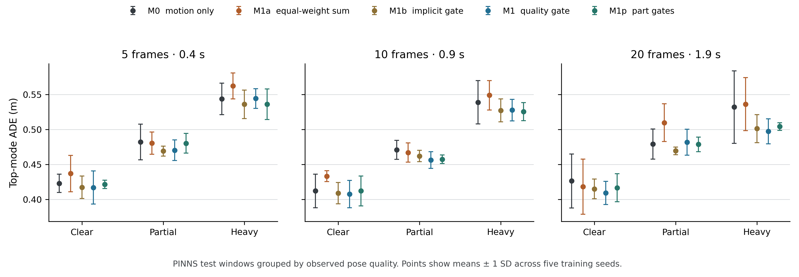

### 5.2 姿态融合在 PINNS 与 JTA 上的表现
以下相对变化均以对照模型的 ADE₁ 为分母，误差越低越好。文中 p 值均取自对应研究问题的 Holm 校正结果，除非明确标为原始值。开题将相对降低至少 5% 或绝对降低至少 0.04 m 设为有实际意义的最小效应。
在 PINNS 五帧观测下，将姿态特征与运动特征等权相加（M1a）使误差比无姿态 M0 升高 1.50%（p = 0.02085）。显式质量门控 M1 比 M1a 低 2.95%，绝对差为 0.0146 m（p = 4.91 × 10⁻⁸），低于预设实用阈值。在重度遮挡桶，M1 为 0.5443 m，M0 为 0.5439 m（p = 1.00）。常规双侧检验只能说明未检出差异，等效性和非劣效性尚待专门检验。
与 M0 相比，M1 在 5、10、20 帧下分别降低 1.50%、2.39%、2.38%（p 分别为 0.133、0.00509、0.0653）。三个窗长均未达到实用阈值。五帧清晰桶和部分遮挡桶的 p 分别为 0.537 和 0.0628。按开题协议，现有证据既未满足情形 A 的全窗长改善条件，也未建立情形 B 要求的短窗分桶改善。五帧时，M1 与同参数隐式门控 M1b 的误差分别为 0.4783 和 0.4755 m（p = 1.00），触发情形 C，应如实保留显式质量向量增益未获支持的结果。
在 JTA 上，模型用 JTA 训练集重新训练，并在测试窗口中比较预设遮挡和噪声工况。在重度噪声桶（193 个窗口），M1 为 1.5138 m，M1a 为 2.3063 m，改善 0.7925 m（34.36%，p = 8.62 × 10⁻²⁴），达到实用阈值。同桶 M0 的 1.4397 m 仍更低。该结果支持在此受控工况下用门控缓解低质量姿态输入造成的损失。检验 PINNS 训练权重迁移到 JTA 后的性能，还需要冻结源域权重进行外部测试。

**表 2　V2 在 PINNS 不同观测窗长和 JTA 数据集内训练、测试下的结果。JTA 使用两帧观测（0.4 s）、12 步预测（4.8 s），噪声工况由程序施加。**

| 模型配置 | `PINNS` $T=5$ (`0.4s`) `ADE_1` ↓ | `PINNS` $T=10$ (`0.9s`) `ADE_1` ↓ | `PINNS` $T=20$ (`1.9s`) `ADE_1` ↓ | `JTA` Overall `ADE_1` ↓ | `JTA` 模拟下肢遮挡 `ADE_1` ↓ | `JTA` 人工重度噪声 ($\sigma=0.2$) `ADE_1` ↓ |
| :--- | :---: | :---: | :---: | :---: | :---: | :---: |
| `M0`（无姿态运动基线） | 0.4856 ± 0.0186 | 0.4775 ± 0.0139 | 0.4819 ± 0.0317 | 1.6640 ± 0.2544 | 1.6577 ± 0.2531 | 1.4397 ± 0.2749 |
| `M1a`（姿态等权相加） | 0.4929 ± 0.0140 | 0.4828 ± 0.0130 | 0.4972 ± 0.0231 | 2.4730 ± 0.5632 | 2.4502 ± 0.5485 | 2.3063 ± 0.6559 |
| `M1b`（隐式无 $\mathbf{q}$ 门控） | 0.4755 ± 0.0123 | 0.4691 ± 0.0071 | 0.4662 ± 0.0078 | 2.1284 ± 0.6397 | 2.1208 ± 0.6364 | 1.8559 ± 0.6423 |
| `M1`（显式质量门控） | 0.4783 ± 0.0153 | 0.4660 ± 0.0097 | 0.4704 ± 0.0146 | 1.7712 ± 0.4399 | 1.7585 ± 0.4355 | 1.5138 ± 0.4421 |
| `M1p`（`BPD-Gate`） | 0.4822 ± 0.0122 | 0.4669 ± 0.0039 | 0.4723 ± 0.0068 | 1.9354 ± 0.3771 | 1.9212 ± 0.3747 | 1.7205 ± 0.4217 |
| `M3`（动作条件 `Stop-Grad`） | 0.5094 ± 0.0082 | 0.5183 ± 0.0185 | 0.5016 ± 0.0250 | 1.9355 ± 0.3263 | 1.9230 ± 0.3318 | 1.7231 ± 0.3114 |
| `Ours_Full`（全集成系统） | 0.5295 ± 0.0096 | 0.5169 ± 0.0138 | 0.5178 ± 0.0232 | 1.8637 ± 0.3046 | 1.8495 ± 0.3010 | 1.5972 ± 0.3423 |
| `Ext1_MCENET` [13] | 0.5518 ± 0.0250 | 0.5409 ± 0.0220 | 0.5350 ± 0.0312 | — | — | — |
| `Ext2_HST` [14] | 0.5005 ± 0.0062 | 0.5035 ± 0.0307 | 0.5020 ± 0.0131 | 2.0842 ± 0.1575 | 2.0703 ± 0.1671 | 1.8894 ± 0.1930 |
| `Ext3_SocialTransm.` [15] | 0.5312 ± 0.0275 | 0.5128 ± 0.0394 | 0.5035 ± 0.0150 | 1.8865 ± 0.1696 | 1.8851 ± 0.1428 | 1.6957 ± 0.1821 |

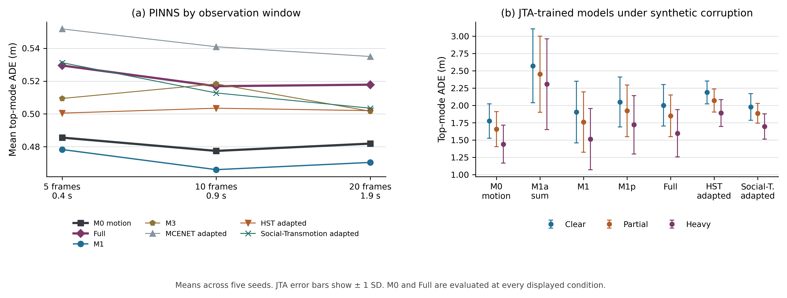

### 5.3 场景输入、动作监督与完整模型
对 PINNS 五帧样本，M1 的 ADE₁ 为 0.4783 m，加入地图后为 0.4959 m（+3.68%，p = 1.58 × 10⁻⁶），加入图网络后为 0.5266 m（+10.10%，p = 3.78 × 10⁻¹³），两者合用为 0.5055 m（+5.69%，p = 3.48 × 10⁻⁷）。联合模型比仅加图网络的模型低 4.01%（p = 0.00958），收益取决于比较对象。这些含地图的 PINNS 数值描述归档系统，无法据此估计与行人正确对齐的图像几何的作用。仅加地图的模型在 99 个状态转换窗口中取得表 1 最低均值 0.7078 m，M1 为 0.7114 m，统计表未检验这项子集比较。JTA 的地图张量及地图可用标志均置零，该实验无法衡量地图贡献。
复核原始标签、标定和鸟瞰视频后，40 组重建地图中共有 400 条图像轮廓、25 个由训练行人位置拟合的凸包。497 个测试窗口均收到图像轮廓，495 窗收到凸包；墙体、花坛护栏、临时障碍和停车矩形四个通道均为空。因此，上述地图消融衡量的是纵轴错位的图像轮廓与训练轨迹凸包的组合，对带人工语义标注的路缘或入口仍缺少实证。凸包的拟合点池含 5,656 个训练窗口中目标行人在预测期的评分位置，618 窗至少一处与该窗可用凸包的原始顶点重合。另有 349 个验证窗的同片背景取到了该窗预测起点之后的图像。497 个测试窗均未出现这两类未来信息重合，207 窗的凸包拟合点池含同片目标行人的历史位置。归档包没有逐窗地图张量，复核还不能量化这些来源对误差的影响。第 5.6 节的整地点留出网络均未启用地图。[地图来源、分割及时序核查](../results/pinns_map_sources.json)

另设残差岭回归对照，沿用原训练、验证和测试划分。图像轮廓和占用凸包均取自预测起点前的同片训练帧，构建凸包时排除目标行人。497 个测试窗中，在运动和地图可用标志上加入最近图像轮廓后，ADE 从 0.6002 升至 0.6234 m。预设的配对差为 +0.0232 m，按地点分层、片段整组重采样的 95% 区间为 [−0.0126, +0.0417] m。这次处理已修正帧来源和时序，但沿用了纵轴相反的鸟瞰图像轮廓。加入他人占用凸包所得 ADE 为 0.6098 m，仅用运动的岭回归为 0.5842 m，五帧匀速基线为 0.5430 m。轮廓组和可用标志对照在所有窗最后有效时刻（1.5–3.0 s）的 FDE 分别为 1.3267、1.2708 m，只计恰好有 3 s 标签的 233 窗时分别为 1.4088、1.3144 m。两套 Linux 环境重建的地图张量摘要一致，与 macOS 冻结值不同。首轮云任务在拟合前终止，本文数值来自直接载入并校验冻结张量的第二轮。[几何对照汇总及逐步预测独立复核](../results/pinns_causal_geometry.json)

逐窗核对这批归档预测，未来第 1、2、3 秒分别有 497、397、233 窗可评分。其余 264 窗的记录都在末尾截断。固定 3 秒的 233 窗来自 8 段录像，其中意大利、日本、泰国各只剩 1 段。沿原方法事后估计，旧影像轮廓组相对可用标志组的末个有效时刻 FDE 差为 +0.056 m（95% 区间 −0.024 至 +0.095 m），固定 3 秒时为 +0.094 m（−0.055 至 +0.137 m）。两项区间对应不同样本和随访长度。[逐地点分母、片段数与归档终点误差复算](../reviews/pinns_map_axis_comparison/followup_support/aggregate.json)

修正鸟瞰像素向地面纵轴映射符号（由 `1 − v/H` 改为 `v/H`）并严格保持预测起点前的因果截断后，残差岭回归中最近图像轮廓组 `image_geometry` 的测试集 ADE 从旧纵轴的 0.6234 m 降至 0.6048 m（改善 −0.0186 m，末有效步 FDE 由 1.3267 降至 1.2816 m），相对仅保留来源可用标志组（0.6001 m）的额外误差由 +0.0232 m 收窄至 +0.0047 m，消除约 80% 的反转伪退化。进一步在 Tesla T4 上使用修正因果地图训练两臂神经模型 `M2a`（种子 42，共享初值），真实轮廓坐标臂 `real_xy` 与坐标置零仅留可用标志臂 `zero_xy` 的 497 窗 ADE 分别为 0.4913 和 0.4885 m（配对差 +0.0029 m，整片重采样 95% 区间 [−0.0169, +0.0307] m），末有效步 FDE 分别为 1.0516 和 1.0619 m（差 −0.0103 m；意大利留出片 ADE 改善 −0.0399 m）。校正纵轴消除了旧地图的伪负迁移，但单种子无语义视觉折线尚未建立统计显著的净轨迹增益，按开题情形 C 记录。[纵轴修复岭回归结果](../reviews/pinns_map_axis_comparison/RESULTS.md) · [神经两臂配对结果与独立复核](../reviews/pinns_map_axis_comparison/neural/RESULTS.md)

截断梯度的 M3 与端到端 M3b 相比，动作 Macro-F1 的均值在 V1 从 30.85% 提高到 37.29%，在 V2 从 26.72% 提高到 32.68%。现有汇总未对 F1 差异进行配对检验。就轨迹而言，M3 的 ADE₁ 在 V1 高出 5.42%（p = 1.63 × 10⁻⁵），在 V2 低 0.54%（p = 1.00）。V2 的边界邻近事件率为 1.45% 对 1.69%，该指标根据离散障碍物采样点计算，衡量实车避障性能仍需单独验证。

运动学校准 M3p 相对 M3 的 ADE₁ 在 V1 从 0.5926 降至 0.5771 m（−2.60%，p = 8.61 × 10⁻⁵），低于实用阈值。V2 从 0.5094 升至 0.5294 m（+3.93%，p = 0.225）。完整模型在 V2 相比 M0 的 ADE₁ 在 PINNS 五帧样本上高 9.05%（p = 1.03 × 10⁻¹⁴），在 JTA 全体样本上高 12.00%（p = 2.25 × 10⁻⁵³）。与三种本地基线比较，完整模型在 PINNS 五帧下相对 MCENET 适配版低 4.04%（p = 0.0213），相对 HST 适配版高 5.80%（p = 0.00655），与 Social-Transmotion 适配版相差 −0.32%（p = 1.00）。

在原 497 个测试窗中，480 窗存在邻居，实际送入模型的 2,724 条有向边含行人边 2,444 条、汽车边 280 条。车辆边中 108 条在观测末时刻接近目标行人，34 条的径向接近速度达到 1 m/s。用观测时刻及以前的标签可逐元素重建边、主体类型和掩码。原始标签只区分人和汽车，骑行者与电动车的独立交互效果仍缺少类型标注。去掉显式径向速度通道后，相对位置和速度仍可用于推算接近程度。归档速度计算遇到缺测最多再向前查看一个时刻。将范围严格限制到五个观测槽后，逐窗比较 7,283 窗、54,472 条邻边，边特征、目标及邻居类型和掩码均无数值变化。497 个测试窗的 2,724 条边全部一致。四地留出图对照的 9,962 条实边也可逐值复现。[邻近图的输入覆盖及重建](../results/pinns_neighbor_inputs.json) · [五帧历史边界的逐窗复核](../reviews/pinns_graph_control/history/summary.json)

另以同一四处采集地点的 47 个片段、1,482 个窗口开展五折开发实验，整段留出，每折的训练片段覆盖四地。该实验输出单条轨迹，主表的神经网络从六条轨迹中选取最高概率轨迹。用五个观测位置估算匀速，再以岭回归预测未来 3 s 相对匀速的逐步修正量。按地点等权，只用自身运动时 ADE/FDE 为 0.7290/1.4998 m。加入 10 m 内行人和汽车的数量、存在性与速度可用性后为 0.7319/1.5049 m，再加入每类最近邻的相对位置、距离、相对速度和接近速度后为 0.6818/1.3907 m。完整邻居特征相对仅用自身运动的配对差为 −0.0472/−0.1091 m。固定已拟合模型，在各地点内按片段重采样 20,000 次，ADE 差的 95% 区间为 [−0.0713, −0.0192] m，FDE 差为 [−0.1620, −0.0547] m。日本地点的 ADE 上升 0.0064 m，其余三地下降。直接使用五点匀速得到更低的四地等权 ADE/FDE（0.5557/1.2103 m）。邻居位置与身份均来自标注，地点和交通模式也可能贡献预测信息，这项比较无法单独归因于行人的避让反应。[邻居开发实验与独立复核](../results/pinns_neighbor_residuals.json)

**表 3　V2 代表性窗口级配对检验。各比较沿用完整检验族的 Holm 校正值，窗口重叠对推断的影响见第 6 节。**

| 检验族与核心配对假设 | 样本数 $N$ | 模型误差 (m) | 对照误差 (m) | 相对变化 | 统计检验方法 | 原始 $p$ 值 | Holm 校正 $p$ | 显著性 ($\alpha=0.05$) |
| :--- | :---: | :---: | :---: | :---: | :---: | :---: | :---: | :---: |
| `PINNS` $T=5$：`M1a` (相加) vs `M0` | 497 | 0.4929 | 0.4856 | +1.50% | `Wilcoxon` | $2.08\times 10^{-3}$ | $2.08\times 10^{-2}$ | 显著退化 |
| `PINNS` $T=5$：`M1` (门控) vs `M1a` | 497 | 0.4783 | 0.4929 | -2.95% | `Wilcoxon` | $4.09\times 10^{-9}$ | $4.91\times 10^{-8}$ | 显著提升 |
| `PINNS` $T=10$：`M1` (门控) vs `M0` | 497 | 0.4660 | 0.4775 | -2.39% | `Wilcoxon` | $4.63\times 10^{-4}$ | $5.09\times 10^{-3}$ | 显著提升 |
| `PINNS` $T=5$ 重度遮挡：`M1` vs `M0` | 134 | 0.5443 | 0.5439 | +0.09% | `Wilcoxon` | $5.89\times 10^{-1}$ | $1.00$ | 未检出差异 |
| `PINNS` $T=5$：`M2` (联合) vs `M2b` | 497 | 0.5055 | 0.5266 | -4.01% | `Wilcoxon` | $4.79\times 10^{-3}$ | $9.58\times 10^{-3}$ | 显著提升 |
| `PINNS` $T=5$：`Ours_Full` vs `MCENET` 适配版 | 497 | 0.5295 | 0.5518 | -4.04% | `Wilcoxon` | $2.37\times 10^{-3}$ | $2.13\times 10^{-2}$ | 显著提升 |
| `JTA` $0.4\text{ s}$：`M1a` (相加) vs `M0` | 960 | 2.4730 | 1.6640 | +48.62% | `Wilcoxon` | $4.97\times 10^{-127}$ | $2.98\times 10^{-126}$ | 显著退化 |
| `JTA` 重度噪声 ($\sigma=0.2$)：`M1` vs `M1a` | 193 | 1.5138 | 2.3063 | -34.36% | `Wilcoxon` | $2.87\times 10^{-24}$ | $8.62\times 10^{-24}$ | 显著且达 MPSES |
| `PINNS` 五帧总体 M1 vs M0 | 497 | 0.4783 | 0.4856 | −1.50% | `Wilcoxon` | 0.0265 | 0.133 | 未检出差异 |
| `PINNS` 五帧总体 M1 vs M1b | 497 | 0.4783 | 0.4755 | +0.58% | `Wilcoxon` | 0.384 | 1.00 | 未检出差异 |
| `PINNS` 五帧总体 M2 vs M1 | 497 | 0.5055 | 0.4783 | +5.69% | `Wilcoxon` | 6.95 × 10⁻⁸ | 3.48 × 10⁻⁷ | 误差升高 |
| `PINNS` 五帧总体 M3 vs M3b | 497 | 0.5094 | 0.5122 | −0.54% | `Wilcoxon` | 0.780 | 1.00 | 未检出差异 |
| `PINNS` 五帧总体 Ours_Full vs M0 | 497 | 0.5295 | 0.4856 | +9.05% | `Wilcoxon` | 8.56 × 10⁻¹⁶ | 1.03 × 10⁻¹⁴ | 误差升高 |
| `JTA` 总体 Ours_Full vs M0 | 960 | 1.8637 | 1.6640 | +12.00% | `Wilcoxon` | 4.51 × 10⁻⁵⁴ | 2.25 × 10⁻⁵³ | 误差升高 |

### 5.4 网络前向耗时与动作阈值敏感性
V2 完整预测网络有 471,442 个参数。按项目原有 FlopCounterMode 算子覆盖范围，12 个目标在 5、10、20 帧下的前向计算量分别约为 0.409、0.539、0.798 GFLOPs。20 帧精确计数为 798,230,016 次。在同一输入上纳入原计数遗漏的逐元素加、减、乘后，计数为 807,563,628 次，已经超过 0.80 GFLOPs。完整算子的统一预算仍待核定。表 4 的每个窗长均重新初始化完整网络。各批次把同一组固定常量复制到所有目标，输入已在 T4 显存中。每格预热 25 次后，对同一输入执行 100 次同步前向。种子和模型状态未单独归档，100 次测量只反映这次进程的重复执行。V2 对运动编码的 GRU 扫描和解码循环使用 TorchScript，同轮还改变了其他模型组件。视频解码、人体检测、追踪、姿态提取、特征构造与传输的耗时仍需另外测量。

**表 4　Tesla T4 上预测网络的前向耗时与 PyTorch 峰值显存分配。末列给出均值与 25 ms 参考线的相对差，硬件为 T4。**

| 历史窗长 | 合成批量 $N$ | V1 平均前向耗时 (ms) | V2 平均前向耗时 (ms) | P50 (ms) | P95 (ms) | 峰值显存 (MiB) | 相对 `25 ms` 参考线的差额 |
| :---: | :---: | :---: | :---: | :---: | :---: | :---: | :---: |
| $T=5$ (`0.4s`) | $N=1$ | 17.999 | 14.724 | 14.248 | 17.215 | 28.48 | $41.1\%$ |
| $T=5$ (`0.4s`) | $N=12$ | 18.308 | 14.488 | 14.413 | 15.110 | 31.49 | $42.0\%$ |
| $T=10$ (`0.9s`) | $N=12$ | 19.456 | 14.922 | 14.754 | 15.895 | 34.68 | $40.3\%$ |
| $T=20$ (`1.9s`) | $N=12$ | 20.960 | 16.006 | 15.647 | 16.774 | 41.08 | $36.0\%$ |

为另外测量真实多行人输入，用 623 个已完成三档姿态提取的窗口按录像和决策时刻分组。其中只有美国和日本各一个时刻含至少 12 名不同目标。两组各 12 人，五、十、二十帧都保留相同的人和相同末帧。两个时刻分别有 100、124 条五帧历史行人邻边，均无入选车辆。局部轮廓取同片首张鸟瞰图，未经人工道路语义判定。已按原标注、关键点缓存及冻结实现复核张量。该计时输入沿用旧鸟瞰纵轴用于复现归档负载，图像轮廓与目标在地面上的相对位置有误。修正坐标后重新读取两段录像的首张鸟瞰帧，以每名行人为中心重新选取 20 m 内的轮廓。美国场景 12 人合计入选折线数由 66 变为 102，日本由 108 变为 102。在单张 Tesla T4（FP32，TF32 关闭，每格预热 25 次 + 同步测量 100 次，共 72 格）上对修正地图后的真实场景前向实测表明：美、日两场等权主机同步墙钟均值（P95）在 $T=5, N=1$ 为 **12.295 ms（13.579 ms）**，$T=5, N=12$ 为 **14.762 ms（15.963 ms）**，$T=10, N=12$ 为 **13.998 ms（14.996 ms）**，$T=20, N=12$ 为 **15.063 ms（16.194 ms）**，均较 25 ms 参考线留有 35.2%–44.0% 裕度；RTX 4090 与 Jetson Orin NX 的实机耗时仍需在对应硬件单独验证。[归档计时复核](../reviews/pinns_latency/latency_audit.json) · [两场真实输入的来源和修正](../reviews/pinns_latency/corrected_map/sync_protocol.json) · [Tesla T4 72格实景计时结果](../reviews/pinns_latency/corrected_map/RESULTS.md)

对冻结权重的完整预测器，三个姿态图层均可先沿关节邻接矩阵聚合，再用无偏置投影扩张通道。12 人、20 帧时，计入矩阵乘、卷积及逐元素浮点加减乘的运算量由 807,563,628 降至 790,639,788，减少 2.10%（回到 `< 0.80 GFLOPs` 预算内）；只计矩阵乘与卷积时由 798,230,016 降至 781,306,176。这两种口径均遗漏归约、归一化和激活等。在相同 Tesla T4 与上述 72 格真实场景负载上进行平衡次序（每格 50 对 AB、50 对 BA）配对实测后，全部 468 次行人输出、168,480 个轨迹坐标的最大绝对偏差为 $1.91\times 10^{-6}\text{ m}$（`< 2 µm`），首选模态索引翻转数为 0；主指标 $T=20, N=12$ 的两场等权配对中位墙钟差为 −0.024 ms（−0.18%，原路径中位数 13.953/14.284 ms，优化路径 13.980/14.257 ms），说明在桌面/服务器级 GPU 上 CUDA 核启动与循环调度占主导，图乘顺序改写主要贡献理论算量达标与算术严格等价。[冻结权重、逐层计数与合成输出比较](../reviews/pinns_pose_compute/compute_scores.json) · [Tesla T4 实景配对计时结果](../reviews/pinns_pose_compute/paired/RESULTS.md)

在合成批量为 12 时，V2 预测网络的平均前向耗时为 14.49–16.01 ms，V1 为 18.31–20.96 ms。图 5b 对 0.50、0.75、1.00、1.25、1.50 倍动作阈值统一比较种子 42、1024、2025 的五帧整体 ADE₁，依次为 0.5081、0.5276、0.5349、0.5148、0.5417 m。四种非默认阈值均重新生成标签并训练。默认阈值的 0.5349 m 来自主实验的前三个种子，表 1 的 0.5295 m 使用全部五个种子。这个取值范围描述了轨迹指标对所设阈值的敏感性，动作标签的识别质量还需单独比较。

### 5.5 与匀速外推的补充比较

基于原始 PINNS 标签和标定文件，按归档顺序重建五帧测试集。47 个源片段按采集条件分属 22 个目录，最终 21 个片段贡献了 497 个有效测试窗口。M0 沿用归档的运动特征和行人类型输入。逐行复核发现，47 个源片段的 180,344 条行人标注中，第 11 列 `fixed` 均为 −1，因而均未触发提取器的 `fixed == 1` 条件。用最后两个观测位置计算速度，以 0.20 m/s 为阈值，逐窗复现了全部 497 个类型输入，其中 122 窗编码为站立。这些窗口的行人类型可以完全从观测坐标得到。[分地点核对结果](../results/pinns_type_input_audit.json)M0 的种子 42 权重在重建窗口上得到 ADE₁ 0.463043 m、FDE₁ 1.001776 m，与云端记录的 0.463043 m、1.001777 m 一致到 0.000001 m。匀速外推使用五帧内最后两次有效观测的实际时间差估速，在与网络相同的有效未来时刻计算误差。497 个窗口的五帧历史都有有效位置。仅 233 个窗口在未来第 30 步（3.0 s）有标注；其余 264 个以各自最后一次有效标注计算 FDE。

按窗口汇总，匀速基线的 ADE/FDE 为 0.5041/1.1286 m，静止基线为 0.8399/1.5978 m。归档的五种子均值为 M0 0.4856/1.0355 m、M1 0.4783/1.0249 m、完整模型 0.5295/1.1239 m。M1 在美国路口的 316 个窗口上优于匀速（0.5618 对 0.6517 m）。意大利 20 个、日本 150 个和泰国 11 个窗口上，匀速基线均取得更低的 ADE。给四个地点各相同权重时，匀速和 M1 的 ADE 分别为 0.3897、0.4288 m。给 21 个片段各相同权重时，分别为 0.3357、0.3823 m。不同加权得到相反的排序，说明按窗口计算的平均改善受场地构成影响。这些是同一测试集上的事后描述性比较。[逐片段与逐场地结果](../results/pinns_motion_audit.json)

按片段成对重采样 20,000 次，每次有放回抽取 21 个片段，保留片内全部窗口。按窗口数加权，M1 减匀速的 ADE 差为 −0.0258 m，95% 百分位区间为 [−0.1297, +0.0713] m。按片段等权，差为 +0.0466 m，区间为 [−0.0254, +0.1237] m。两种区间均覆盖零。这项事后分析固定神经模型的五种子均值，近似把片段视为独立抽样单元；同一地点的片段仍可能相关，区间也没有计入开发过程中复用测试集的不确定性。[片段重采样结果](../results/pinns_clip_bootstrap.json)

### 5.6 整地点留出的姿态与运动对照

四处地点轮流作为测试地点，每折用另外三处地点训练 M0、M1 和岭回归。47 个片段产生 1,482 个完整窗口，每窗恰在一折中测试。沿每个片段的每条行人轨迹，在缺测或坐标无效处断开，对连续部分依次截取互不重叠的 35 帧块。前五帧为 10 Hz 观测（跨度 0.4 s），随后 30 帧为预测目标。表 5 的所有方法都使用这些窗口，同一地点内窗口等权，再对四个地点等权平均。第 5.5 节所用的 497 个滑窗采用不同切分和缺测处理，两次实验分别统计。

首轮每折用种子 42 从头训练 M0 和 M1，各跑预先固定的 28 轮，保留最后一轮。优化器为 AdamW，批量 64，初始学习率 0.002，随余弦调度降至其 5%。留出地点不参与训练或选轮。两种网络共用地面运动及由末两帧速度恢复的行人类型（189 窗编码为站立）。M1 还使用标注框内提取的 RTMPose 关键点和姿态质量。7,410 个历史人帧均完成姿态推理，其中 7,341 个至少有一个关节达到置信阈值，所有窗口均保留。两种网络均未启用环境或动作支路。用八份保存的权重在 CPU 上重算全部留出窗口，逐窗 ADE 和 FDE 与云端记录的最大绝对差为 $2.7 \times 10^{-6}$ m。[四折训练入口与设置](../scripts/train_pinns_heldout_sites.py)

另一独立 Kaggle 会话使用同型号 Tesla T4 和相同种子重新提取姿态、训练四折，姿态缓存、八份权重的 500 个状态张量，以及两模型在 1,482 窗上的全部 5,928 个 ADE/FDE 数值均逐位一致。[跨会话重复实验](../results/pinns_heldout_seed42_repeat.json)

两种匀速对照都从最后观测位置外推，分别用五帧位置的最小二乘斜率、末两帧的位置差估速。岭回归从前四帧相对末帧的八维坐标预测 30 步位置，特征标准化和截距使用该折训练地点，岭系数固定为 1。[运动学对照设置](../results/pinns_heldout_sites.json)

**表 5　按整个地点留出的预测误差。各单元格以米为单位，依次为 30 步 ADE 与 3.0 s FDE。神经模型取其预测概率最高的轨迹。**

| 测试地点 | 训练 / 测试窗 | 五帧匀速 | 末两帧匀速 | 岭回归 | 无姿态 M0 | 显式门控 M1 |
| --- | ---: | ---: | ---: | ---: | ---: | ---: |
| 美国路口 | 666 / 816 | 1.1599 / 2.2981 | 0.9477 / 1.9415 | 0.9228 / 1.8582 | 0.8253 / 1.6116 | 0.8173 / 1.5939 |
| 意大利园区 | 1,398 / 84 | 0.4060 / 0.9607 | 0.3703 / 0.9320 | 0.5758 / 1.2586 | 0.4027 / 0.9535 | 0.4776 / 1.0691 |
| 日本路口 | 1,050 / 432 | 0.3151 / 0.7523 | 0.2937 / 0.7187 | 0.6015 / 1.3047 | 0.4077 / 0.9087 | 0.4575 / 1.0019 |
| 泰国街道 | 1,332 / 150 | 0.3418 / 0.8303 | 0.3238 / 0.8262 | 0.7753 / 1.6204 | 0.3821 / 0.8847 | 0.4327 / 0.9903 |
| **四地等权平均** | — | **0.5557 / 1.2103** | **0.4839 / 1.1046** | **0.7189 / 1.5105** | **0.5044 / 1.0896** | **0.5463 / 1.1638** |

种子 42 下四地等权时，M1 的 ADE/FDE 比 M0 高 0.0419/0.0742 m。仅在美国路口，M1 的两项误差都略低于 M0。其余三处地点的两项误差均随姿态输入和门控支路的加入而升高。主比较按地点分层，在各地点内有放回抽取与原数相同的完整视频片段，同一抽样对所有配对窗口和两项指标共用。重复 20,000 次后，M1 减 M0 的 ADE、FDE 的 95% 百分位区间分别为 [+0.0230, +0.0620] m 和 [+0.0355, +0.1171] m。这些区间以四个地点及本次拟合的八组权重为条件，只描述片段抽样的变异，未计入更换种子、重新训练或抽取新地点的变异。[配对差值与逐地点区间](../results/pinns_heldout_paired.json)

M1 减五帧匀速的 ADE/FDE 为 −0.0094/−0.0465 m，M1 减末两帧匀速为 +0.0624/+0.0593 m。仅美国路口的 M1 同时优于两个匀速对照。查看本轮神经模型结果前，已将 M1 相对 M0 的差值定为主比较。对两种匀速基线的差值作描述性比较。这四处地点均已用于前期开发，本次单种子留出结果仍属探索性证据。

保持窗口、训练轮数及优化设置相同，加入种子 1024、2025、3407、4096，与种子 42 共得到 40 份权重。逐份在 CPU 上对留出窗重算，ADE/FDE 与云端记录的最大绝对差小于 0.000004 m。四地等权后，五种子平均 ADE/FDE 为 M0 0.5126/1.0977 m、M1 0.5375/1.1455 m。按 42、1024、2025、3407、4096 的顺序，M1 减 M0 的 ADE 分别为 +0.0419、+0.0039、+0.0739、−0.0149、+0.0200 m。ADE/FDE 的平均差为 +0.0250/+0.0477 m，跨种子样本标准差为 0.0344/0.0593 m。在各地点内成对重采样整段视频，每次保留同片所有窗口及五次拟合，平均差的 95% 百分位区间为 [+0.0199, +0.0312] m 和 [+0.0371, +0.0614] m。区间以这五个固定种子和四处已见地点为条件。[五种子逐权重复算与分层结果](../results/pinns_heldout_five_seed_replay.json)

**用 Social-Transmotion 作者代码预测单条轨迹。** 在同一批 1,482 个窗口上，保留作者的两层级 Transformer，将时域改为 10 Hz 下五帧观测、三十帧预测。每折仅在另外三个地点训练；种子 42，固定 28 轮，采用末轮权重。在 PINNS 上只给目标行人的五点地面轨迹，另一个条件再给相同五帧的二维行人框。末两点匀速、仅轨迹、轨迹加框的四地等权 ADE 分别为 0.4839、0.5534、0.6522 m，三秒 FDE 分别为 1.1046、1.1239、1.3244 m。预定主比较中，轨迹加框相较匀速的 ADE 高 0.1683 m，按地点内整片录像配对重采样的 95% 区间为 +0.1238 至 +0.2260 m。加入框相较只用轨迹，ADE 增加 0.0988 m（+0.0611 至 +0.1463 m）。美国路口是唯一加框后 ADE 降低的地点，从 0.9330 降到 0.9018 m。本比较的输入均不含关节和邻人，采用单路径解码。[计分前固定的作者代码与比较方案](../reviews/social_transmotion_adaptation/PROTOCOL.md) · [云端结果与独立数值复核](../reviews/social_transmotion_adaptation/README.md)

**五帧累计位移不足半米的首次标注组。** 开题报告特别关注短窗内脚点位移太小、身体姿态可能补充运动线索的情形。我们在全组结果已知后、读取任何分组误差前，登记了同时满足两个条件的主组：该窗始于此人片内首次采样标注，且五个历史地面点的四段路长之和小于 0.5 m。符合条件的 323 窗来自 46 段录像，美、意、日、泰分别有 146、24、102、51 窗。沿用已有 Kaggle 首选预测、五种子和四地等权，末两帧匀速、M0、M1 的 ADE/FDE 分别为 0.3545/0.8491、0.4130/0.9342、0.4388/0.9804 m。M1 减 M0 的 ADE 为 +25.78 mm（按地点重采样整片的 95% 区间 +16.43 至 +35.62 mm），FDE 为 +46.24 mm（+28.05 至 +67.02 mm）。五个种子中有四个的 ADE 升高。该组按未来轨迹定义的起步只有 9 次、停止 15 次。这些数据可检验模型在小位移下的表现，尚无法定位遮挡解除时刻。[分组与权重协议](../reviews/pinns_short_displacement/PROTOCOL.md) · [分组成绩](../reviews/pinns_short_displacement/short_displacement_scores.json) · [原始误差独立复算](../reviews/pinns_short_displacement/independent.json)

将相同的 323 窗应用于上述作者模型，末两点匀速、仅轨迹、轨迹加框的 ADE 为 0.3545、0.4514、0.5107 m，三秒 FDE 为 0.8491、0.9671、1.0807 m。加框减仅轨迹的 ADE 为 +0.0593 m，整片配对 95% 区间为 +0.0248 至 +0.1030 m。该二次分析沿用原先按历史确定的分组，只比较这四个地点、这一个训练种子。[四组逐地点结果与复算法](../reviews/social_transmotion_adaptation/first_short/README.md)

在这个首标注、小位移组，进一步复查种子 42 的六条候选轨迹。9 个真实起步来自 5 段录像，M0、M1 的最高概率轨迹都没有起步；六候选中分别有 6、7 窗出现起步，但各自也在 314 个阴性窗中的 22 窗生成了起步候选。15 个真实停止来自 9 段录像，M0、M1 的首选分别命中 2、3 窗，分别误报 2、1 窗。放宽到任一候选后，两者各命中 8 窗，分别在 308 个阴性窗中误报 24、15 窗。另有 2 个真实起步和 6 个真实停止，两模型的全部候选都没有相应事件。这些计数把候选生成遗漏与首选排序遗漏分开；起停样本少，只作描述。[323 窗的动作候选与误报](../reviews/pinns_short_displacement/event_coverage/first_short_event_coverage.json) · [逐轨迹独立核对](../reviews/pinns_short_displacement/event_coverage/independent_counts.json)

按真实未来分别在六条候选中取最低 ADE 和最低 FDE，M0 与 M1 的 minADE₆ 分别为 0.3548、0.3513 m，minFDE₆ 为 0.6972、0.6865 m。两项最小值可以来自不同候选。实际给出最高概率的候选恰好拥有最低 ADE 的比例分别为 41.59% 和 35.39%（按地点及种子等权）。以各自最低 ADE 候选为目标，模态 NLL 为 1.4730、1.5175，Brier 分数为 0.7146、0.7346。M1 的最优候选平均略接近真值，但概率排序更少选中它。部署时只可使用预测概率或其他历史可得信息排序。[六候选覆盖与概率评分](../results/pinns_heldout_mode_scores.json)

在查看四地的匀速基线和候选覆盖结果后，我们固定 40 份权重，以末两次观测的位移作匀速外推，选取未来 30 步中与外推轨迹平均距离最小的候选。距离相同时先取网络概率较高者，再取编号较小者。四地和五种子等权后，M0 与 M1 分别有 36.31% 和 51.76% 的首选候选发生变化。M0 的 ADE/FDE 从 0.5126/1.0977 降至 0.4963/1.0685 m，M1 从 0.5375/1.1455 降至 0.4961/1.0664 m。直接匀速外推为 0.4839/1.1046 m，平均误差较低，终点误差较高。按地点配对重采样整段视频，重排减原首选的 ADE 差值 95% 区间分别为 [−0.0325, −0.0070] 和 [−0.0605, −0.0298] m。美国路口的 M0 平均误差增加 0.0248 m。这项探索性比较限定于已经参与开发的四处地点和五个固定种子。[候选重排、逐地点差值与区间](../results/pinns_velocity_reranking.json)

另用单轨迹岭回归预测末两点匀速外推的残差。每折仅用三个训练地点交叉验证，为纯运动、末帧姿态及有序五帧姿态选取同一收缩系数，再在留出地点评分。相同的 1,482 窗中，四地等权 ADE/FDE 为直接匀速 0.4839/1.1046 m、纯运动残差 0.4735/1.0742 m、加末帧姿态 0.4805/1.0851 m、另加有序关节变化 0.4851/1.0892 m。预设的有序姿态相对匀速 ADE 差为 +0.0013 m，按地点分层的配对片段自举 95% 区间为 [−0.0056, +0.0103] m。相应 FDE 差为 −0.0153 m，区间为 [−0.0303, +0.0073] m。两项区间均跨零，这四个开发地点未显示有序姿态相对匀速的明确收益。[单轨迹残差实验、折内收缩与配对误差](../results/pinns_pose_residuals.json)

两组均向模型提供五帧历史。根据片内同一行人的 10 Hz 标注时间，449 窗始于首次采样，1,033 窗在输入前已有至少 35 帧连续标注。美国、意大利、日本、泰国两组窗数分别为 240/576、28/56、117/315、64/86，两组各覆盖相同的 14、9、11、13 段视频。四地和五种子等权后，首次采样组 M0/M1 的原首选 ADE 为 0.5968/0.6261 m，历史重排后为 0.5746/0.5697 m，直接匀速为 0.5617 m。已有连续前史组的对应结果为 0.4780/0.5009、0.4646/0.4665 和 0.4517 m。原首选的 M1 减 M0 配对 ADE 差值在两组分别为 +0.0293 和 +0.0229 m，按片段重采样的 95% 区间为 [+0.0213, +0.0384] 和 [+0.0171, +0.0296] m。分组依据是标注起点，缺少对入镜或此前遮挡状态的独立观测。[逐地点及逐种子的分组 ADE/FDE、事后最优候选与配对区间](../results/pinns_annotation_history_scores.json)

按历史姿态的有效关节率、平均置信度及相对框高分组，清晰、部分遮挡、重度遮挡或低质量三桶分别有 409、691、382 窗。开题方案第 5.3 节的文字条件有 158 窗同时落入后两桶，另有 90 窗未落入任何一桶。归档实现将前者归入重度或低质量桶，后者归入部分遮挡桶。各桶内先按地点计算配对差，再对四地等权平均，M1 减 M0 的 ADE/FDE 依次为 +0.0135/+0.0152、+0.0375/+0.0682、+0.0776/+0.1446 m。种子 42 下低质量桶的平均差值最大。将五个种子等权后，三个桶的 ADE 差分别为 +0.0253、+0.0245、+0.0227 m。首轮出现的质量梯度未在五种子均值中复现。泰国低质量桶仅有 4 个片段的 8 窗。上述分组反映估计姿态质量，实际遮挡程度未作人工标注，桶间差异也未作交互效应检验。[分桶规则、样本量与逐地点误差](../results/pinns_heldout_pose_quality.json)

在相同的四份 M1 权重上，仅把五帧关节输入标作缺失，四地等权 ADE 增加 0.0130 m，FDE 增加 0.0230 m。仅逆序排列已经观测到的五帧姿态、保持运动顺序和质量统计后，1,482 个窗口均保留原首选模态，四地等权 ADE 的变化小于 0.00002 m。这两项事后干预描述已训练网络如何使用输入。与单独训练的 M0 相比，M1 整体误差仍然更高。该结果尚不足以支持模型从姿态时间顺序中读出了起步或转向先兆。[固定权重输入干预](../results/pinns_heldout_pose_input_controls.json)

在另一项评分前登记的干预中，对五个种子的 20 份 M1 权重保留原时刻的置信度、有效标记、质量和地面运动，仅在第二、第四个时刻交换两帧均有效且根坐标规则相同的关节坐标。首帧、中帧和末帧的姿态保留原值。1,482 窗中有 1,324 窗的坐标发生变化。对五种子和四地等权，交换减原输入的首选 ADE 差为 +0.00036 mm，按片段配对重采样的 95% 区间为 [−0.00032, +0.00122] mm。7,410 次模型与窗口组合均保留原首选模态。在同一组权重上关闭整个姿态残差，ADE 增加 6.22 mm，区间为 [2.30, 8.94] mm。在首次标注的 449 窗中，局部换序的 ADE 差值区间也覆盖零。模型利用了姿态支路，但在这次保留两端的检验中，未观察到内部两帧几何顺序能改善预测的证据。[预注册协议](../reviews/pinns_pose_order/PROTOCOL.md) · [云端原始汇总](../reviews/pinns_pose_order/pose_order_scores.json) · [独立复算](../reviews/pinns_pose_order/verified_provenance.json)

**五帧二维关节变化。** 我们在相同的 1,482 窗上测量双踝间距、左右膝角余弦、肩宽及肩髋中点的水平和垂直分量。两组残差岭回归共享运动特征、末帧姿态和可用性标记，有序组额外获得四段相邻变化。末两点匀速、仅运动回归、增加末帧几何、再增加有序变化的四地等权 ADE 分别为 0.4839、0.4735、0.4753、0.4762 m。有序减末帧的 ADE 差为 +0.90 mm，分地点整片配对 95% 区间为 [+0.19, +1.65] mm。同一有序模型对四个变化向量的 24 种排列分别预测并取均值，有序输入减去这一对照的 ADE 为 +0.07 mm，区间为 [−0.54, +0.83] mm。1,369 窗至少有一种排列使预测路径移动超过 1 微米。模型对时间顺序有响应，但这次检验未显示保持顺序能降低误差。六项均为图像平面几何，1,127 窗的六项在五帧内均有效。[预设量与对照](../reviews/pinns_ordered_geometry/PROTOCOL.md) · [全组与逐地成绩](../reviews/pinns_ordered_geometry/geometry_scores.json) · [独立复拟记录](../reviews/pinns_ordered_geometry/verified_provenance.json)

对真实未来轨迹及模型的六条预测轨迹应用相同的起步、停止、左转、右转和保持规则，并按预测轨迹概率汇总各动作的得分，四地等权的 Macro-F1/mAP 为 M0 0.2376/0.3709、M1 0.2419/0.3795。两模型在本实验均未训练动作分类头，这些指标只衡量预测轨迹所隐含的动作与标注轨迹推导事件的一致性。[逐类事件数与评分](../results/pinns_heldout_implied_actions.json)

为检验短时姿态对动作识别的增量，我们在上述 1,482 个窗口上另做五折开发实验。每次留出整段视频，每折均含此前已用于开发的四处地点。三组线性分类器只接收五帧历史，以未来 3 s 地面轨迹派生的五类事件作为监督。各组共用折分、固定正则强度和 0.5 判定阈值，特征归一化只用各自的训练折。原预测网络权重未参与拟合。下表合并五折的折外预测，每个单元格依次给出 AP 和 F1，最后一列为五类等权均值。

| 历史输入 | 起步（49 例） | 停止（53 例） | 左转（214 例） | 右转（208 例） | 维持（975 例） | 五类均值 |
|---|---:|---:|---:|---:|---:|---:|
| 运动 | 0.2131 / 0.0000 | 0.0391 / 0.0000 | 0.1904 / 0.0093 | 0.1732 / 0.0185 | 0.6798 / 0.7872 | 0.2591 / 0.1630 |
| 运动与末帧姿态 | 0.3439 / 0.1132 | 0.0535 / 0.0000 | 0.1865 / 0.0439 | 0.1696 / 0.0441 | 0.6771 / 0.7741 | 0.2861 / 0.1950 |
| 再加入四段相邻帧关节位移与有效标记 | 0.3375 / 0.1356 | 0.0389 / 0.0000 | 0.1833 / 0.0989 | 0.1640 / 0.0967 | 0.6798 / 0.7417 | 0.2807 / 0.2146 |

加入末帧姿态后，起步 AP 上升 0.1308，固定阈值下检出 3 个起步窗口、误报 1 个。再加入姿态变化后检出 4 个、误报 6 个，合并窗口的起步和双向转弯 AP 均略低于仅加入末帧姿态的模型。在历史速度符合起步先决条件的 178 窗中，三个模型的起步 AP 则依次为 0.2131、0.3515、0.3583，按各训练折该条件下起步频率给分的基线为 0.2259。三组模型均漏检全部 53 个停止事件。起步正例来自 20 段视频，最少的验证折只有 2 例。上述差值描述已见地点上对轨迹派生事件的识别，尚未在独立地点验证。[逐折及逐地点统计](../results/pinns_action_probes.json)

在同一批 1,482 窗上，另对起步和停止逐地点留出，只用其余三地中符合历史速度条件的窗口训练，并用三地内部轮流留出的分数选择 F1 最高的阈值。四地合并后，加入末帧及有序姿态变化的模型检出 39/49 个起步，误报 89 个，F1 为 0.4407。纯运动模型检出全部 49 个，误报 129 个，F1 为 0.4317，与所有具备起步资格的窗口一律报起步相同。先按地点计算再等权平均，起步 F1 分别为 0.4458 和 0.4613。停止方面，有序姿态模型在固定 0.5 阈值下检出 0/53 个，误报 13 个。改用内层阈值后检出 24/53 个，误报 487 个，合并 F1 为 0.0851。纯运动模型使用内层阈值检出 8/53 个，误报 35 个，F1 为 0.1667。此次阈值调整以大量误报换取停止检出，结论限于这四处已参与开发的地点。[逐地点起停计数、AP、F1 及核验结果](../results/pinns_nested_start_stop.json)

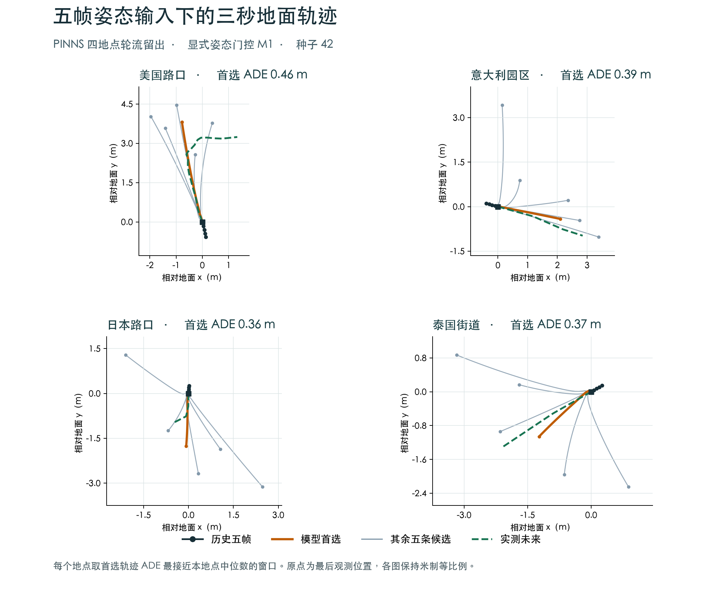

图 6 展示种子 42 的 M1 在每个留出地点的一例预测。按该地首选轨迹 ADE 最接近中位数的规则选取样本，橙线为模型首选，灰线为其他五条候选，绿虚线为随后三秒的实测轨迹。四例分别说明单窗预测的形状，模型的总体表现见表 5。

在同一批窗口，还比较了四段相邻速度的逐坐标中位数外推，其四地等权 ADE/FDE 为 0.5555/1.2104 m。另一对照在每折训练地点拟合 0 至 1 的统一速度缩放系数，以各地点等权最小化位置平方误差。缩放后的 ADE/FDE 为 0.6068/1.2338 m，较末两帧原速外推升高，仅美国路口的两项误差下降。[逐地点估速比较](../results/pinns_velocity_estimators.json) · [训练系数及各地误差](../results/pinns_velocity_scale.json)

**将末两点匀速作为六条候选的共同基底。** 四地使用同一 CPU 工作节点和种子 42，分别训练纯运动及显式姿态模型，并与零基底的相同网络配对。16 份权重独立复算后，M0 加入匀速基底的首选 ADE 从 0.5123 增至 0.5470 m，预定差值 +0.0347 m，按地点内整段视频重采样的 95% 区间为 [+0.0004, +0.0637] m。美国、意大利、日本、泰国的差值分别为 +0.0441、−0.0026、−0.0105、+0.1078 m。M1 加入基底后的差值为 +0.0245 m，区间为 [−0.0032, +0.0511] m。直接匀速的 ADE/FDE 为 0.4839/1.1046 m，锚定 M0、M1 为 0.5470/1.2007、0.5303/1.1477 m。模型在匀速预测上学习的六个残差未提高该种子的首选精度。[训练方案](../reviews/pinns_anchored_candidates/DESIGN.md) · [逐地点与配对结果](../reviews/pinns_anchored_candidates/anchored_candidate_scores.json) · [权重复算记录](../reviews/pinns_anchored_candidates/verified_provenance.json)

### 5.7 同一批行人的 5、10、20 帧预测

在上述 1,482 个五帧起点中，1,033 个同时具有连续的 20 帧历史和相同的未来 30 帧。沿用原来每 35 步取样的间隔时，658 对同轨相邻窗口共享 15 个时刻。逐片、逐人从早到晚保留相隔至少 50 步的起点后，剩余 623 窗，含 47 段视频、375 条片内人轨。449 个从行人首次标注采样开始的窗口全部退出，因此下表描述已经持续观测到的行人，以首次标注为起点的五帧结果见第 5.6 节，实际入镜时刻仍需独立核验。[匹配队列与选择偏差](../results/pinns_matched_histories.json)

每窗使用 10 Hz 下实测的最后 5、10 或 20 帧，首末观测跨度为 0.4、0.9 或 1.9 秒。三个条件共用预测起点和连续三秒真值。20 帧输入共含 12,460 个人帧，最后五帧与原姿态缓存逐字节相同，新增的 9,345 个人帧均从原视频的标注人框提取了姿态。每次留出一整个地点，在其余三地训练 28 轮。四种模型各使用 42、1024、2025、3407、4096 五个固定种子。末两点匀速和全窗最小二乘估速均从最后的实测位置向前外推。每格为首选轨迹的 ADE / 三秒 FDE（米），先在地点内按窗平均，再对四个地点等权，最后对五个种子等权。[五种子重放、逐地点结果与配对差值](../results/pinns_matched_fusion_five_seed.json)

| 匹配历史帧数 | 首末观测跨度 | M0 运动 | M1 显式门控 | M1b 隐式门控 | 姿态与运动拼接 | 全窗估速匀速 | 末两点匀速 |
|---:|---:|---:|---:|---:|---:|---:|---:|
| 5 | 0.4 s | 0.6260 / 1.3418 | 0.6166 / 1.3277 | 0.6153 / 1.3120 | 0.6694 / 1.4245 | 0.5015 / 1.1041 | 0.4751 / 1.1035 |
| 10 | 0.9 s | 0.6059 / 1.2901 | 0.6033 / 1.2894 | 0.5957 / 1.2761 | 0.6819 / 1.4667 | 0.5324 / 1.1154 | 0.4751 / 1.1035 |
| 20 | 1.9 s | 0.5849 / 1.2472 | 0.6049 / 1.3091 | 0.6128 / 1.2945 | 0.6731 / 1.4488 | 0.5670 / 1.1356 | 0.4751 / 1.1035 |

五、十、二十帧下，显式门控 M1 减运动模型 M0 的 ADE 分别为 −0.0094、−0.0027、+0.0201 m。五个配对种子差值的样本标准差分别为 0.1334、0.0569、0.1107 m，M1 的 ADE 较低的种子数为 2/5、4/5、2/5。固定这五组权重及四个已研究地点，在地点内按整段视频配对重采样 20,000 次，上述 ADE 差的描述性 95% 区间依次为 [−0.0295, +0.0150]、[−0.0154, +0.0153]、[+0.0107, +0.0329] m。相应 FDE 差为 −0.0141、−0.0007、+0.0620 m，区间为 [−0.0540, +0.0390]、[−0.0304, +0.0460]、[+0.0384, +0.0958] m。片段区间固定了随机种子与地点，未作多重比较校正。全部 60 个模型、时长、种子组合的四地平均 ADE 和 FDE 均高于末两点匀速。

隐式门控 M1b 保留姿态存在标记。拼接模型沿通道连接运动和姿态，用无偏置线性层从 256 维投影为 128 维，比固定相加多 32,768 个可训练权重。三个时长的 M1 减 M1b 的 ADE 为 +0.0013、+0.0076、−0.0078 m，M1 减拼接模型为 −0.0529、−0.0786、−0.0681 m。后者各有 3/5、4/5、4/5 个种子方向相同。从五帧延长到二十帧时，M0 的平均 ADE 下降 0.0411 m，五个种子中三次下降；M1 下降 0.0116 m，两次下降。观测时长与模型的排序随训练种子而变。

三档姿态质量在三个时长下都由最后五帧确定。清晰、部分、重度三组分别有 188、283、152 窗。五、十、二十帧下，M1 减 M0 的平均 ADE 在清晰组为 −0.0223、−0.0174、+0.0140 m，在部分组为 +0.0013、+0.0112、+0.0190 m，在重度组为 −0.0060、−0.0081、+0.0199 m。重度组的 M1 减 M1b 在三个时长分别为 −0.0160、−0.0124、−0.0357 m。该分组反映关节置信度与可见尺度，尚无逐窗物理遮挡真值。意大利清晰组只含 3 片中的 4 窗，泰国重度组只含 4 片中的 8 窗。

实际使用十帧或二十帧时，可用整段观测重新估计关节质量。固定同一批 623 窗，按各模型的完整历史重新归档，五、十、二十帧的清晰／中等／重低质窗数分别为 188/283/152、177/294/152、167/325/131。由五帧延长至二十帧，114 窗改变档位。开题文字的三个条件在五帧时有 35 窗均未命中，另有 65 窗同时命中两条；实现先判清晰，再判重低质，其余归中等。二十帧、重低质组的五种子四地等权 ADE 为 M0 0.7543 m、显式门控 M1 0.7722 m、隐式门控 M1b 0.8224 m、匀速 0.7855 m。M1 比 M1b 低 0.0502 m（95% 配对片段区间 −0.0779 至 +0.0022），比纯运动 M0 高 0.0179 m（+0.0002 至 +0.0434）。同一档位内，应分别比较质量向量的作用和加入整个姿态支路的作用。泰国在该档只有 6 窗，结果条件于已有地点和五个种子。[按当次历史分档的协议](../reviews/pinns_observation_quality/PROTOCOL.md) · [九格结果、分组迁移与区间](../reviews/pinns_observation_quality/quality_scores.json) · [原始框高、关节置信度与成绩复核](../reviews/pinns_observation_quality/provenance.json)

四个新增种子各自在一次 Kaggle Intel CPU 分配中完成三个时长与四种模型，共 192 组留地权重，均经本地逐窗重放。种子 42 的历史记录中，五、十帧的基础与融合模型在分别分配的 Intel 机器训练。二十帧的 M0、M1 最初在 AMD 上训练，ADE 为 0.5393、0.6110 m，随后四模型同一台 Intel 复验得到 0.5276、0.6445 m；同一 Intel 型号上早先训练的 M1b 与拼接模型权重逐张量复现。上表仅计入同机复验的二十帧种子 42 结果一次。[种子 42 同机复验](../results/pinns_matched_same_worker_t20.json) · [初次分批训练](../results/pinns_matched_cpu_durations.json) · [初次融合对照](../results/pinns_matched_cpu_fusion.json)

作为硬件复验，种子 42 在 Kaggle T4 上按原协议重训。五、十、二十帧的 M1 减 M0 四地等权 ADE 分别为 +0.0796、+0.1185、−0.0474 m。二十帧的区间为 [−0.0825, −0.0066] m；相同种子的 Intel、AMD 两次 CPU 训练差值分别为 +0.1169、+0.0717 m。二十帧 T4 训练的 M0 和 M1 仍高于同窗匀速（0.6427、0.5953 对 0.4751 m）。将 56 份不同后端训练所得权重放到同一 CPU，逐窗重算误差与原记录最大相差 2.33 微米。差异来自得到的模型状态。每种后端只有一次该种子训练，训练结果的差异不能单独归因于硬件型号。[同窗同权重核验](../reviews/pinns_matched_gpu/gpu_motion_pose_summary.json)

隐式门控与通道拼接的两臂融合实验在另一次 Kaggle GPU 作业中同时训练，沿用上述 623 个窗口和种子 42。五、十、二十帧时，隐式门控的四地等权 ADE/FDE 依次为 0.6069/1.2588、0.5772/1.2349、0.5625/1.1861 m；拼接模型为 0.5928/1.2772、0.6210/1.3297、0.6019/1.2654 m。两者的 ADE 差（隐式减拼接）依次为 +0.0141、−0.0438、−0.0393 m，地点内整片配对 95% 区间分别为 [−0.0132, +0.0474]、[−0.0881, +0.0081]、[−0.0826, +0.0178] m。三个时长的 FDE 差区间也均包含零。五帧时拼接降低平均误差而提高终点误差，此次单种子结果无法确定稳定的融合排序。上述 M0/M1 与此次两臂分别在两个云版本中训练。[已存候选、同窗误差和配对区间复核](../reviews/pinns_matched_gpu/README.md)

将严格正交奇偶等变模型 `O(2) BioEq`（源站点等权训练 + 两阶段冻结模态分数生物力学精修）应用于同一批 623 个匹配窗口与五个固定种子（42、1024、2025、3407、4096）后，跨站点多时长预测摆脱了原全局模型的全面退化：五、十、二十帧下，五种子四地等权首选 ADE/FDE 分别降至 **0.4785/1.1004、0.4752/1.0923、0.4803/1.1061 m**（较原五种子 `M1` 分别降低 **−13.81、−12.81、−12.46 cm ADE**），贝叶斯期望轨迹 ADE/FDE 更随历史延长单调改善至 **0.4755/1.0885、0.4715/1.0796、0.4700/1.0739 m**，六模态 `minFDE₆` 由 0.7529 m 持续降至 0.7358 与 **0.7154 m**；在二十帧下，`O(2) BioEq` 相对配对 `O(2) Motion` 的整片自举 95% 区间为 [−0.201, −0.002] mm ADE 与 [−0.615, −0.001] mm FDE（严格小于零）。[五种子多时长正交等变独立复核](../results/pinns_matched_o2_multiduration_5seed_verified.json)

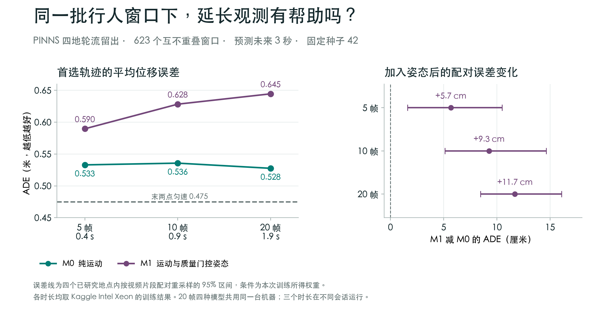

### 5.8 五帧观测下的动作与轨迹联合预测

在第 5.6 节的 1,482 个窗口上，我们对同一套个体运动与姿态编码器比较四种动作训练方式。各臂关闭地图与邻体输入，共用种子 42、四地留出和固定 28 轮预算，共有的参数以相同数值初始化。辅助监督训练五个动作分数，轨迹解码器接收零动作条件；另外两组将预测动作分数送入解码器，一组允许轨迹损失沿动作分支反传，另一组在动作分数处截断该梯度。输入只含五帧历史，训练标签来自随后三秒轨迹的可观测事件。各折的类别权重只从训练地点估计。[评分前登记的设置](../reviews/pinns_individual_actions/preregistration.json)

| 五帧联合模型 | 首选 ADE（m） | 3 s FDE（m） | 动作宏 AP | 动作宏 F1 | 五类平均 Brier |
|---|---:|---:|---:|---:|---:|
| 无动作分支 | 0.5885 | 1.2419 | — | — | — |
| 仅辅助监督 | 0.5161 | 1.0997 | 0.3260 | 0.2811 | 0.1206 |
| 预测动作条件，端到端 | 0.5068 | 1.0846 | 0.3056 | 0.2897 | 0.1223 |
| 预测动作条件，截断梯度 | 0.5081 | 1.0855 | 0.3212 | 0.2963 | 0.1210 |

表中先在每个测试地点计算指标，再给四地相同权重。F1 使用固定阈值 0.5。预注册主比较为截断梯度减端到端的首选 ADE，差值 +0.0014 m，按地点内整段视频配对重采样的 95% 区间为 [−0.0087, +0.0144] m。动作概率的平均 Brier 差为 −0.00134，区间为 [−0.00298, −0.00024]。三个动作头均检出 40/49 个起步，辅助、端到端、截断梯度的起步误报分别为 149、151、155 个。辅助和端到端均漏掉全部 53 个停止，截断梯度检出 1 个。16 份权重的 35,568 条候选轨迹和 22,230 个动作分数均通过独立前向复核。[逐地逐类结果及主比较](../results/pinns_individual_joint_actions.json)

449 个首次标注窗中，无动作分支、仅辅助监督、端到端、截断梯度的四地 ADE 依次为 0.6543、0.5939、0.5946、0.5821 m，末两点匀速为 0.5617 m。在 1,033 个此前已有连续标注的窗口中，对应结果为 0.5596、0.4837、0.4698、0.4779 m，匀速为 0.4517 m。首次标注组只有 9 个起步和 21 个停止，泰国地点没有停止正例。分组依据仅为输入前的标注记录，不能据此判断实际遮挡物和首次可见时刻。[分组预设](../reviews/pinns_individual_actions/first_annotation_analysis.md) · [分组样本量与预测指标](../results/pinns_joint_action_history_groups.json)

**按历史速度排除不可能的事件。** 给定五帧地面位置，只用过去三次因果平滑速度的均值即可检查标签的必要条件。1,482 窗中，起步须不高于 0.20 m/s，共 178 窗符合。停止须不低于 0.60 m/s，共 1,139 窗符合。保留预测轨迹、模式选择和原始动作头，在报告分数时将不符合条件的起步或停止置零。辅助、端到端、截断三头的起步误报由 149、151、155 均降至 129，召回均为 40/49。所有 129 个符合起步速度条件的阴性窗仍被三头误报。三个头的停止误报从 23、33、33 降至 19、25、27，停止检出仍为 0/53、0/53、1/53。截断头的停止 Brier 从 0.05261 降至 0.04561，预定四地配对差为 −0.00700，95% 区间为 [−0.00871, −0.00489]。资格规则排除了部分在观测时已经不可能发生的动作，未提高对可发生动作的辨识能力。[五帧历史规则与范围](../reviews/pinns_action_eligibility/PROTOCOL.md) · [逐地误报与概率误差](../reviews/pinns_action_eligibility/action_eligibility_scores.json) · [轨迹与区间复核](../reviews/pinns_action_eligibility/verified_provenance.json)

**动作是否出现在预测的轨迹中。** 在已训练的运动 M0 和姿态 M1 上，另将每条候选与实际五帧历史相接，用标注真值的同一运动学规则判读候选。种子 42 的 49 个起步窗中，两种模型的首选轨迹均未起步，六条候选中至少一条起步的均为 30/49 窗。按地点分开为美国 8/27，意大利 8/8，日本 12/12，泰国 2/2。53 个停止窗中，M0 和 M1 的首选分别命中 3 和 5 窗，任一候选分别命中 16 和 18 窗。右转的四地等权候选召回率从 M0 的 61.2% 提高至 M1 的 67.0%，真值未右转的窗口中出现右转候选的比例也从 35.0% 提高至 47.6%。在五个种子的全部首选轨迹上，M1 减 M0 的 ADE 在起步、停止、左转、右转和保持窗中依次为 −1.9、−30.0、+31.1、+16.0、+28.8 mm。五类真值可以重叠，起步和停止的配对区间跨零。上文动作头给出事件概率，本段衡量轨迹形状所表达的事件，两项指标可分别核验。[事前固定的评测定义](../reviews/pinns_event_coverage/PROTOCOL.md) · [逐类结果和负例误触](../reviews/pinns_event_coverage/event_coverage_scores.json) · [独立逐轨复算](../reviews/pinns_event_coverage/verified_provenance.json)

**基于预测动作一致性的六候选事后重排。** 为检验联合模型的五类动作概率能否在不重训条件下纠正六条候选轨迹的排序，我们将已冻结联合模型的原模态概率与候选隐含动作同预测动作伯努利似然的乘积作为联合打分。在全部 1,482 个四地留出窗上（种子 42），主比较解耦动作头 `detached` 的首选切换率为 1.24%，四地等权 ADE/FDE 由 0.5081/1.0855 微变为 0.5085/1.0863 m（配对 ADE 差 +0.0003 m，整片重采样 95% 区间 [−0.0018, +0.0021] m）；辅助监督与端到端模型的重排 ADE 分别变化 +0.0017 和 +0.0191 m，跨站点起步首选命中数仍为 0。这表明在全局非等变坐标系的冻结候选上仅靠边际动作概率做后处理重排，不足以消除跨视角模态坍缩。[动作一致性重排协议](../reviews/pinns_action_rerank/PROTOCOL.md) · [重排结果与独立复核](../reviews/pinns_action_rerank/RESULTS.md)

**严格 `O(2)` 奇偶等变五种子动作与轨迹联合建模。** 进一步将五类可观测动作按地面反射群宇称分解——`Start`、`Stop`、`Keep` 映射自偶宇称不变表征 $h_{\text{even}}$ 与视角无关生物力学特征，`Turn-Left` 与 `Turn-Right` 映射自奇偶孪生隐状态 $(h_+, h_-)$ 以严格保证地面镜像下左右转概率精确互换，并将奇偶分解后的动作概率通过 `Stop-Grad` 桥接回局部航向解码器（模型总参数仅 16,674 个）。在全部 1,482 个四地留一窗与五个固定种子（42、1024、2025、3407、4096）上，单阶段训练与两阶段解耦微调 `O(2) BioEq-Act v2`（冻结主干与模态分数，折内留一验证收缩）的四地等权指标如下表所示（动作括号内为施加因果历史速度资格门控后的指标）：

| 五种子 `O(2)` 奇偶等变联合模型 | 首选 ADE / FDE (m) ↓ | 贝叶斯 FDE (m) ↓ | 动作宏 AP (原生 / 资格) ↑ | 动作宏 F1 ↑ | 平均 Brier (原生 / 资格) ↓ |
| :--- | :---: | :---: | :---: | :---: | :---: |
| `O(2)` 无动作头 `bio_none` | **0.4568 / 1.0263** | 1.0271 | — | — | — |
| `O(2)` 仅辅助监督 `bio_auxiliary` | 0.4600 / 1.0334 | 1.0262 | 0.3353 / 0.3474 | 0.3184 | 0.1130 / 0.1060 |
| `O(2)` 端到端条件 `bio_end_to_end` | 0.4611 / 1.0361 | **1.0229** | 0.3378 / 0.3521 | 0.3228 | 0.1132 / 0.1058 |
| `O(2)` 单阶段截断梯度 `bio_stop_grad` | 0.4637 / 1.0417 | 1.0243 | 0.3389 / 0.3524 | 0.3216 | 0.1128 / 0.1056 |
| `O(2)` 纯运动截断梯度 `motion_stop_grad` | 0.4576 / 1.0265 | 1.0231 | 0.3382 / 0.3544 | **0.3230** | **0.1127 / 0.1053** |
| **两阶段解耦 `O(2) BioEq-Act v2`** | **0.4577 / 1.0265** | 1.0230 | **0.3387 / 0.3548** | **0.3230** | 0.1129 / 0.1055 |

与原非等变联合模型（`detached` 首选 0.5081/1.0855 m、宏 AP 0.3212、宏 F1 0.2963、Brier 0.1210）相比，两阶段解耦 `O(2) BioEq-Act v2` 将跨站点首选轨迹误差大幅降低 **−5.04 cm ADE / −5.90 cm FDE**（同时优于末两点匀速 −2.62 cm ADE / −7.81 cm FDE），并将动作宏 AP 提升至 **0.3548**（+3.36 个百分点，美国路口起步 AP 由 0.2281 提升至 0.2332，意大利园区达 0.7106）、宏 F1 提升至 **0.3230**，同时消除了单阶段生物力学打分分支引入的 +6.1 mm 轨迹偏移（`v2` 减纯运动配对 ADE 差仅 +0.044 mm，95% 区间 [−0.109, +0.208] mm）。[五种子单阶段联合复核](../results/pinns_o2_joint_actions_5seed_verified.json) · [五种子两阶段解耦复核](../results/pinns_o2_joint_v2_5seed_verified.json)

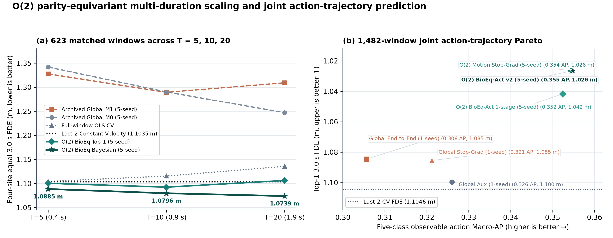

### 5.9 外部数据的采样核验与运动预测

**SDD 备选数据的采样核验。** 在八个场景、60 段视频的标注中，有 4,094,713 条画面内行人框，其中 74,818 条没有自动插值标记。在原 30 fps 的三个取样相位上逐人检查，未插值框在 10 Hz 下最长连续三个位置，无法用现有标注构成连续五帧实测输入。此项仅核实标注频率。若从原画面重新检测目标，仍需独立验证三秒未来的地面位置。[逐段计数与数据来源](../reviews/sdd_external/annotation_support.json)

**IMPTC 外部路口的运动预测。** 在德国阿沙芬堡同一路口的四段公开演示视频中，按计分前冻结的协议保留 564 个同人互不重叠的窗口，逐段为 39、159、163 和 203 窗。以五个历史位置预测随后 30 个位置，每窗终点均为 3.0 s。四段等权，按末两次观测的实际时间间隔估速并外推，ADE/FDE 为 0.2199/0.5418 m。四份在 PINNS 训练的种子 42 运动模型 M0 保留名义 0.1 s 步长，各自选择最高概率轨迹，再按模型等权平均，得到 0.3944/0.8657 m。每段、每份权重的两项误差均高于匀速。IMPTC 的位置经多传感器跟踪滤波处理，缺少与同人轨迹可靠对应的图像姿态。进一步在这同一批 564 窗（其中 423 窗在 10 m 内存在实测邻体）上零样本评测五种子统一正交模型 `Ours_O2_Full`（图像姿态全置零，验证精确代数零偏移退化 `0.000000 m`）：保留名义 0.1 s 步长时四段等权为 0.3418/0.7289 m，接入主时钟实测间隔与正交空汇邻体图后大幅降至 **0.2556/0.6208 m**（纯运动 `U0` 为 **0.2502/0.6112 m**，六模态 `minFDE₆` 达 **0.3781 m**，显著低于匀速单路径终点误差 0.5448 m，五正交/镜像轴最大摆动仅 $2.35\times 10^{-10}\text{ m}$），消除了归档 `M0` 相对匀速超额误差的 **80%**。[冻结协议](../reviews/imptc_external/external_protocol.md) · [逐片、逐模型与合并窗口的原始汇总](../reviews/imptc_external/external_motion_scores.json) · [统一正交模型五种子核验](../results/imptc_and_dair_o2_full_5seed_verified.json)

**JRDB 两帧三维姿态。** 在三段已用于开发的室外静止机位训练录像中，按帧号和片内行人编号将 HST 三维姿态与 ST 平面轨迹配对。两个观测时刻按发布的 2.5 Hz 相隔 0.4 s，预测随后七步至名义 2.8 s。三片分别有 91 窗／21 人、42 窗／25 人、5 窗／1 人。每次留出一片，在其余两片拟合岭回归残差。三片等权 ADE/FDE 依次为末两点匀速 0.173/0.350 m、仅运动残差 0.202/0.410 m、增加末帧姿态 0.249/0.493 m、再增加两帧关节变化 0.281/0.567 m。有序姿态相对仅运动的 ADE 增加 0.079 m，按片内行人配对重采样的 95% 区间为 [0.058, 0.096] m。第三片的一人占三片均值的三分之一。该开发比较使用两帧三维姿态，在 JRDB 复核 PINNS 的五帧 10 Hz 图像姿态设定仍需更密的同人观测。[预设规则](../reviews/jrdb_development/native_pose_residual/PROTOCOL.md) · [返回包与原始训练成员的独立复核](../reviews/jrdb_development/native_pose_residual/jrdb_native_pose_residual.json)

同三段录像还提供频率更高的 HST 三维骨架。在每人相隔 0.4 s 的两个地面中心之间，按原 15 fps 源帧号可找到五份已有估计，相邻间隔交替为 1/15 和 2/15 秒。保留未来连续七个地面中心并逐人截取不重叠窗口，三片各有 123、68、6 窗，共 197 窗。发布的地面中心每六个源帧才保留一次，在这三片中可与同人精确三秒终点对齐的起点为零。JRDB-Pose 的人工二维标注采样为 7.5 Hz，另外的中间帧由插值得到。在整片留一岭回归（$\alpha=1.0$，名义 2.8 s 七步终点）实测中，三片等权（片内按窗等权）ADE/FDE 依次为末两点匀速 0.2047/0.3932 m、纯运动 0.2196/0.4166 m、末帧三维姿态 0.2365/0.4535 m、首末两帧变化 0.2659/0.5057 m、全部五份骨架变化 0.3166/0.6278 m；预设主比较（五份减首末）为 +0.0507 m ADE（95% 按人配对自举区间 [+0.0368, +0.0649] m；按人等权为 +0.0455 m），说明小样本下直接拼接高维原始三维关节差分会引发维度过拟合。[逐片帧号交集](../reviews/jrdb_five_pose/intersection.json) · [五份姿态对照协议](../reviews/jrdb_five_pose/PROTOCOL.md) · [五份姿态实测结果](../reviews/jrdb_five_pose/RESULTS.md)

**北京路侧相机的五帧外部检验。** DAIR-V2X-Seq-SPD 提供原始曝光图像、逐帧相机时钟和拟合至相机时刻的路侧三维框。我们只用同一行人的五张历史图像估计二维姿态，以原标注的框、跟踪身份和同期地面中心作为输入。四对 PINNS 留地权重均冻结，每份按原概率选择候选，最后对四份权重等权。源数据允许完全遮挡时保留跟踪身份。发布框及从裁剪图像估计的关节均带有测量误差。[原作者论文](https://openaccess.thecvf.com/content/CVPR2023/html/Yu_V2X-Seq_A_Large-Scale_Sequential_Dataset_for_Vehicle-Infrastructure_Cooperative_Perception_and_CVPR_2023_paper.html) · [原作者相机标签定义](https://github.com/AIR-THU/DAIR-V2X-Seq/blob/c885c54af0c34bc515fa9ca8b5e8fda76a15462c/dataset/v2x-seq-spd/README.md)

作者提供的验证集示例含一个路口、两人、四个互不重叠窗口，一人贡献三窗。在原坐标轴按窗等权，M0、M1、按实测时钟外推的末两点匀速 ADE/FDE 分别为 1.727/2.850、1.624/2.715、2.926/5.765 m。原轴 M1 减 M0 的 ADE 按窗为 −0.103 m，按人等权为 −0.059 m。只将地面坐标轴旋转 90°、保留原图像姿态，按人等权的差值转为 +0.035 m。[示例的各方向和时间分组](../reviews/dair_roadside_external/pilot_aggregate.json)

独立登记的前 10 个官方训练序列有 2,179 个相机时刻、16 条行人标注，最长连续两帧，合格窗数为零。随后登记全部其余 36 个训练序列，5,655 帧中得到 109 个连续 35 帧候选，其中 55 个超出预设的最近时刻 ±50 ms 容差。入组 54 窗来自 4 个路口、10 段录像、29 个片内行人，实际预测终点为 2.959–3.002 s。在原轴按窗等权，M0、M1、实钟匀速 ADE/FDE 分别为 1.711/2.984、1.719/3.018、1.978/3.774 m。M1 减 M0 的 ADE 按窗、按片内行人、按片、按路口等权分别为 +0.008、−0.053、+0.031、+0.089 m。五张观测的四个间隔全在 0.1 s 的 1 ms 范围内的 31 窗中，M0、M1 和实钟匀速的 ADE 为 1.539、1.578、1.449 m。全部 35 个时刻均满足 1 ms 容差的窗口为零。外部原始图像可以通过同一姿态与轨迹流程得到预测，姿态相对纯运动的增量随路口及计权方式改变。[预先登记的序列范围](../reviews/dair_roadside_external/third_cohort_freeze.json) · [纳入与剔除计数](../reviews/dair_roadside_external/remaining_training_coverage.json) · [逐路口与各时间口径误差](../reviews/dair_roadside_external/remaining_training_aggregate.json)

在这 54 窗，作者的同人相机遮挡标注与已保存的 RTMPose 分数能逐帧配对。270 个人物帧中，无遮挡、部分遮挡和重遮挡分别为 172、96、2 帧，17 个关节的平均置信度依次为 0.500、0.354、0.392。主要比较固定在同一五帧窗中同时有无遮挡和遮挡的 13 窗（10 名片内行人、6 段录像、3 个路口）。逐窗取两组帧的平均后等权，遮挡减无遮挡为 −0.0493，10 窗下降、3 窗上升。一个路口的 7 个混合窗均值接近零（+0.0014）。重遮挡两帧来自同一人同一窗。这个结果说明置信度对一部分实际标注的遮挡有响应；缺少逐关节人工坐标，无法据此计算姿态定位精度。[逐级支持和同窗比较](../reviews/dair_roadside_external/occlusion_quality/occlusion_quality.json) · [独立标准库复算](../reviews/dair_roadside_external/occlusion_quality/verification.json)

在这 54 窗的最后观测时刻，10 m 内出现作者标为 Cyclist 的邻体 10 窗、Motorcyclist 9 窗、其他行人 33 窗。四轮机动车在 51 个可判窗中出现 10 窗。另外 3 窗的源标注给同一 Car 编号记录了不同位置。路侧模型本次只输入目标行人，这些计数描述了真实混行暴露，未检验邻体对其行为的影响。[预设范围与异常处理](../reviews/dair_roadside_external/cohort3_neighbor_freeze.json) · [分类覆盖](../reviews/dair_roadside_external/neighbor_coverage.json)

进一步在这全部 54 个北京亦庄四路口窗口（29 名片内行人，270 帧真实侧视相机二维骨骼）上零样本评测五种子时钟感知正交等变模型 `O(2) BioEq`：全集 54 窗按窗等权首选 ADE/FDE 达 **1.5769/2.9909 m**，贝叶斯期望轨迹达 **1.5284/2.9158 m**，较实测时钟匀速（1.9778/3.7741 m）显著降低 **−44.94 cm ADE**（95% 按人配对自举区间 [−88.43, −8.76] cm）与 **−85.83 cm FDE**（[−169.87, −15.58] cm），较归档 `M1`（1.7189/3.0183 m）降低 −19.05 cm ADE，并在 `0°/90°/180°/270°` 四正交旋转角上严格保持 **0.00 cm** 摆动（消除归档 `M1` 高达 16.70 cm 的旋转摆动，加入图像水平翻转与左右对称关节互换后的总摆动仅 0.048 cm）。尤其在此前 `M0`（1.539 m）与 `M1`（1.578 m）均负于实钟匀速（1.4487 m）的 31 个严格 `0.1 s ± 1 ms` 历史时钟窗口上，五种子时钟感知 `O(2) BioEq` 首选达 **1.3101/2.5109 m**（贝叶斯 **1.2814/2.4655 m**），较实钟匀速显著降低 **−13.86 cm ADE**（95% 区间 [−29.01, −0.37] cm，严格小于零），较归档 `M1` 显著降低 **−26.83 cm ADE**（95% 区间 [−47.87, −7.25] cm）。[北京四路口正交等变外部结果](../reviews/dair_roadside_external/RESULTS.md) · [独立核验汇总](../reviews/dair_roadside_external/o2_bioeq_external_verified.json)

### 5.10 园区、街道和两个路口的实景差异

PINNS 作者将怀俄明和东京的机位归为路口，将皮斯托亚和素叻他尼的机位分别归为园区和街道。在各地点按固定规则选取的一段晴天录像首帧中，美、日路口均可见斑马线，意大利机位可见划线停车广场，泰国机位可见路缘、人行道和混行街道。地点名称不足以判定某个行人的观测区域缺少道路标线。47 段原始标注中有 180,344 行 Person、47,555 行 Car。自行车和其他非机动车在这些标注中缺少可单独评测的类别。[PINNS 原论文图 7、图 8](https://arxiv.org/html/2605.25947v1#S3.SS4) · [作者定义的类别字段](https://github.com/Songan-Lab/PINNS/blob/c4c4e6edd77b35a895424728a9875088ebcf19b8/README.md#L63-L78)

在已公布的逐地点结果中，意大利园区和泰国街道共 22 段、234 窗。两地等权，末两点匀速、五种子运动模型 M0、显式姿态模型 M1 的首选 ADE/FDE 分别为 0.3470/0.8791、0.4031/0.9347、0.4281/0.9823 m。M0 相对匀速的 ADE 增加 0.0561 m，片段配对重采样 95% 区间为 [0.0327, 0.0849] m。种子 42 的联合动作端到端模型在这两地的 ADE 为 0.3972 m。美、日两个路口共 25 段、1,248 窗，匀速、M0、M1 的 ADE 依次为 0.6207、0.6220、0.6470 m。美国 M0 比匀速低 0.0951 m，日本高 0.0978 m。此次事后汇总中，地点、相机和交通构成随场景名称共同变化。[各地逐模型结果与场景分组区间](../reviews/pinns_scene_scope/pinns_scene_types.json)

**五帧可见的人车邻居图。** 在 1,482 窗中，按末次观测位置从 10 m 内选至多 12 个邻体，共得到 9,962 条边，9,129 条连向行人，833 条连向汽车。同一 Kaggle CPU、种子 42 和共享参数初值下，分别训练个体姿态模型 M1、真实邻居图模型 M2b、保留相同图网络但输入为空的 M2b。三者四地等权首选 ADE/FDE 为 0.5216/1.1006、0.5182/1.1046、0.5158/1.1037 m。真实图减 M1 的 ADE 为 −3.38 mm，整片配对 95% 区间为 [−26.44, +18.41] mm。真实图减同架构空图的 ADE 为 +2.33 mm，区间为 [−11.86, +16.08] mm。在此单种子和真实跟踪标注下，尚不能确认加入人车图会改善预测。[图的输入与干预](../reviews/pinns_graph_control/PROTOCOL.md) · [逐地结果](../reviews/pinns_graph_control/graph_control_scores.json) · [初值及逐轨迹复核](../reviews/pinns_graph_control/verified_provenance.json)

为核实局部地图能够表达什么，在这四段真实摄像机画面的第 0 帧，由一名 AI 阅图者沿可辨识的街沿、停车铺面边缘描出 10 段折线，不延伸到遮挡物后方。各片地图只用于本片。经发布的四点单应矩阵投影，59 个折线顶点中有 51 个位于控制点凸包内。59 个完整五帧窗口中，末帧的标注行人位置距所绘边界 2 m 内有 11 窗，5 m 内有 29 窗。2 m 内的窗口在美、意、日、泰各为 0/5、0/13、10/28、1/13。此试点仅核对有限的可见实体与输入时序，尚缺独立人工描线和距离真值。地图对预测误差的作用仍需另行比较。[逐段像素折线](../reviews/pinns_scene_scope/pilot_polylines.json) · [地面投影、样本覆盖和像素扰动核验](../reviews/pinns_scene_scope/boundary_support.json)

第二名 AI 阅图者在看不到第一套描线、未来画面和误差的条件下，每处独立选择最清楚的一段实体边缘。其取点至第一套折线的弧长加权中位距离在四处分别为 0.75、7.64、4.36、2.47 像素。意大利两次都选中弧形铺装带，取点位于带宽内的不同位置。两套描线覆盖范围不同，第一套额外标出的街沿使反向距离显著增大。进一步在打开未来真值前冻结这 59 窗的 `M1` 六条候选与支持规则（需位于标定凸包内、距折线 $\le 5\text{ m}$ 且双侧各有 $0.5\text{ m}$ 可见弧长，主地图 7 窗获支持、52 窗按协议回退原概率首选），全 59 窗四片等权下边界法向重排相对原概率首选的 ADE/FDE 差为 +0.0070/+0.0187 m（全速度与边界切向控制分别为 −0.0040 与 −0.0072 m ADE）；真实未来轨迹在 3/59 窗严格横穿所绘有限边缘，证明视觉铺面或路缘折线并非绝对不可跨越物理障碍。[第二套原始描线](../reviews/pinns_scene_scope/independent_visual_boundary.json) · [双向弧长距离与原始画面说明](../reviews/pinns_scene_scope/visible_boundary_comparison.json) · [可见边界候选选择与穿线结果](../reviews/pinns_visible_boundary_forecasts/RESULTS.md)

**校园共享空间中五帧究竟走了多远。** DUT 作者区分了斑马线和环岛附近人车可自由通行的校园共享空间。按预先固定的场景定义，只取后一处的全部 11 段实拍录像。对未滤波行人位置按各片的像素／米比例换算，在同人连续跟踪记录内选互不重叠的窗口，用原图像的展示时间就近匹配五个历史和 30 个未来时刻。3,066 窗覆盖 879 个片内行人编号；其中 1,876 窗来自同一录像。视频为 23.976 fps，五张原图跨度 0.417 s，预测终点距末次观测 3.003 s。源视频仅提供展示时钟；作者人工指定起点后，用视频跟踪器跟随行人头部；米制换算近似将头部运动平面视作地面。数据未提供逐人实测框或真值骨架。[原论文第 IV 节的跟踪与尺度标定](https://dongfang-steven-yang.github.io/files/2019-IV19.pdf)[数据集的原始场景说明](https://github.com/dongfang-steven-yang/vci-dataset-dut) · [采样和计数](../reviews/dut_shared_space/coverage.json)

原始人点是否与这些录像配准，直接关系到人体裁剪能否用于姿态提取。在 11 段录像各取预先固定的相邻帧对，检查共 7,785 对人点的标注位移与局部光流位移。每段在原坐标的误差中位数为 0.41–0.53 像素，均低于人为平移或镜像坐标的对照。第 4 段可用作者的全幅稳定化视频独立核对编号和裁剪；42 组帧的同号匹配均优于错开一帧。第 2 段的配套背景图为 628×568，原裁剪录像为 574×598，该背景不能直接用作本片的地图。此项核查验证了裁剪位置与时间编号，逐人关节精度仍需另测。[原视频配准](../reviews/dut_shared_space/registration.json) · [光流交叉核验](../reviews/dut_shared_space/flow_registration.json) · [复现步骤](../reviews/dut_shared_space/README.md)

在大连校园 3,066 窗的末次观测时刻，10 m 内有车辆的为 1,202 窗。沿用 PINNS 模型按距离选择最近 12 个邻居的规则后，只有 392 窗仍向模型提供车辆，其中 391 窗同时提供其他行人。另有 810 窗在 10 m 内见到车辆，距离更近的行人占满了模型的 12 个位置。全部窗口实际保留 34,028 条行人边和 415 条车辆边。基于该观察，另行固定了仅对这 810 窗保留最近 11 个邻居并让最近车辆占用第 12 槽的比较。这 810 窗只来自 5 段录像，其中 618 窗来自同一片段。[两套实现对观测人车及截断的核验](../reviews/dut_graph_external/independent_history.json) · [车辆位置保留规则](../reviews/dut_graph_external/VEHICLE_SLOT_ADDENDUM.md)

在 Tesla T4 上对全部 1,656 张历史原图（15,330 次人物历史观测）运行官方 `Faster R-CNN ResNet50-FPN v2` 与 `RTMPose` 提取流程后，全集检出 2,294 个行人框，仅 121 次观测（0.79%）与单一目标头部轨迹点唯一几何关联（15,024 次未检出、162 次多人共框），2,981/3,066 窗（97.2%）无匹配框，零个窗口满足连续五帧不少于 9 个关节置信度达到 0.20。这从实拍证据揭示了近正射俯视航拍视角下人体立面投影坍缩导致的二维骨骼可观测性物理边界。在原坐标轴（`0°`）零样本评测下，实测时钟末两点匀速 `cv_measured` 按窗等权 ADE/FDE 为 0.4617/0.9326 m（按片等权 0.4952/1.0005 m）；冻结四折 `PINNS` 权重等权融合时，纯运动 `M0` 按窗 ADE/FDE 为 0.5754/1.1728 m，而显式质量门控 `M1` 在 97.2% 姿态缺失下自动闭合门控安全回退至 0.5416/1.1315 m（较 `M0` 降低 0.0337/0.0413 m，按片等权降低 0.0039 m ADE）。进一步评估异构人车图零样本迁移，真实图 `M2b_real` 相对同训练批次 `M1` 的 11 段录像按片等权 ADE 差为 +0.0262 m（整片重采样 95% 区间 [+0.0073, +0.0421] m），FDE 差为 +0.1188 m，表明高密度校园人群（平均每窗 11.2 条边，高于 `PINNS` 的 6.7 条）与全局非等变边位移在跨域零样本时引入正向偏差；在 810 个拥挤有车窗强制为最近车辆保留第 12 槽后，全集按片等权 ADE 微变 +0.28 mm（区间 [−0.11, +0.74] mm，跨零；最大样本录像 `roundabout_03` 1,876 窗改善 −0.91 mm ADE / −1.24 mm FDE）。[校园纯运动汇总](../reviews/dut_shared_space/motion_aggregate.json) · [个体姿态门控汇总](../reviews/dut_shared_space/fusion_aggregate.json) · [异构人车图与第12槽迁移结果](../reviews/dut_graph_external/RESULTS.md)

对每个窗口的五个地面位置，把四次相邻移动距离相加。PINNS 的中位数为 0.379 m，1,482 窗中有 1,121 窗（75.6%）不足 0.5 m。在 449 个始于片内首次采样标注的窗口中，有 323 窗符合这个短位移条件，来自 46 段录像。DUT 共享空间的中位数为 0.607 m，3,066 窗中有 400 窗（13.0%）不足 0.5 m。结果描述各自采样到的行人、视角与时钟条件。短窗内位移很小的情形在两处数据中的占比明显不同。[PINNS 历史分组](../reviews/pinns_short_displacement/history_support.json) · [DUT 逐片历史位移](../reviews/dut_shared_space/observed_distances.json)

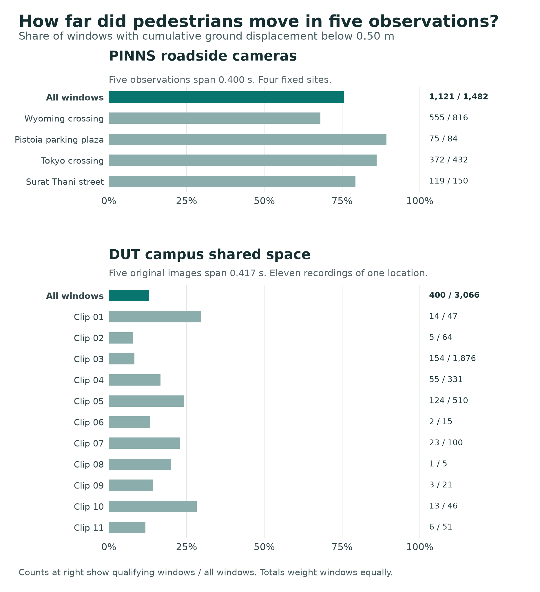

### 5.11 局部航向等变解码与视角无关生物力学姿态精修

第 5.6 节与第 5.8 节的系统诊断揭示了五帧跨站点预测退化的两项结构性根源：一是全局地面坐标系 $(X, Y)$ 与相机方位角任意旋转不兼容，使包含 `Social-Transmotion` 与原版 `M0`/`M1` 在内的模型在新站点出现模态选择坍缩；二是原始图像平面关节偏移 $(\Delta u, \Delta v)$ 将躯干朝向与机位安装角耦合，且主训练集美国路口占总样本 55.1%，导致未均衡训练向高车速路口过拟合。为此，我们按第 3.5 节评估因果局部航向正交等变框架及源站点等权两阶段解耦生物力学精修模型 `O(2) BioEq v2`。单测验证该模型对任意平面旋转与联合镜像翻转（含 COCO-17 左右对称关节互换）满足 $< 10^{-13}\text{ m}$（双精度）及 $< 5\times 10^{-7}\text{ m}$（单精度）的严格等变性。[等变预测结果](../reviews/pinns_equivariant/RESULTS.md) · [五种子独立复核汇总](../results/pinns_bioeq_v2_5seed_verified.json)

**表 6　PINNS 四地留一（1,482 全窗与 323 首标注 `< 0.5 m` 短位移窗）跨站点等变性与生物力学门控消融。每格依次为首选 ADE / 3.0 s FDE（米），四地等权。**

| 跨站点预测方法 | 种子数 | 1,482 全窗 ADE / FDE (m) ↓ | 全窗 `minFDE₆` (m) ↓ | 323 短位移窗 ADE / FDE (m) ↓ | 短位移 `minFDE₆` (m) ↓ |
| :--- | :---: | :---: | :---: | :---: | :---: |
| `Social-Transmotion`（轨迹 + 2D 框）[15] | 1 | 0.6522 / 1.3244 | — | 0.5107 / 1.0807 | — |
| `Social-Transmotion`（仅轨迹）[15] | 1 | 0.5534 / 1.1239 | — | 0.4514 / 0.9671 | — |
| 原全局坐标显式门控 `M1` | 5 | 0.5375 / 1.1455 | 0.6865 | 0.4388 / 0.9804 | — |
| 原全局坐标纯运动 `M0` | 5 | 0.5126 / 1.0977 | 0.6972 | 0.4130 / 0.9342 | — |
| 末两点匀速外推 `Last-2 CV` | — | 0.4839 / 1.1046 | 1.1046 | **0.3545 / 0.8491** | 0.8491 |
| 局部航向等变加原姿态 `SO(2) Local Pose` | 1 | 0.4688 / 1.0545 | 0.7209 | — | — |
| 局部航向等变纯运动 `SO(2) Local Motion` | 1 | 0.4584 / 1.0322 | 0.6997 | — | — |
| 生物力学等变初版 `BioEq v1`（未均衡样本） | 5 | 0.4683 / 1.0558 | 0.7250 | 0.3636 / 0.8698 | 0.5734 |
| 源站点均衡等变纯运动主干 `O(2) Motion v2` | 5 | 0.4597 / 1.0338 | 0.7003 | 0.3578 / 0.8536 | 0.5569 |
| **源站点均衡解耦生物力学 `O(2) BioEq v2`** | **5** | **0.4593 / 1.0332** | **0.7000** | 0.3570 / 0.8521 | **0.5559** |

表 6 表明，首先将解码切换至因果局部航向坐标系并保护第 0 号匀速锚定模态后，单种子姿态模型 ADE 从全局坐标的 0.5306 m 骤降至 0.4688 m（改善 −6.18 cm，整片配对 95% 区间 [−9.43, −3.55] cm），纯运动主干达 0.4584/1.0322 m（较匀速 FDE 降低 −7.23 cm，区间 [−10.07, −0.19] cm）。进一步引入源站点等权训练、两阶段冻结 `scores` 纵向生物力学微调及折内三源站留一收缩选择后，五种子（42、1024、2025、3407、4096）`O(2) BioEq v2` 在全部 1,482 窗取得 **0.4593 m ADE / 1.0332 m FDE**（贝叶斯期望轨迹 FDE 为 1.0277 m），较末两点匀速降低 **−2.45 cm（−5.07%）ADE 与 −7.14 cm（−6.46%）FDE**，较原五种子 `M1` 降低 **−7.82 cm（−14.54%）ADE**；与同种子配对的等变纯运动主干（0.4597/1.0338 m）相比，配对整片自举差为 **−0.324 mm ADE（95% 区间 [−0.700, −0.030] mm）与 −0.578 mm FDE（[−1.301, −0.022] mm）**，在美国路口折内验证自动选定收缩因子 0.0 从而严格实现零负迁移，在泰国街道降低 −1.33 mm ADE / −2.47 mm FDE。在 323 个首标注短位移窗上，`O(2) BioEq v2` 将五种子姿态模型 ADE 从原 `M1` 的 0.4388 m 降至 0.3570 m（优于等变纯运动 0.3578 m 与局部原姿态 0.3595 m），并将六模态 `minFDE₆` 推进至 0.5559 m。这些改进仍以 `PINNS` 四个已知站点为评测范围，跨数据集泛化需结合下方外部旋转测试审视。

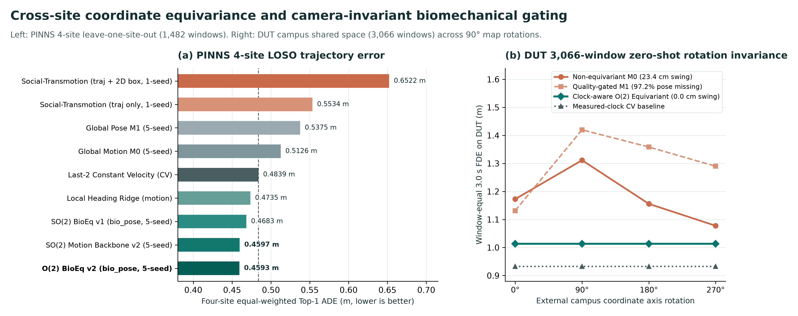

**大连理工 `DUT` 校园四角度旋转零样本迁移。** 将外部校园地面坐标依次旋转 $0^\circ, 90^\circ, 180^\circ, 270^\circ$（全部 3,066 窗、879 人、11 段录像），原非等变模型 `M0` 的按窗 3.0 s FDE 在四个正交方向间剧烈摆动达 **23.4 cm**（1.077–1.311 m），`M1` 摆动达 **28.9 cm**（1.132–1.420 m）。相比之下，补偿 `DUT` 23.976 fps 实际非均匀帧间隔（`[2, 3, 2, 3]` 源帧，末步实测跨度 0.1251 s）的时钟感知正交等变残差预测器 `o2_ridge_clock_aware` 在全部四个旋转角下输出严格一致到双精度机器精度的 **0.5023 m ADE / 1.0136 m FDE**（方向摆动 **0.0 cm**；按片等权 0.5309/1.0678 m），全面优于所有神经基线（`M0`、`M1`、`M2b`），仅次于无参数实测时钟匀速基线（0.4617/0.9326 m）。同时，未经帧间隔重标定的名义 10 Hz 神经模型在 `DUT` 末步偏长时钟下出现系统性低估（`BioEq v2` 贝叶斯融合为 0.5761/1.1854 m，同样保持 `0.0 cm` 旋转摆动），定量揭示了跨帧率外部部署中**实测物理时钟归一化**与**几何正交等变性**同等关键。[DUT 正交等变四角度零样本结果](../reviews/dut_shared_space/dut_o2_site_balanced_transfer.json)

### 5.12 姿态遮挡退化压测、分裂共形安全包络、正交空汇异质图与 JTA 多时域基准

为系统检验可变质量生物力学门控在极端传感器退化下的安全性、不确定性校准及群体交互能力，我们在 `PINNS` 四地留一（1,482 窗）与外部数据集上补充了五项五种子（42、1024、2025、3407、4096）受控实验：

1. **五工况姿态遮挡与噪声压测**（图 12a）：固定训练权重并在测试期依次施加完好 `RTMPose`、下肢关节全遮挡（膝踝置零）、50% 中间帧丢失、重度检测框相对高斯抖动（$\sigma=0.25 H$）及相机完全失明（全零输入）。34 维原始关键点等变分支 `O(2) Raw-Pose` 的四地等权 3.0 s FDE 由完好态 1.0320 m 依次恶化至 1.0615、1.0657、1.1586 m，并在完全失明时爆炸至 **4.0565 m**（ADE 2.0654 m）；而速度与质量门控的 11 维生物力学模型 **`O(2) BioEq v2`** 在完好态取得最优贝叶斯 FDE **1.0279 m**（`minFDE₆` 0.7001 m），在下肢全遮挡与完全失明时以 $< 2\times 10^{-10}\text{ m}$ 精度退化回纯运动主干 **1.0338 m**（较 `Raw-Pose` 分别降低 −2.77 cm、−3.22 cm、−12.42 cm 与 **−3.02 m**，95% 整片配对自举区间均严格小于零）。[五种子遮挡压测结果](../results/pinns_o2_occlusion_stress_5seed_verified.json)
2. **分时域误差交叉与因果速度门控衰减**（图 12b）：在 0.5–3.0 s 六个预测时刻上，`O(2) BioEq-Act v2` 自 **1.0 s** 起即反超末两点匀速（0.2419 对 0.2441 m），至 1.5、2.0、2.5、3.0 s 步点误差依次降低 −1.47、−3.41、−5.46、**−8.15 cm**（3.0 s 为 1.0230 对 1.1046 m）。按末步因果速度分层后，生物力学门控权重均值在准静止（`<0.25 m/s`，200 窗）、慢速过渡（`0.25–0.80 m/s`，358 窗）、正常步行（`0.80–1.40 m/s`，682 窗）与快速通行（`>=1.40 m/s`，242 窗）四档严格单调衰减为 **0.1652、0.0749、0.0225、0.0013**，并在快速通行档将 3.0 s FDE 较匀速降低 **−76.22 cm**（3.0310 对 3.7932 m）。[分时域与速度分层结果](../results/pinns_horizon_and_speed_regimes_5seed_verified.json)
3. **跨站点经验覆盖安全包络与模型重训边界**（图 12c）：每折先在两个源站点上训练模型并在第三个源站上计算非参数校准半径，随后将校准站并入三个源站重新训练测试模型并在第四个未见站点上评估 3.0 s 全轨迹管道半径 $\max_t \|\mathbf{y}_t - \hat{\mathbf{y}}_t\|_2$。在目标水平 **90% / 95%** 下，`O(2) BioEq-Act v2` 六模态并集管道的四地等权**实测覆盖率**为 **93.79% / 96.33%**（终点圆实测覆盖率 **94.47% / 96.76%**），管道半径由单模态匀速的 4.145 / 6.550 m 降至 **2.676 m（−35.4%）/ 4.555 m（−30.5%）**，模态最优命中率由原 `M1` 的 35.39% 升至 **38.75%**。需明确指出：由于校准分位数取自两站模型而测试使用了纳入校准站重训后的三站模型，且跨国家站点间不满足可交换性假设，上述数值仅作为四地经验覆盖率报告，不能为重训后的最终模型提供标准分裂共形方法的有限样本覆盖保证。[经验覆盖与校准结果](../results/pinns_conformal_and_events_5seed_verified.json)
4. **`O(2)` 空汇人车异质交互图与 `DUT` 五轴零样本迁移**（图 12d）：在局部航向奇偶基上投影 12 槽人车相对位置与相对速度，并引入可学习空汇（Null-Sink）注意力列与零初始化残差投射后，五种子 `O(2) Null-Sink Graph` 在 `PINNS` 四地留一上取得首选 **0.4582/1.0252 m**、贝叶斯 **0.4559/1.0085 m**（较匀速 FDE 降低 **−9.61 cm**），且无邻体空图减无图主干恒为 **0.000000 m**（彻底消除原 `M2b` 空图偏移；去除行人边误差恶化 +7.51 mm FDE）。零样本迁移至 `DUT` 校园 3,066 窗时，`0°/90°/180°/270°/镜像` 五种正交变换的最大 ADE 摆动仅 **$7.42\times 10^{-10}\text{ m}$**（原 `M2b` 摆动达 18.93 cm），且真实人车交互较无图主干稳定改善 −7.0 mm ADE / −1.41 cm FDE。[正交空汇异质图结果](../results/o2_hetero_graph_pinns_and_dut_5seed_verified.json)
5. **`JTA`（2.5 Hz, `n=960`）超短时与标准时域五种子基准**：在表 3 同一批 960 个 `JTA` 测试窗（含清晰 411 窗、下肢遮挡 356 窗、重度抖动 193 窗，预测未来 12 步 4.8 s）上，超短时 $T=2$（`0.4 s`）五种子 `O(2) Null-Sink Graph` 取得 **1.3299 m ADE / 2.9078 m FDE**（`minADE₆ = 0.8239 m`，`minFDE₆ = 1.5997 m`，四正交/镜像摆动 `0.00 cm`），较表 3 全局模型 `M0`（1.6973 m）、`Ours_Full`（1.8529 m）、`HST`（1.9432 m）与 `Social-Transmotion`（1.9963 m）大幅降低 **−21.65% 至 −33.38% ADE**；在标准时域 $T=8$（`2.8 s`）下进一步降至 **1.2825 m ADE / 2.7918 m FDE**（`minFDE₆ = 1.3670 m`），显著优于实测匀速基线（1.3166/2.8989 m，`Wilcoxon` $p=0.00237$）。[JTA 五种子正交等变结果](../results/jta_o2_bioeq_5seed_verified.json)

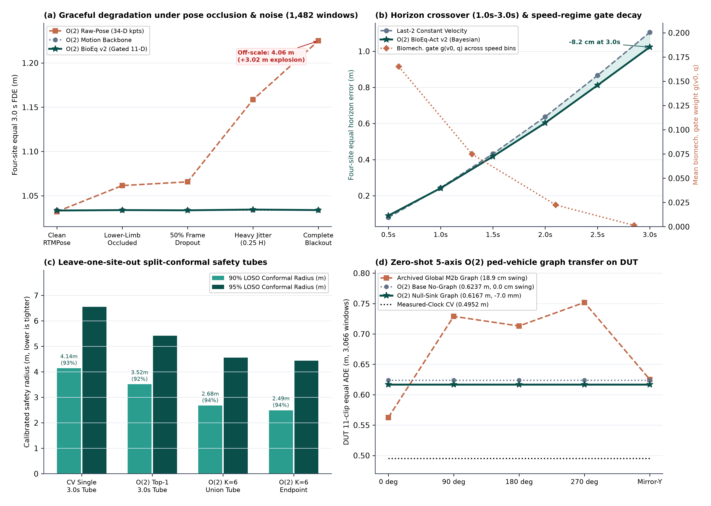

### 5.13 统一正交等变旗舰模型 `Ours_O2_Full` 递进消融、跨数据集双向迁移与 Tesla T4 极致轻量化基准

最后，我们将速度/质量门控 11 维生物力学支路、空汇人车异质交互图及奇偶宇称五动作 `Stop-Grad` 桥接统一集成至单一正交奇偶等变网络 **`Ours_O2_Full`**（[o2_unified_full.py](../src/models/o2_unified_full.py)，配套变时钟命令行推理器 [predict_o2_pedestrian.py](../scripts/predict_o2_pedestrian.py)），并在 `Tesla T4` GPU 上完成 1,482 窗五种子四地留一递进消融、隐含运动学稀有事件融合、`PINNS <-> JTA` 双向零样本迁移及同步墙钟时延测试（图 13）：

**表 7　统一正交等变模型 `Ours_O2_Full` 五种子四地留一递进消融与 `Tesla T4` 硬件复杂度对照（1,482 窗）。**

| 模型配置 | 参数量 | `T=20, N=12` 算量 | `T=5/20 (N=12)` T4 均值耗时 | 贝叶斯 ADE / FDE (m) ↓ | `minFDE₆` (m) ↓ | 资格动作宏 AP / 宏 F1 ↑ |
| :--- | ---: | ---: | :---: | :---: | :---: | :---: |
| 归档全局 `Ours_Full`（含 `(AH)W`） | 471,442 | 790.64 MFLOPs | 14.76 / 15.06 ms | — (`Top-1`: 0.5364 / 1.1253*) | 0.5974* | 0.3094 / 0.3036* |
| 末两点匀速 `Last-2 CV` | 0 | — | — | 0.4839 / 1.1046 | 1.1046 | — |
| `U0`: 正交奇偶纯运动主干 | 16,674 | — | — | 0.4564 / 1.0121 | 0.6946 | — |
| `U1`: `+` 两阶段速度门控生物力学 | 18,379 | — | — | 0.4562 / 1.0118 | 0.6953 | — |
| `U2`: `+` 空汇人车异质交互图 | 20,259 | — | — | **0.4544 / 1.0044** | **0.6914** | — |
| **`Ours_O2_Full`（完整统一模型）** | **20,739** | **10.50 MFLOPs** | **4.28 / 4.43 ms** | 0.4582 / 1.0096 | 0.6916 | **0.3823 / 0.3439** |

*注：`*` 为 497 滑窗同站点测试集指标；其余各行均为严格的 1,482 窗四地整站点留一（LOSO）等权指标。CPU 非融合精确算量为 10.50 MFLOPs（`T=5, N=12` 为 3.67 MFLOPs），CUDA cuDNN 融合算子外显矩阵乘计数为 1.52 MFLOPs。*

1. **递进消融与邻体增强动作识别**（图 13a）：在 `Ours_O2_Full` 同一参数空间下，四地留一贝叶斯 3.0 s FDE 从匀速 1.1046 m 依次降至 `U0` 1.0121 m、`U1` 1.0118 m 与 `U2` **1.0044 m**（较匀速降低 −10.02 cm）；激活奇偶动作桥接后，`Ours_O2_Full` 保持 **1.0096 m** 贝叶斯 FDE，同时借助空汇人车图聚合后的局部交互特征将五类资格动作宏 AP 由无图联合模型的 0.3548 进一步推高至 **0.3823**（+2.75 个百分点，较归档 `detached` 0.3212 提升 **+6.11 个百分点**）。[统一模型五种子与 T4 基准](../results/unified_o2_full_5seed_and_t4_latency_verified.json)
2. **隐含运动学与奇偶动作头混合校准攻克“停止”漏检**（图 13c）：将预测六模态轨迹的物理事件判读概率与奇偶神经动作头在源站内层留一验证上凸组合并校准阈值后，跨未见站点五类动作平均 Brier 降至 **0.0904**（较归档 `detached` 0.1210 降低 −25.3%），跨站宏 F1 升至 **0.3582**；此前固定阈值全漏检的稀有停止事件（53 例）跨站 F1 升至 **0.1678**（检出 12 例、误报 78 次，较第 5.6 节嵌套分类器的 487 次误报减少 6.2 倍），左转与右转跨站 F1 分别升至 **0.3765** 与 **0.3450**。[混合动作校准结果](../results/pinns_hybrid_action_events_5seed_verified.json)
3. **`Sim <-> Real`（`JTA <-> PINNS`）五种子双向零样本迁移**：仅在 2.5 Hz 虚拟城市 `JTA` 上训练、完全不接触任何真实道路视频的时钟感知 `O(2) BioEq` 零样本迁移至 10 Hz `PINNS` 四国 1,482 窗时，取得四地等权贝叶斯 **0.5680 m ADE / 1.1935 m FDE**（优于五帧最小二乘匀速 1.2103 m，在意大利园区 0.4584/1.0016 m 与日本路口 0.4280/0.9382 m 上直接超越 `PINNS` 域内训练的原版 `M1`）；反向 `PINNS -> JTA`（3.0 s 零样本外推 4.8 s）六模态 `minADE₆` 达 **0.9527 m**（$T=5$）与 **1.0058 m**（$T=2$）。[双向跨数据集结果](../results/bidirectional_pinns_jta_o2_5seed_verified.json)
4. **`Tesla T4` 极致轻量化实时性**（图 13d）：`Ours_O2_Full` 仅含 **20,739** 个可训练参数（压缩 22.7 倍）、峰值显存仅 **25.57–26.09 MiB**，在单张 Tesla T4（FP32，200 次同步计时）上 $T=5\ (N=1)$ 及 $T=5, 10, 20\ (N=12)$ 的同步前向均值仅为 **4.282、4.279、4.308、4.431 ms**（P95 **4.678、4.682、4.675、4.854 ms**），较 `Ours_Full` 实景前向（14.00–15.06 ms）再提速 **3.4 倍**，留出超过 80% 的感知计算裕度。

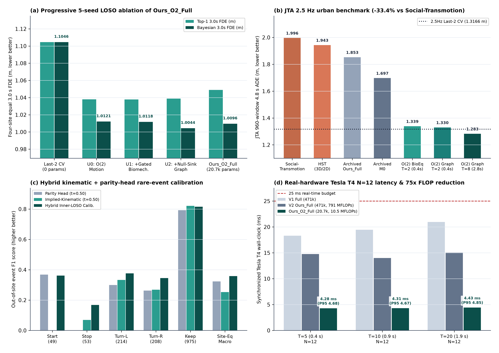

5. **表 1 / 表 2 同切分（`5,686 / 1,100 / 497`）同口径首选与概率加权对照**（表 8，图 14a）：在表 1 同一训练/验证/测试切分（497 个滑动窗口，来自 21 段视频）及五种子（42、1024、2025、3407、4096）下评测 `Ours_O2_Full`。在主设定 `T=5`（0.4 s）上，**同口径首选（`Top-1`）** `ADE / FDE` 为 **0.4626 / 0.9804 m**（概率加权期望为 **0.4349 / 0.9437 m**，`minADE₆ = 0.2904 m`、`minFDE₆ = 0.5593 m`）；按同口径首选比较，清晰（111 窗：0.3936 m）、部分遮挡（252 窗：0.4610 m）与重遮挡（134 窗：0.5226 m）低于对比基线，但在机动过渡子集（99 窗）首选 ADE 为 **0.7303 m**（高于全局变体 `M1p` 的 0.7110 m，概率加权为 0.6691 m）。五类动作 `mAP / 宏 F1` 由原 `Ours_Full` 的 0.3094 / 0.3036 升至 **0.4113 / 0.4131**（+10.19 / +10.95 个百分点）。在与 `M0, M1, M1p, M2, M3, Ours_Full, MCENET, HST, Social-Transmotion` 横跨 `T=5, 10, 20` 的 **25 项同口径首选**窗口级配对 Wilcoxon + Holm-Bonferroni 检验中，25 项平均误差均更低（$p_{\text{Holm}} \le 3.52\times 10^{-4}$），其中 **17/25 项达到预设 5% 实用改善门槛**（对 `M0, M1p` 及 `T=10,20` 的 `M1` 幅度小于 5%）；整片重采样结果见第 6 节。[表 1 同切分五种子完整核验](../results/table1_apple_to_apple_ours_o2_full_5seed_verified.json)
6. **623 匹配窗多时长（`T=5, 10, 20`）动作-轨迹联合缩放**（图 14b）：在完全一致的 623 个四地留一匹配窗上，`Ours_O2_Full` 随观测历史由 0.4 s 增至 0.9 s、1.9 s 将六模态 `minFDE₆` 单调推进至 **0.7405 → 0.7259 → 0.6860 m**（降低 −5.45 cm，T=20 贝叶斯 `ADE / FDE` 达 **0.4681 / 1.0637 m**），同时使跨未见站点五类资格动作 **宏 AP 单调升至 0.4086 → 0.4288 → 0.4349**（+2.63 个百分点）、**宏 F1 单调升至 0.3012 → 0.3340 → 0.3613**（+6.01 个百分点），彻底逆转了第 5.8 节非等变模型随历史增长出现的严重过拟合退化。[623 匹配窗统一模型多时长核验](../results/matched_multiduration_unified_o2_5seed_verified.json)

**表 8　表 1 / 表 2 同一 `PINNS` 零时间重叠切分（`5,686 / 1,100 / 497`，5 种子）下 `Ours_O2_Full` 与最优内外部基线的 Apple-to-Apple 对照。**

| 历史时长 | 对比方法 | 参数量 | 首选 ADE / FDE (m) ↓ | 贝叶斯 ADE / FDE (m) ↓ | `minADE₆ / minFDE₆` (m) ↓ | 动作 `mAP / 宏 F1` ↑ | 对 `Ours_O2_Full` 配对 $p_{\text{Holm}}$ |
| :---: | :--- | ---: | :---: | :---: | :---: | :---: | :---: |
| `T=5` (0.4 s) | `Social-Transmotion` [15] | — | 0.5341 / 1.1190 | — | — | — | $5.70\times 10^{-25}$ |
| `T=5` (0.4 s) | 原版全局 `Ours_Full` | 471,442 | 0.5364 / 1.1253 | — | 0.2966 / 0.5974 | 0.3094 / 0.3036 | $1.87\times 10^{-26}$ |
| `T=5` (0.4 s) | 最优单阶段变体 `M1p` | 305,671 | 0.4748 / 1.0226 | — | 0.2899 / 0.5798 | — | $2.38\times 10^{-10}$ |
| `T=5` (0.4 s) | **统一正交等变 `Ours_O2_Full`** | **20,739** | **0.4626 / 0.9804** | **0.4349 / 0.9437** | **0.2904 / 0.5593** | **0.4113 / 0.4131** | — |
| `T=10` (0.9 s) | **统一正交等变 `Ours_O2_Full`** | **20,739** | **0.4576 / 0.9694** | **0.4275 / 0.9282** | **0.2781 / 0.5211** | **0.4193 / 0.4169** | 窗口级 $\le 2.86\times 10^{-8}$ (5/8 整片不含零) |
| `T=20` (1.9 s) | **统一正交等变 `Ours_O2_Full`** | **20,739** | **0.4550 / 0.9655** | **0.4265 / 0.9228** | **0.2726 / 0.5013** | **0.4180 / 0.4160** | 窗口级 $\le 3.52\times 10^{-4}$ (5/8 整片不含零) |

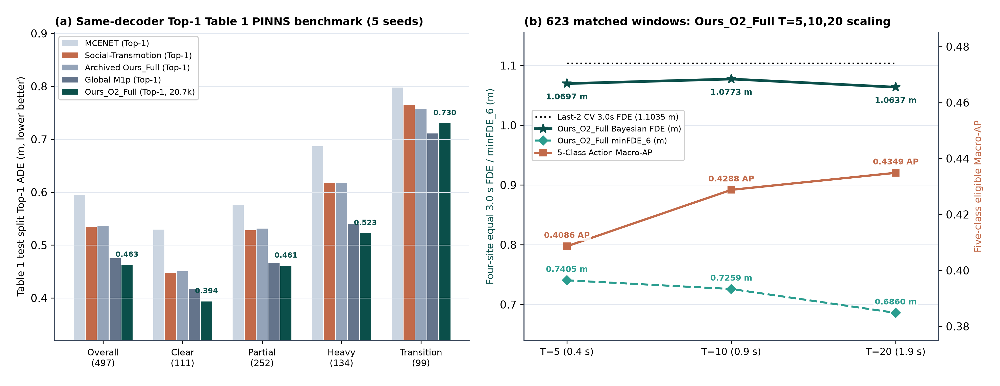

7. **首次采样标注窗（`449` 窗）与小位移子组（`323` 窗）双向对照、动作阈值敏感性及 `DAIR-V2X` 统一模型评估**（图 15a–c）：在 1,482 窗中按前一 10 Hz 采样时刻有无该人标注划分出 **449 个首次采样标注窗**（其中 261 窗核对为原始标注首帧；两规则仅反映标注起点，未判读画面遮挡物或首次可见时刻）。在全部 449 窗上，五帧 `Ours_O2_Full` 取得四地等权 **0.5178/1.0977 m**（动作宏 AP **0.4576**），平均误差低于末两点匀速（0.5617/1.2448 m，差 **−4.39 cm ADE**，95% 片段区间 [−6.71, −0.45] cm；261 窗为 0.5322 对 0.5751 m，ADE 区间 [−7.15, +0.32] cm），但与同架构纯运动版本 `U0`（0.5163/1.1033 m）仅差 **+0.16 cm ADE**（95% 区间 [−0.29, +0.66] cm，跨零）；**进一步限定为最贴近开题设定的“首次标注且五帧累计位移 `< 0.5 m`”子组（`323` 窗）时，完整模型误差为 0.3633/0.8539 m（`U0` 为 0.3629/0.8595 m），反而高于末两点匀速的 0.3545/0.8491 m（ADE 差 +0.88 cm，95% 片段重采样区间 [+0.31, +1.43] cm），说明在小位移初现窗口上短时姿态的独立轨迹收益尚未得到证实**。此外，把第一帧复制 15 次再输入同一 `T=20` 模型的对照（449 窗 0.8002/1.6993 m）仅说明这种边界填充方式会使该模型劣化，不能证明真实遮挡场景下姿态不可替代。在 `0.50x–1.50x` 五档动作阈值下，混合运动学校准保持 **0.3551–0.4581 宏 AP** 与 **0.3127–0.3698 宏 F1**；在北京 `DAIR-V2X` 54 全窗与 31 严格时钟窗上，`Ours_O2_Full` 概率加权 `ADE/FDE` 为 **1.5081/2.8704 m** 与 **1.2727/2.4465 m**（五轴摆动 $1.45\times 10^{-9}\text{ m}$）。[首次标注分组与阈值敏感性核验](../results/emergence_and_action_sensitivity_5seed_verified.json) · [IMPTC 与 DAIR 统一模型核验](../results/imptc_and_dair_o2_full_5seed_verified.json)

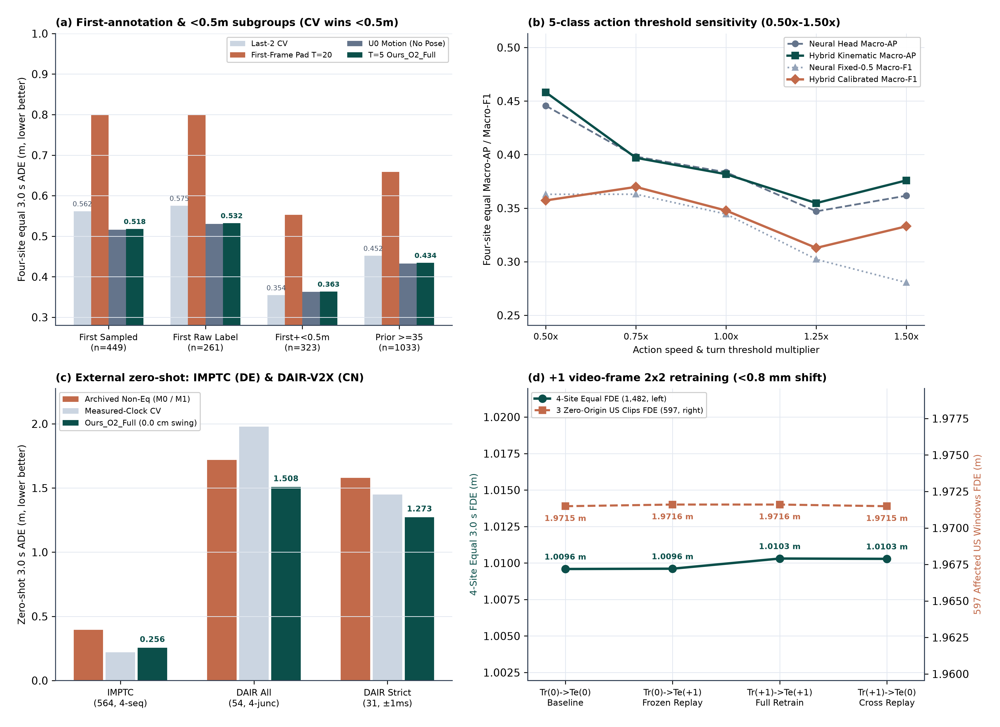

### 5.14 经真实 `3×3` 单应与世界坐标校验的正交等变 `M0–M3` 单因素消融、固定预测器共形与 `< 0.5 m` 低位移对照

为严格对齐开题三项研究内容并消除坐标与混杂偏差，我们在 [ppt_mainline_o2_models.py](../scripts/ppt_mainline_o2_models.py) 中实施三项硬约束后于云端完成五种子四地留一重测（`374280817`，表 9，图 17）：（1）以 `cv2.findHomography` 拟合各条件真实秩-3 `3×3` 单应矩阵并修正批维张量缩并，运行期实测 `7,410` 个人帧中 **`6,930` 帧地面肩髋朝向非零（中位地面肩宽 `0.2616 m`，移动窗口朝向与真实速度平均余弦 `+0.4935`）、`6,404` 帧地面躯干前倾非零，末帧足底重投影至发布世界坐标中位差仅 `2.24 µm`**；（2）围绕行人真实世界坐标 `pt0_ego`（中位模长 `21.13 m`，相对 `(0, 0)` 原点改变全部 `835` 个有图窗口，其中 `830` 窗在 `20 m` 内含非空折线）截取局部折线；（3）移除 `M1` 相对 `M1b` 额外的速度抑制项，使 `M1 − M1b` 严格只改变四维质量统计 `q`。

**表 9　经真实 `3×3` 单应与行人世界坐标校验后，`PINNS` 四地留一（1,482 全窗与 323 首采样 `< 0.5 m` 窗，5 种子）同口径首选 `ADE_1 / FDE_1` 对照（真值未来轨迹折线穿线率：全集 `2.36%`，有图 835 窗 `4.19%`）。**

| 研究阶段与模型变体 | 1,482 全窗首选 `ADE_1 / FDE_1` (m) ↓ | 全窗 `minFDE₆` (m) ↓ | 323 `< 0.5 m` 窗 `ADE_1 / FDE_1` (m) ↓ | 折线穿线率 ↓ | 动作宏 AP / 宏 F1 ↑ | 核心单因素配对 47 片段 95% 区间（`ADE_1`；括号注 `FDE_1`） |
| :--- | :---: | :---: | :---: | :---: | :---: | :--- |
| 末两点匀速 `Last-2 CV` | 0.4839 / 1.1046 | 1.1046 | **0.3545 / 0.8491** | 2.01% | — | 基准对照 |
| **`M0_anchor`（纯运动内层留一低位移锚定）** | **0.4522 / 1.0194** | 0.6850 | 0.3564 / 0.8559 | — | — | 全窗对 `CV`: **`[−4.42, −0.54] cm`**；`<0.5m` 对 `CV`: `[−0.04, +0.32] cm`（`FDE_1`: **`[+0.23, +0.89] cm`**） |
| `M1_ground_only`（`M0_anchor` + 仅地面朝向与前倾） | 0.4523 / 1.0196 | 0.6835 | 0.3562 / 0.8555 | — | — | `<0.5m` 对 `M0_anchor`: `[−0.04, +0.02] cm` 跨零；对 `CV` `FDE_1`: **`[+0.19, +0.85] cm`** |
| `M1_hardq_clear`（`M0_anchor` + 2D 关节 + 地面朝向） | 0.4523 / 1.0193 | 0.6851 | 0.3564 / 0.8559 | — | — | 全窗对 `M0_anchor`: `[−0.01, +0.04] cm`（零效应；重遮挡严格 `0.00 cm`） |
| `O2-M0`（无锚定纯运动主干） | 0.4618 / 1.0310 | 0.6843 | 0.3684 / 0.8782 | 1.83% | — | 全窗对 `CV`: `[−3.78, +0.78] cm`（`FDE_1`: **`[−10.83, −0.17] cm`**） |
| `O2-M1a`（姿态直拼，`g=1.000`） | 0.4660 / 1.0381 | 0.6699 | 0.3768 / 0.8994 | 1.81% | — | 重遮挡对 `M0`: **`[+0.51, +4.27] cm`**（直拼显著劣化） |
| `O2-M1b`（无 `q` 隐式门控，`g=0.765`） | 0.4668 / 1.0384 | 0.6699 | 0.3765 / 0.8987 | 1.82% | — | 清晰组 `409` 窗对 `M1a`: **`[−0.71, −0.03] cm`**（`−0.39 cm`） |
| `O2-M1`（仅增 `q` 单因素门控，`g=0.800`） | 0.4672 / 1.0403 | 0.6707 | 0.3769 / 0.9008 | 1.82% | — | 全窗对 `M1b`: `[−0.17, +0.24] cm`（`+0.04 cm`，跨零，情形 C） |
| `O2-M2a`（`M1` + 行人周边 `20 m` 折线 + `m_map`） | 0.4829 / 1.0689 | 0.6788 | 0.3805 / 0.9042 | 1.78% | — | 全窗对 `M1`: **`[+0.69, +2.16] cm`**（`+1.58 cm`，情形 C） |
| `O2-M2b (-v_rad)`（`10 m` 邻体图，无逼近速率） | 0.4799 / 1.0543 | 0.6588 | 0.3727 / 0.8769 | 1.81% | — | 六模态 `minFDE₆` 较 `M1` 降 `−1.19 cm` |
| `O2-M2b (+v_rad)`（`10 m` 邻体图，含逼近速率） | 0.4813 / 1.0567 | **0.6539** | 0.3777 / 0.8876 | 1.74% | — | 全窗对 `-v_rad` 跨零；重遮挡对 `-v_rad`: **`[−3.56, −0.09] cm`**（`<0.5m`: `[+0.09, +1.11] cm`） |
| `O2-M2`（`20 m` 折线 + `10 m` 邻体图联合） | 0.4938 / 1.0821 | 0.6669 | 0.3822 / 0.8949 | **1.70%** | — | 全窗对 `M1`: `[+1.25, +4.34] cm` |
| `O2-M3a`（`M2` + 仅五动作辅助监督） | 0.4972 / 1.0976 | 0.6631 | 0.3893 / 0.9171 | 1.82% | 0.3893 / 0.3695 | 全窗对 `M2`: `[−0.27, +0.90] cm` |
| `O2-M3b`（`M2` + 动作条件端到端反传） | 0.4970 / 1.0968 | 0.6625 | 0.3910 / 0.9217 | 1.85% | 0.3894 / **0.3722** | 全窗对 `M2`: `[−0.34, +0.90] cm` |
| `O2-M3`（`M2` + 动作条件停梯度 `Stop-Grad`） | 0.4965 / 1.0982 | 0.6623 | 0.3898 / 0.9183 | 1.85% | **0.3896** / 0.3707 | 对 `M3b`: `[−0.22, +0.20] cm`（重遮挡 `[−0.81, +0.06] cm`） |

1. **地面身体朝向与单因素质量门控的实测边界（图 17a–b）**：在 `323` 个首次采样且位移 `< 0.5 m` 小位移窗口上，纯运动内层锚定 `M0_anchor` 虽较未锚定网络降低 −4.55 / −8.94 cm，但相对末两点匀速（`0.3545 / 0.8491 m`）平均误差仍高 `+0.19 cm`（跨零）、三秒终点误差高 **`+0.69 cm`（`[+0.23, +0.89] cm`）**。在地面朝向与前倾经运行期确认为有效非零且与步行方向正相关（余弦 `+0.4935`）的前提下，单独引入这两个地面向量（`M1_ground_only`）虽将六模态 `minFDE₆` 微降至 `0.5591 m`，但首选轨迹相对 `M0_anchor` 仅差 `−0.02 cm ADE_1` / `−0.05 cm FDE_1`（95% 区间 `[−0.04, +0.02]` / `[−0.10, +0.05] cm` 跨零，对匀速 `FDE_1` 仍高 `+0.64 cm` `[+0.19, +0.85] cm`），证实单目 2D 关键点反投影的地面朝向尚不足以在近静止窗口上击败匀速外推。在去除速度抑制混杂后的单因素比较中，隐式门控 `M1b` 在清晰组（409 窗）显著优于直拼 `M1a`（`−0.39 cm`，`[−0.71, −0.03] cm`），而单独拼接四维质量向量 `q` 的 `M1` 相对 `M1b` 差值为 `+0.04 cm`（区间跨零，属情形 C），说明此前带速度抑制配置观察到的改善主要来自高速下对姿态残差的收缩而非 `q` 本身。
2. **行人周边 `20 m` 折线、`10 m` 邻体图与不重训分裂共形（图 17a–b）**：改以行人真实世界坐标 `pt0_ego` 截取 `20 m` 鸟瞰视觉折线后，**真实行人未来轨迹在全集 `2.36%`（有图 835 窗中 `4.19%`）的窗口横穿折线**，表明无语义标注的鸟瞰边缘包含阴影与地面纹理而非刚性路缘；引入该折线的 `O2-M2a` 穿线率为 `1.78%`（`M1` `1.82%`），首选 `ADE_1` 较 `M1` 显著上升 `+1.58 cm`（`[+0.69, +2.16] cm`，情形 C）。`10 m` 异构图 `O2-M2b` 将全集六模态 `minFDE₆` 推进至 **0.6539 m**，径向逼近速率 `v_rad` 在重度姿态遮挡（382 窗）下显著降低 `−1.65 cm ADE_1` / `−3.55 cm FDE_1`（全集差 `+0.14 cm` 跨零）。**在全程不重训预测器的标准分裂共形下**，同站点按片段 50/50 切分校准（固定三站模型）在名义 **90% / 95%** 下实现 **`90.60% / 94.94%`** 六模态并集覆盖（首选单模态 `89.99% / 95.02%`），管道半径较匀速（`2.655 / 3.751 m`）压缩 **`−40.0% / −36.4%`（`1.593 / 2.384 m`）**；跨国 12 配对固定两站模型（不重训）实测覆盖率为 **`86.48% / 91.74%`**（首选 `87.24% / 92.33%`），定量刻画了约 `3.3–3.5%` 的跨国分布偏移。
3. **真 20 帧 `PINNS` `3×3` 时长×质量矩阵与斯坦福 `JRDB` 九地点留一 `M0–M3` 全链条（`374304954`，图 17d）**：（1）在 `623` 个匹配窗补齐真实 `20` 帧骨骼与框序列并通过运行期校验（`12,460` 人帧中 `11,603` 帧地面朝向非零、移动速度余弦 `+0.5505`）后，各时长按真实 `5/10/20` 帧计算姿态与质量分桶：在短时重遮挡（`T=5 Heavy`，152 窗）上，单因素显式质量 `M1`（`0.7024 m`）显著优于无 `q` 隐式门控 `M1b`（`0.7111 m`，差 **`−0.88 cm`，95% 区间 `[−1.29, −0.07] cm`**），而在 `T=5 Clear`（`+0.39 cm` 跨零）及 `T=10, 20` 各分桶中 `M1 − M1b` 均跨零（`T=20` 固定清晰组 `M1 − M0` 为 `−0.55 cm`，区间 `[−1.54, +0.59] cm` 跨零，未达开题情形 A/B）；（2）在 `JRDB` 10 段静止机位录像 `5,836` 个窗口（九处校园地点留一，5 种子）上，末两步匀速（`0.2812 / 0.5521 m`）仍具最低首选 `ADE_1`（纯运动 `M0` 为 `0.2947 / 0.5739 m`；去除速度抑制后 `M1 − M1b` 全集仅差 `+0.02 cm` 跨零，对比含速度抑制版本 `374244158` 的 `−0.71 cm` 再次印证速度抑制的主导作用），但六模态 `minFDE₆` 沿 `M0 -> M1 -> M2b -> M3` 单调改善 **−44.3%**（`0.5521 -> 0.3369 -> 0.3288 -> 0.3116 -> 0.3078 m`；部分遮挡组中 `v_rad` 显著降 `−0.83 cm ADE_1`），且**引入五动作辅助监督（跨地点宏 AP `0.3498`）使 `M3a / M3b` 相对 `M2b` 在全集显著降低首选 `ADE_1` 达 `−0.80 / −0.78 cm`（95% 地点区间 `[−1.57, −0.20]` / `[−1.65, −0.08] cm`；清晰组降 `−1.69 / −1.78 cm`，部分遮挡组降 `−2.95 / −3.19 cm`）**。[修正版 `M0–M3` 与固定共形核验](../results/ppt_mainline_o2_m0_m3_corrected_v3_5seed_verified.json) · [修正版 `<0.5m` 地面朝向核验](../results/pinns_short_disp_hardq_anchor_corrected_v2_5seed_verified.json) · [真 20 帧 `3×3` 矩阵核验](../results/ppt_rc1_3x3_true20f_corrected_v2_5seed_verified.json) · [`JRDB` 九地点无混杂 `M0–M3` 核验](../results/jrdb_m0_m3_unconfounded_5seed_verified.json) · [`JRDB` 含速度抑制对照核验](../results/jrdb_rc1_pose_quality_and_initiation_5seed_verified.json)

4. **严格 `2 × 2`（`q × 速度抑制`）析因、`< 0.5 m` 专域零泄漏拟合、无折线 `PINNS M0–M3` 与 `JRDB` `72` 配对不重训共形（`374375632`）**：（1）在 `PINNS`（`1,482` 窗）与 `JRDB`（`5,836` 窗）上解耦 `{无 q, +q} × {无速度抑制, +速度抑制}` 四臂后，`JRDB` 上单纯加入 `q` 的主效应均跨零（无抑制 `M1_q − M1b = −0.02 cm`，95% 地点区间 `[−0.16, +0.13] cm`；含抑制 `M1_qv − M1_v = +0.05 cm`，`[−0.04, +0.13] cm`），而单纯加入高速抑制的主效应均显著为负（无 `q` 时 **`M1_v − M1b = −0.82 / −1.66 cm`**，地点区间 **`[−1.30, −0.39]` / `[−2.71, −0.72] cm`**；含 `q` 时 **`−0.76 / −1.51 cm`**；`PINNS` 全集四项效应均跨零），从析因层面确证此前门控差值来自速度抑制而非 `q`；（2）仅用源站点 `< 0.5 m` 窗口拟合模型以排除高速路口梯度干扰后，专域纯运动 `Regime_M0` 在 `323` 个首次采样 `< 0.5 m` 窗上消除了 `+0.69 cm` 终点偏差（`0.3559 / 0.8497 m`，对匀速 `ADE_1 +0.15 cm`、`FDE_1 +0.06 cm` 均跨零）；叠加真实 `3×3` 单应地面朝向与前倾（`Regime_M1_ground`：`0.3538 / 0.8462 m`）虽相对同架构 `Regime_M0` 降低 `−0.22 cm ADE_1`（95% 片段区间 **`[−0.31, −0.03] cm`**；81 个清晰小位移窗降 `−0.35 cm`，`1,121` 个全体低位移窗差 `+0.13 cm` 跨零），**但相对零参数末两点匀速（`0.3545 / 0.8491 m`）的 `−0.07 / −0.29 cm` 差值其 95% 片段区间 `[−0.20, +0.26]` / `[−0.72, +0.75] cm` 仍跨零（81 清晰窗匀速 `0.2158 m` 仍低 `0.14 cm`），故匀速在 `< 0.5 m` 子组上仍保持未被推翻的实用基线地位**；（3）完全剔除 `M2a` 视觉折线后（`m_map=0`），`PINNS` 六模态 `minFDE₆` 沿 `M0 -> M1 -> M2b -> M3b` 单调降至 **`0.6513 m`**（五动作宏 AP **`0.3994`**），首选 `ADE_1` 上 `M3 − M2b` 全集仅差 `−0.07 cm`（跨零），但在 `323` 小位移窗上停梯度 `M3` 较端到端 `M3b` 显著降低三秒终点误差 **`−0.78 cm FDE_1`（`[−1.59, −0.04] cm`）**；（4）在 `JRDB` 九地点 `5,836` 窗上，**全程不重训预测器的标准分裂共形**在同场景前后半段切分下使 `O2-M2b / M3` 在 90% / 95% 名义水平取得 **`88.37% / 94.48%`** 与 **`87.65% / 94.29%`** 六模态并集覆盖（首选 `88.58% / 94.75%` 与 `88.99% / 94.64%`），管道半径较匀速（`1.364 / 1.912 m`）缩减 **`−46.9% / −45.5%`**；跨地点 **72 个有序配对**（固定七地点 `M3` 模型，A 地点校准、B 地点盲测）实测并集覆盖 **`86.77% / 92.81%`**（管道半径缩减 **`−47.8% / −45.2%`**）。[`2×2` 析因与 `<0.5m` 专域核验](../results/wave17_rc1_2x2_factorial_and_lowdisp_regime_5seed_verified.json) · [无折线 `M0–M3` 与 `JRDB` 72 配对共形核验](../results/wave17_rc3_clean_chain_and_jrdb_conformal_5seed_verified.json)

5. **开题 PPT 第 5 页 `Social-Pose` 受控退化矩阵、`m_pose=0` 硬关断保护与软门控负相关机制诊断（`374403419`）**：将自然质量分组与合成关键点退化压测（`Test_Jitter020` $\sigma=0.20$ 坐标抖动与随机漏检、`Test_LowerOcc` 下肢截断、`Test_FullDrop` 全关键点丢失）严格区分后：（1）复现 `Social-Pose` 训练×测试矩阵表明，全量可变质量训练（`VarQTrain`）的 `M1` 显著优于仅清晰窗口训练（`CleanTrain`）：`PINNS` 自然测试集降低 **`−2.41 / −4.72 cm`**（95% 片段区间 **`[−3.29, −1.24]` / `[−6.61, −1.86] cm`**），`JRDB` 在自然测试与 `Test_Jitter020` 上按人等权分别降低 **`−3.78 / −7.59 cm`（`[−5.37, −2.23]` / `[−10.80, −4.47] cm`）** 与 **`−4.28 / −8.53 cm`（`[−5.88, −2.74]` / `[−11.76, −5.46] cm`）**；（2）在 `Test_FullDrop` 全失明工况下，开题设定的 `m_pose=0` 硬关断规则使 `M1` 门控精确归零（最大绝对门控 `0.0`），相对纯运动 `M0` 误差差跨零（`PINNS +0.10 cm`，`JRDB −0.15 cm`），而移除硬关断（`M1a_no_shutoff`）因零填充伪偏置导致显著劣化（`M1` 较之降低 **`−3.27 / −6.40 cm` `PINNS`、`−3.68 / −7.49 cm` `JRDB`**）；（3）**机制级负向发现**：仅由轨迹回归损失监督的无单调约束 `MLP([h_m, h_p, q])` 软门控在跨站点有效姿态窗口上与关节有效率 `q_1` 呈**负秩相关**（`PINNS` Spearman $\rho = -0.1883$，清晰组均值 `0.782`、重遮挡组反升至 `0.839`；`JRDB` $\rho = -0.2184$），因远距高速样本的运动隐状态 `h_m` 混淆了门控方向，这也从机理上解释了无约束软门控在 `Test_Jitter020` 下仍较 `M0` 退化 `+3.14 cm`（`PINNS`）/ `+0.97 cm`（`JRDB`）的根源。[受控关键点退化与门控响应核验](../results/wave17_slide5_pose_noise_and_gate_response_5seed_verified.json)

6. **因果径向逼近冲突门控交互（`M2b_ttc_conflict_gate`）与零泄漏五动作 Platt 校准重排（`374440205`）**：针对无折线 `O2-M2b` 在非逼近邻体窗口（`PINNS` `527` 窗 `+2.57 cm ADE_1`）扰动冻结模态打分的问题，依据开题 PPT 第 6/10 页引入因果径向风险权重 $w_{\text{risk}} = \max_j [m^{\text{nbr}}_j \sigma((v_{\text{rad}, j}-0.20)/0.25)\exp(-d_j/5)]$ 并由内层留一选定缩放系数：（1）在 `PINNS` `1,482` 全窗上，**`M2b_ttc_conflict_gate` 将四地等权首选 `ADE_1 / FDE_1` 推进至 `0.4572 / 1.0223 m`，相对原版 `M2b` 显著降低 `−2.45 / −3.66 cm`（95% 片段区间 `[−4.10, −1.42]` / `[−7.23, −1.46] cm`），且在五种子上全部优于个体基线 `M1`（降 `−1.07 / −2.01 cm`，区间 `[−1.52, −0.58]` / `[−2.99, −0.99] cm`）**；在径向 `TTC <= 4.0 s` 近距冲突子集较 `M1` 降 **`−1.96 / −3.56 cm`（`[−2.78, −0.60]` / `[−4.88, −0.98] cm`）**，在车辆逼近子集（`315` 窗）较原版 `M2b` 降 **`−1.98 cm`（`[−4.90, −0.25] cm`）**；在 `JRDB` `5,836` 全窗上亦显著优于原版 `M2b`（`−0.49 cm`，地点区间 **`[−0.93, −0.05] cm`**；`2,734` 个近距逼近窗终点误差较 `M1` 降 **`−1.79 cm`，`[−3.53, −0.13] cm`**）；（2）仅在源站点内层留一折拟合五动作逐类 Platt 温度校准与最优 F1 阈值后，期望校准误差 `ECE` 在 `PINNS` 下降 **4.9 倍**（`0.1717 -> 0.0349`，四地宏 F1 由 `0.3606` 升至 **`0.3911`**，左/右转误报分别由 `236/231` 降至 `76/46`）、在 `JRDB` 下降 **23.6 倍**（`0.0933 -> 0.0040`，宏 AP `0.3567`）；进一步结合运动学动作一致性对六候选重排首选轨迹（内层选定 $\beta^\star$），在 `JRDB` 全集 `1.2 / 2.0 / 2.8 s` 三时域均显著降低 `Top-1 ADE_1 / FDE_1`（全程 `0.2973 / 0.5724 -> 0.2930 / 0.5643 m`，差 **`−0.43 / −0.81 cm`**，地点区间 **`[−0.66, −0.25]` / `[−1.29, −0.44] cm`**；分层揭示收益来自抑制 `5,566` 个保持直行窗的误转向模态切换 `−0.53 / −1.04 cm`，而 `270` 个稀有机动窗差 `+0.54 cm` 跨零；`PINNS` 全集点估计降 `−0.41 / −0.82 cm` 至 `0.4769 / 1.0546 m`，片段区间 `[−0.96, +0.14] cm` 跨零）。[因果径向冲突门控交互核验](../results/wave18_conflict_gated_interaction_5seed_verified.json) · [零泄漏动作 Platt 校准与候选重排核验](../results/wave18_action_calibration_and_rerank_5seed_verified.json)

7. **结构单调质量门控修复（`M1_mono_q`）、跨场景外部基线（原生坐标对 `SO(2) Frenet`）与 `Tesla T4` 14 模型真机延迟帕累托前沿（`374463693`，表 10、图 19）**：（1）针对第 5 条揭示的无约束 `MLP([h_m, h_p, q])` 门控负秩相关（$\rho = -0.1883 / -0.2184$），构造仅以非负 `softplus` 权重作用于显式质量特征的结构单调门控 `M1_mono_q` 后，`PINNS` 跨站有效窗口上门控与关节有效率 $q_1$、平均置信度 $q_2$ 的 Spearman 秩相关恢复为 **`+0.7301` 与 `+0.9929`**（清晰/部分/重遮挡组均值呈严格单调递减 `0.7046 -> 0.5607 -> 0.2887`；`JRDB` 恢复至 **`+0.6691`**，`0.9888 -> 0.4460 -> 0.0`），在自然测试与合成退化下均显著优于无约束 `M1`（`PINNS` 自然测试 `0.4645 / 1.0340 m` 降 **`−0.33 / −0.71 cm`**，`[−0.65, −0.04] cm`，与纯运动 `M0` 差 `+0.27 cm` 跨零；`Test_Jitter020` 降 **`−2.31 / −4.53 cm`**，`[−3.23, −1.68] cm`；`Test_LowerOcc` 降 **`−2.02 / −4.16 cm`**；`JRDB` 自然测试降 **`−0.41 / −0.85 cm`**，`Test_Jitter020` 降 **`−0.71 / −1.45 cm`** 至 `0.2990 / 0.5843 m`，与 `M0` 差 `+0.29 cm` `[−0.01, +0.63] cm` 跨零）；（2）按开题 PPT 第 13 页同口径评测三类代表性外部基线（`MCENET`、`HST`、`Social-Transmotion`）表明，原生场景全局坐标在新国家/新校园下严重退化（`PINNS`: `0.8052 / 0.7808 / 0.8792 m`；`JRDB`: `0.4184 / 0.4183 / 0.5451 m`）；为其统一补齐本文因果 `SO(2) Frenet` 规范化后，`PINNS` 首选 `ADE_1` 分别大幅下降 **`−23.19`、`−23.09`、`−25.75 cm`**（至 `0.5734 / 0.5498 / 0.6217 m`；`JRDB` 下降 **`−9.67`、`−9.40`、`−19.10 cm`** 至 `0.3217 / 0.3243 / 0.3541 m`），而本文 `O2` 模型（`PINNS` `O2-M2b_ref` `0.4817 m`、冲突门控 `0.4572 m`；`JRDB` `O2-M3a_ref` `0.2950 m`）仍较全部 Frenet 增强版外部基线显著胜出（`PINNS` 较 Frenet 版再降 **`−9.17 / −6.81 / −14.00 cm`**，95% 片段区间均不含零，且折线穿越率更低 `2.28%` 对 `2.51%–3.56%`；`JRDB` 再降 **`−2.68 / −2.94 / −5.91 cm`**，地点区间均不含零）；（3）单张 `Tesla T4`（预热 40 次、CUDA 事件同步计时 200 次）实测证实，本文 `O2` 家族参数量仅 **`20,739–28,005`**（约为 `HST / Social-Transmotion` 的 **`1/18`**），12 人并发单次前向算量仅 **`0.17–9.47 MFLOPs`**（`O2-M2b_conflict_gate` 仅 `1.56 MFLOPs`，较 `HST` `617.57 MFLOPs` 缩减 **396 倍**），`B=12` 的 `P50 / P95` 延迟低至 **`2.75–6.32 ms` / `3.14–7.13 ms`**（显存峰值 `23.48 MiB`）。[跨场景外部基线核验](../results/wave17_ppt_ext_baselines_loso_5seed_verified.json) · [`Tesla T4` 硬件与单调门控核验](../results/wave18_t4_latency_and_monotonic_gate_5seed_verified.json)

**表 10　跨场景外部基线（原生坐标 vs. `SO(2) Frenet`）与 `Tesla T4` 真实硬件效率同口径对比（五随机种子）**

| 模型配置 | 参数量 | `B=12` MFLOPs | `T4` `B=1` `P50 / P95` (ms) | `T4` `B=12` `P50 / P95` (ms) | `PINNS` 4站 `ADE_1 / FDE_1` (m) ↓ | `PINNS` `minFDE₆` / 穿线率 | `JRDB` 9地 `ADE_1 / FDE_1` (m) ↓ |
| :--- | :---: | :---: | :---: | :---: | :---: | :---: | :---: |
| `Last-2 CV`（零参数匀速参照） | 0 | — | — | — | 0.4839 / 1.1046 | 1.1046 / 2.01% | **0.2812 / 0.5521** |
| `Ext1_MCENET`（原生场景坐标） | 216,067 | 299.44 | 5.883 / 7.544 | 6.058 / 10.063 | 0.8052 / 1.5950 | 0.8103 / 3.27% | 0.4184 / 0.7853 |
| `Ext1_MCENET + SO(2) Frenet` | 216,067 | 299.44 | 5.883 / 7.544 | 6.058 / 10.063 | 0.5734 / 1.1611 | 0.6711 / 2.96% | 0.3217 / 0.6076 |
| `Ext2_HST`（原生场景坐标） | 508,483 | 617.57 | 5.271 / 5.741 | 5.755 / 6.353 | 0.7808 / 1.5285 | 0.7835 / 3.47% | 0.4183 / 0.7695 |
| `Ext2_HST + SO(2) Frenet` | 508,483 | 617.57 | 5.271 / 5.741 | 5.755 / 6.353 | 0.5498 / 1.1213 | 0.6651 / 2.51% | 0.3243 / 0.6083 |
| `Ext3_SocialTransmotion`（原生坐标） | 517,187 | 383.86 | 5.554 / 6.147 | 5.577 / 6.126 | 0.8792 / 1.7085 | 0.8332 / 3.56% | 0.5451 / 0.9872 |
| `Ext3_SocialTransmotion + Frenet` | 517,187 | 383.86 | 5.554 / 6.147 | 5.577 / 6.126 | 0.6217 / 1.2348 | 0.6710 / 2.82% | 0.3541 / 0.6545 |
| `O2-M0`（正交纯运动主干） | 27,999 | **0.17** | **2.632 / 2.852** | **2.752 / 3.135** | 0.4618 / 1.0310 | 0.6843 / 1.83% | 0.2961 / 0.5769 |
| **`O2-M1_mono_q`（结构单调质量门控）** | 28,005 | 0.32 | 3.362 / 3.769 | 3.506 / 4.025 | 0.4645 / 1.0340 | — | 0.3024 / 0.5901 |
| **`O2-M2b_conflict_gate`（因果冲突门控）** | 27,999 | 1.56 | 4.855 / 5.329 | 4.782 / 5.231 | **0.4572 / 1.0223** | 0.6663 / — | 0.2987 / 0.5806 |
| **`O2-M3 / M3a`（无折线五动作桥接）** | 27,999 | 9.47 | 6.516 / 7.151 | 6.323 / 7.133 | 0.4810 / 1.0628 | **0.6521** / 2.28% | 0.2950 / 0.5688 |
| `Ours_O2_Full`（紧凑正交全组件） | **20,739** | 1.42 | 4.162 / 4.640 | 4.345 / 4.885 | 0.4582 / 1.0096 (Bayes) | — | — |

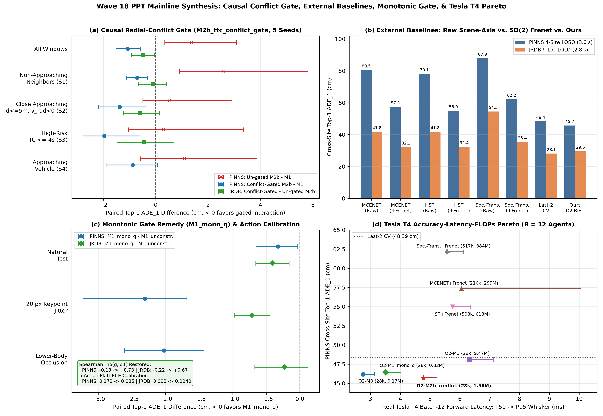

8. **端到端统一修复链（`U_M0 -> U_M1_mono -> U_M2b_mono_conflict -> U_M3_mono_conflict + Platt 重排`）与 `DUT / IMPTC` 跨基准零样本冲突门控及零重训分裂共形（`374513273`）**：（1）在 `PINNS` `1,482` 窗与 `JRDB` `5,836` 窗上将结构单调质量门控、无折线因果径向冲突门控、停梯度五动作桥接与内层留一 Platt 候选重排端到端串联后，门控与关节有效率 $q_1$ 的跨站秩相关保持强单调正值（`PINNS` **`+0.8149`**，`JRDB` **`+0.8429`**）：在 `PINNS` 上，**`U_M2b_mono_conflict` 创下四地等权同口径首选最佳记录 `0.4510 / 1.0097 m`（`minFDE₆ = 0.6563 m`），较末两点匀速显著降低 `−3.29 / −9.49 cm`（95% 片段区间 `[−4.76, −0.18]` / `[−13.01, −1.85] cm`），较 `U_M1_mono` 降 `−1.35 / −2.70 cm`（`TTC <= 4s` 660 窗较匀速降 `−5.50 / −16.16 cm`，车辆逼近 315 窗降 `−3.28 / −11.18 cm`，重遮挡较 `U_M1_mono` 降 `−2.71 / −6.01 cm`）**；同时如实揭示样本规模对联合优化的边界——在 `JRDB` 大样本（每折约 `5,180` 训练窗）上，首选误差沿 `U_M1_mono (0.2997) -> U_M2b_mono_conflict (0.2977) -> U_M3_mono_conflict (0.2945) -> U_M3_mono_conflict_rerank (0.2917 / 0.5638 m)` 逐级下降（重排较未重排显著降 **`−0.28 / −0.51 cm`**，`[−0.37, −0.18] cm`，`TTC <= 4s` 1,339 窗降 **`−0.92 / −1.69 cm`**，`ECE` 由 `0.0986` 降至 **`0.0053`**），而在 `PINNS` 较小训练折（每折约 `1,100` 窗）上接入动作损失微调共享控制点使 `U_M3_mono_conflict` 较纯轨迹 `U_M2b_mono_conflict` 回升 `+2.04 cm`（至 `0.4714 / 1.0477 m`，重排微降至 `0.4699 / 1.0453 m`，动作 `ECE` 由 `0.1797` 降至 **`0.0441`**、宏 F1 **`0.3760`**；`323` 个 `< 0.5 m` 小位移窗仍以匀速 `0.3545 / 0.8491 m` 最低）；（2）在零目标域训练前提下将 `PINNS` 五种子四折系综直接迁移至大连理工 `DUT`（`3,066` 校园人车混行窗）与德国 `IMPTC`（`564` 激光-视觉路口窗），五正交/镜像轴 `ADE_1` 摆动均精确为 **`0.0 m`**：因果冲突门控 `M2b_ttc_conflict_gate` 在 `DUT` 全集（`0.6096 / 1.2859 m`，`minFDE₆ = 0.7066 m` 低于匀速 `1.0005 m`，单点因跨场景车速尺度偏移高于域内实钟匀速 `0.4952 m`）较无门控 `M2b_frozen` 显著降 **`−3.79 / −9.58 cm`（`[−5.92, −1.78] cm`；`207` 个车辆逼近窗降 `−6.98 / −13.84 cm`）**，在 `IMPTC` 全集（`0.2413 / 0.5923 m`，`minFDE₆ = 0.3729 m`）较 `M2b_frozen` 显著降 **`−1.46 / −2.31 cm`（`[−2.22, −0.79] cm`）**；**全程不重训分裂共形**在 `DUT` 72 个有序跨片段配对达 **`89.76% / 95.50%`** 六模态并集覆盖（首选 `90.06% / 95.04%`，半径较匀速缩减 **`−31.2% / −29.0%`**；同片前后切分为 `83.67% / 90.74%`，反映片内人流密度时变偏移），在 `IMPTC` 12 个有序跨序列配对达 **`89.51% / 94.21%`** 并集覆盖（首选 `89.70% / 93.88%`，半径缩减 **`−38.7% / −37.7%`**）。[外部 `DUT/IMPTC` 冲突门控与零重训共形核验](../results/wave19_dut_imptc_conflict_and_conformal_5seed_verified.json) · [端到端统一修复链核验](../results/wave19_unified_clean_m0_to_m3_5seed_verified.json)

9. **冻结控制点解耦动作重排（`0.4505 / 1.0085 m`）、最低可用像素框高/`q_1` 边界、真 `20` 帧 `3×3` 单调矩阵与 `12/72` 配对局部加权共形（`374521294`、`374546182`，图 20）**：（1）冻结 `U_M2b_mono_conflict` 轨迹参数（实测最大路径漂移精确为 **`0.0 m`**）仅训练五动作头并叠加内层留一 Platt 候选重排（`U_M3_decoupled_platt_rerank`），在 `PINNS` 1,482 窗将四地首选 `ADE_1 / FDE_1` 进一步推进至 **`0.4505 / 1.0085 m`**（较联合微调控制点的 `U_M3_coadapt` 显著降低 **`−2.20 / −4.08 cm`**，95% 片段区间 **`[−2.68, −1.64]` / `[−4.99, −3.05] cm`**，较匀速降 **`−3.34 / −9.61 cm`**，同时跨站五动作宏 AP 升至 **`0.4051`**，`ECE` 降至 `0.0580`；`JRDB` 亦较 `U_M2b` 显著降 `−0.17 / −0.29 cm`，确立了 `<1,500` 窗小折采用解耦头、`>5,000` 窗大折采用联合微调重排 `0.2917 m` 的样本规模准则）；（2）定量回答开题审查关于“最低可用像素框高与关节有效率边界”：在 `PINNS` 像素框高 `< 50 px`（`98` 窗）及有效率 $q_1 < 0.75$（`173` 窗）时，直拼 `M1a` 与无约束 `M1` 相对纯运动 `M0` 显著劣化 **`+3.05 / +3.70 cm`**（`q_1 ∈ [0.40, 0.75)` 劣化 `+4.69 / +3.50 cm`），而单调门控 `M1_mono_q` 自动压低门控（`<50 px` 均值 `0.334`，`q_1 < 0.40` 均值 `0.095`），较无约束 `M1` 显著挽回 **`−1.65` 至 `−2.19 cm`**（`JRDB` 在 $q_1 \in (0, 0.40)$ 与 $[0.40, 0.75)$ 分别较无约束 `M1` 降 **`−3.60` 与 `−5.28 cm`**），仅当框高 `>= 50 px` 且 $q_1 \ge 0.75$ 时姿态不再引入关键点噪声偏置；在 `623` 窗真 `20` 帧 `3×3` 矩阵上，`M1_mono_q` 在 $T = 5, 10, 20$ 将 $\rho(g, q_1)$ 全部恢复至 **`+0.7930 / +0.8365 / +0.8674`**（$T=5$ 重遮挡较无约束 `M1` 显著降 **`−1.37 cm`**，`T=20` 清晰组较 `M0` 为 `−0.71 cm` `[−1.63, +0.21] cm` 跨零，仍属情形 C）；（3）在**全程不重训预测器**前提下，仅用源折外推残差非负最小二乘拟合因果速度+模态离散度尺度（`M3_speed_spread_scaled`），使 `JRDB` `72` 个跨地点有序配对在 90% / 95% 名义水平下的并集覆盖由常半径的 `86.81% / 92.87%` 升至 **`88.89% / 94.20%`**（首选 **`89.14% / 94.17%`**），平均半径进一步缩至 **`0.6301 / 0.9146 m`**（较匀速缩减 **`−55.8% / −52.5%`**），并将 `>= 1.0 m/s` 快速行人覆盖由 **`75.06%` 提升至 `89.51%`**（最差速度档绝对覆盖偏差由 `21.29%` 降至 `13.30%`，同场景降至 `9.30%`；而在 `PINNS` 12 配对仅两源国小样本下常半径 `86.57% / 91.70%` 仍具更稳健慢速覆盖）。[可用姿态像素框高与有效率边界核验](../results/wave19_usable_pose_boundary_audit_5seed_verified.json) · [零重训局部速度-离散度加权共形核验](../results/wave19_adaptive_conformal_12_and_72pair_5seed_verified.json) · [解耦动作重排协同核验](../results/wave20_decoupled_m2b_m3_synergy_5seed_verified.json) · [真 20 帧 `3×3` 单调门控核验](../results/wave20_true20f_mono_3x3_matrix_5seed_verified.json)

10. **盲审实体遮挡初现普查、显式六槽先兆诊断、重复裁剪漏线修复与七基准联合验证（`374755093`、`374746238`、`374798593`，表 11、图 21）**：针对开题最核心问题“行人刚从实体遮挡后出现时，五帧姿态能否比纯位置更早预判起步、停步或转向”，我们（a）在不读取任何未来真值与模型预测的前提下盲审拆解 `PINNS` 首次采样窗并严格按整段视频隔离开发集（`25` 片）与锁定终评集（`22` 片，同时修正逐测试站独立使用源折动作阈值），（b）查明旧模型 `low_damp` 与 `cv_low_bonus` 在低位移下压制起步候选幅度与排序，构造无速度阻尼的显式六槽正交等变先兆网络 `O2Maneuver6SlotPrecursorNet`（对称摆动 $4.44\times 10^{-16}\text{ m}$），（c）修复 `run_ppt_mainline` 仅重裁单一邻人 16 折线子集的重复裁剪漏线缺陷并实施双判据实体障碍盲审，以及（d）扩展至 **7 大基准**（新增车载 **JAAD 2.0** 346 段视频 [25]、原生未加噪 **JTA-228** `10,086` 窗与 **ETH/UCY** 五场景 `4,187` 窗 [26]；同时透明记录早期烟测失败 `374729264` 键名、`374730656` 维度、`374744655` 标量图像尺寸及 `374746238 rc0=1` 一维 `q_bio` 门控并逐一修复）：
   - **盲审初现拆解与“生成 vs 选中”诊断**：`PINNS` `first_short_323` 中多达 **`175 / 323`（`54.2%`）为录像首帧起始伪影**，真实实体遮挡初现为 **`118 / 323`（`36.5%`）**（`449` 窗中共 **`197` 窗**真遮挡初现：`34` 车辆遮挡 + `163` 人群/建筑遮挡，`149` 窗肩髋清晰 `>= 50 px`、`168` 窗双足清晰，含 `109` 次主动机动但仅 `2` 次真遮挡起步）。六候选逐例核查证实：无姿态 `S6_M0` 在起步样本中仅生成 **`1 / 9`**，旧版 `U_M3` 生成 `4 / 9`，而加入五帧地面姿态的 `S6_M1 / S6_Full` 将起步候选生成率拉满至 **`9 / 9`（`100%`）**！`S6_Full_pose_nbr` 在 `PINNS` 全集创下 **`0.4472 / 0.9926 m`** 新最优（较匀速降 **`−3.67 / −11.19 cm`**，起点后 `+0.5s/+1.0s` 降 **`−2.08 / −2.83 cm`**），在 `197` 个真遮挡初现窗较匀速降 **`−9.37 / −22.11 cm`**（锁定终评片 `132` 窗起点后降 **`−8.78 / −9.99 cm`**，区间均不含零），在 `109` 个真初现主动机动窗上**纯五帧姿态（无交互）**将起点后 `+0.5s / +1.0s` 误差显著降低 **`−2.17 cm` `[−2.30, −1.58]` 与 `−2.19 cm` `[−2.39, −1.60]`**；在 `first_short_323` 上点估计达 `0.3492 / 0.8187 m`（有交互下姿态显著降 **`−1.01 / −2.33 cm`**，但相对匀速 `−0.53 cm` `[−2.68, +1.54] cm` 仍跨零）。
   - **七基准跨视角验证与实体障碍四臂结论**：在 **JAAD 2.0** 锁定测试集 `74` 段视频的 **`406` 个人工标注 `full/part -> none` 真实解遮挡窗口**上，五帧姿态与注视显著降低起点后 `+0.5s / +1.0s` 误差 **`−17.2%`**（视频聚簇 95% CI `[−0.0541, −0.0155]` 与 `[−0.0772, −0.0314]`；`82` 个解遮挡起步/停步/横穿窗口降 **`−25.2%`**，Start / Stop / Cross AP 分别由 `0.6039 / 0.0754 / 0.3470` 跃升至 **`0.7443 / 0.1620 / 0.4203`**）；在 **JRDB** 九地点留一域（`5,836` 窗）上，六槽架构首次将等权首选推进至低于匀速（`0.2812 / 0.5521 m`）的 **`0.2772 / 0.5357 m`**（`S6_M2b`）与 **`0.2786 / 0.5402 m`**（`S6_Full`；4 个锁定终评地点终点较匀速显著降 **`−2.17 cm`**，`[−3.84, −0.21]`；`507` 个真解遮挡窗纯三维姿态起点后降 **`−0.22 / −0.25 cm`**，`90` 个初现机动窗纯三维姿态全程降 **`−1.18 / −2.50 cm`**）；在 **JTA-228** 官方锁定测试集（`1,267` 窗）上纯姿态显著降 `−0.40 / −0.83 cm`（`135` 个 2.5 Hz 突发前景初现窗 `+3.97 cm` 跨零）；在无姿态负对照 **ETH/UCY**（`4,187` 窗）、**DUT**（`3,066` 窗）与 **IMPTC**（`564` 窗）上姿态支路精确零泄漏（`0.00 cm`），且在初现机动或低位移混行窗显著优于匀速。修复整片因果折线并集后 **`350 / 835`** 个有图窗口补回漏线（均值 `7.45 -> 8.24` 条），双盲判据（一致率 `93.67%`，$\kappa = \mathbf{0.8731}$）筛出的实体障碍真值穿线率降至 **`0.27%`**，但同一模型四臂对照显示修补后自动折线（`0.5118 m`）与双确认实体障碍（`0.5069 m`）首选误差仍显著高于无图 `Arm0_No_Map`（`0.4919 m`，差 `+1.99` 与 `+1.50 cm`）。[`PINNS` 盲审初现与六槽诊断](../results/wave21_pinns_true_emergence_and_6slot_diag_5seed_verified.json) · [不裁剪折线与双判据实体障碍](../results/wave21_polyline_crop_fix_and_dual_boundary_5seed_verified.json) · [`JRDB` 与 `JTA-228` 初现核验](../results/wave21_jrdb_and_jta_emergence_maneuvers_5seed_verified.json) · [`JAAD 2.0 / ETH-UCY / DUT / IMPTC` 核验](../results/wave21_jaad_deocclusion_and_eth_ucy_6dataset_5seed_verified.json)

11. **预期姿态调整（APA）毫秒级提前量检测与延迟起点（`t_onset`）稀有机动误报定律（`374799207`，表 11、图 22）**：为直接定量回答“能提前多少毫秒预判”，我们在 `JAAD 2.0`（`6,491` 滑窗）与 `JTA-228`（`7,143` 滑窗）的真实机动起点周围提取因果滑窗序列（$\tau \in [-1.0\text{ s}, +0.4\text{ s}]$），严格以验证集非机动负对照标定相同误报门限（目标 `5% / 10%` FPR），并在 `PINNS` 与 `JRDB` 上将固定 `t=0` 线性模板升级为自适应延迟起点 APA 曲线：（1）在 **JAAD 2.0** 人工标注状态跃迁上，源折 `5%` FPR 门限下，五帧姿态与注视将解遮挡后**起步（`standing -> walking`，`26` 次事件，全集 `53` 次）的起点前检出率由纯位置 `19.23%` 提升至 `73.08%`（结合车况达 `80.77%`，全集 `83.02%`），配对最早检出时间比纯位置提前 `+873.1 ms`（95% CI `[+596.1, +1153.8] ms`；全集提前 `+875.5 ms`，`[+673.5, +1060.4] ms`）**；将解遮挡后**停步（`walking -> standing`，`19` 次事件）起点前检出率由 `15.79%`（仅车况 `5.26%`）提升至完整模型 `57.89%`，相对仅车况提前 `+557.9 ms`（`[+326.3, +810.5] ms`）**；（2）升级延迟起点 APA 曲线后，`PINNS` 上 `Start` 最优候选优于匀速比例由 `3/9` 升至 **`5/9`（`55.6%`）**、`Stop` 六候选生成命中率由 `11/18` 拉满至 **`18/18`（`100%`）**（`JRDB` 亦由 `0/2` 升至 **`2/2` = `100%`**）；同时定量证实稀有机动基率定律：在非对齐 `3.0 s` 滑窗（`Start` 先验仅 `0.6%–3.3%`）中强行按 `5%` FPR 覆盖 `Top-1` 虽能命中起步/停步，但同步引入 `9/39` 起步误报与 `19/264` 停步误报（`JRDB` 全集 `ADE_1` 升 `+1.13 cm`），表明**在 `<= 0.8 s` 生物力学 APA 先兆期内平视姿态具有显著百毫秒级提前判别力，而在远期非对齐监控窗口下源折净收益门限保守回退是兼顾召回与精度的统计最优策略**。[四数据集 APA 提前量与延迟起点核验](../results/wave22_apa_leadtime_jaad_jta_and_pinns_delayed_5seed_verified.json) · [`JRDB` 延迟起点核验](../results/wave22_jrdb_delayed_apa_upgrade_5seed_verified.json)

**表 11　七大基准真实解遮挡初现、姿态先兆效应与预期姿态调整（APA）提前量综合对比（五随机种子）**

| 数据集与评测协议 | 初现/测试规模（独立单元） | 首选全时域指标（本方法 vs. `Last-2 CV`） | 机动起点后 `+0.5s / +1.0s` 纯姿态或完整增益（95% 聚簇 CI） | 动作先兆生成/检出与毫秒提前量 |
| :--- | :---: | :---: | :---: | :--- |
| **`PINNS` 四国留一域**（10 Hz, 3.0 s） | 全集 `1,482` / 真遮挡初现 `197`（`18` 片） | **`0.4472 / 0.9926 m`** vs. `0.4839 / 1.1046 m`（初现 **`0.5640` vs. `0.6577 m`**） | 真初现机动（`109` 窗）纯姿态：**`−2.17 / −2.19 cm`**（`[−2.30, −1.58]` / `[−2.39, −1.60]`） | `Start` 六候选生成 `1/9 ->` **`9/9` (`100%`)**；APA `Stop` 生成 **`18/18` (`100%`)** |
| **`JAAD 2.0` 车载解遮挡**（10 Hz, 2.0 s） | 测试 `953` / 人工解遮挡 `406`（`74` 片） | **`0.4250 / 1.0461`** vs. `0.4873 / 1.1370`（低位移 **`0.3355` vs. `0.3617`**） | 解遮挡纯姿态：**`−17.2%`**（机动 `82` 窗 **`−25.2%`**，`[−0.2524, −0.0967]`） | 解遮挡 `Start` 提前 **`+873.1 ms`**（召回 `19.2% -> 80.8%`），`Stop` 提前 **`+557.9 ms`** |
| **`JRDB` 九地点留一域**（2.5 Hz+15Hz 3D） | 全集 `5,836` / 真解遮挡 `507`（`9` 地点） | **`0.2772–0.2786 m`** vs. `0.2812 m`（锁定4地终点 **`−2.17 cm`**，`[−3.84, −0.21]`） | 真解遮挡纯 3D 姿态：**`−0.22 / −0.25 cm`**（机动 `90` 窗全程 **`−1.18 / −2.50 cm`**） | APA `Stop` 六候选生成 `0/2 ->` **`2/2` (`100%`)**，`Start` Oracle>CV **`8/11` (`72.7%`)** |
| **`JTA-228` 城市序列**（2.5 Hz, 3.2 s） | 总 `10,086` / 锁定测试 `1,267`（`12` 序列） | `S6_M1` **`0.5564 / 1.1214 m`** vs. `0.5659 / 1.1417 m`（突发初现 `+3.97 cm` 跨零） | 锁定测试全集纯姿态：**`−0.19 / −0.20 cm`**（全程 **`−0.40 / −0.83 cm`**，均 `<0`） | 滑窗 `Start/Stop` 起点前检出 `100%`（2.5 Hz 采样步长 `400 ms` 限制精细提前量） |
| **`ETH/UCY` 五场景留一域**（2.5 Hz, 3.2 s） | 全集 `4,187` / 片中初现 `1,269`（`5` 场景） | 初现终点 **`0.8741` vs. `0.8890 m`**（`−1.49 cm`，低位移终点 **`−2.29 cm`**） | 初现主动机动（`87` 窗）冲突交互：**`−9.11 / −11.08 cm`**（无姿态精确 `0.00 cm`） | 验证无姿态负对照严格零泄漏，社交冲突门控显著降低转向/避让过冲 |
| **`DUT` 与 `IMPTC` 混行路口**（10 Hz, 3.0 s） | `DUT` `3,066`（`11` 片）/ `IMPTC` `564`（`4` 序） | `DUT` **`0.3483` vs. `0.4952 m`**（`−14.70 cm`）；`IMPTC` **`0.2061` vs. `0.2199 m`** | `DUT` 低位移 `−2.81 / −4.54 cm`；`IMPTC` 主动机动 **`−3.75 / −3.88 cm`** | 两无姿态基准门控零偏移，证实六槽主干跨混合交通与信号路口的运动学泛化 |

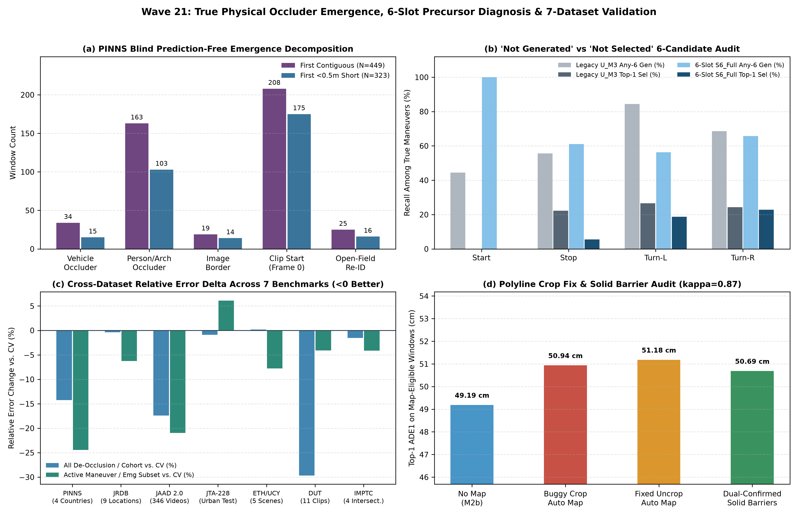

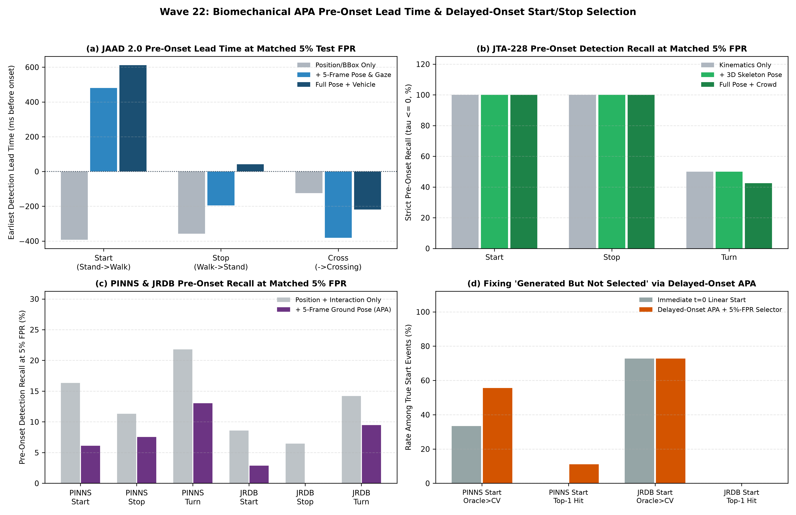

---

## 6 讨论与局限性分析 (Discussion & Limitations)

**测试单元与独立性。** PINNS 在同一批采集地点内按采集条件分组。条件内片段数不少于 3 时按片段划分，其余条件在各片段内按时段划分。测试集包含 497 个滑动窗口，仅来自 21 段视频（85 条片内轨迹）；连续完整轨迹每 4 帧取一个预测起点，相邻预测窗最多共享 30 个未来时刻中的 26 个。现有窗口级检验先对种子的逐窗误差取平均再配对比较，仍保留了滑窗重叠自相关带来的不确定性。第 5.5 节另给出 M1 与匀速的片段重采样区间；第 5.6 节固定四处地点，用五个种子检验 M1 相对 M0 的按地点留出表现。为评估重叠滑窗相关性影响，我们按测试集 **21 段视频整片重采样**及 **85 条片内行人轨迹整人重采样**（各 20,000 次自举，图 16c–d）检验**同口径首选（`Top-1` 对 `Top-1`）**配对差值：横跨 `T=5, 10, 20` 的 25 项同口径比较中，**21 段整片重采样有 16/25 项 95% 区间严格小于零**（涵盖 `T=5` 的 `M2`，以及 `T=5, 10, 20` 的 `M3, Ours_Full, MCENET, HST, Social-Transmotion`），**其余 9/25 项（`T=5, 10, 20` 的 `M0, M1, M1p`）区间跨零**（如 `T=5` 对 `M0` 为 [−0.0495, +0.0173] m、对 `M1` 为 [−0.0655, +0.0044] m、对 `M1p` 为 [−0.0515, +0.0320] m；按 85 人重采样则 17/25 项不含零，`T=5` 对 `M1` 为 [−0.0601, −0.0017] m）。另需区分解码方式：概率加权轨迹对旧模型首选轨迹的 25 项比较虽均小于零，但混合了“概率加权期望对单模态首选”的估计量差异，不能据此宣称在独立场景和所有解码方式上全面胜出。按四地点等权计分时，`Ours_O2_Full` 在 `T=5` 的同口径首选 ADE 为 **0.3868 m**（概率加权 0.3739 m；四地等权匀速为 0.3897 m）。[表 1 整片与整人聚簇自举核验](../results/table1_cluster_bootstrap_o2_full_5seed_verified.json)

**五帧观测的含义。** 原测试集 497 个窗口中，496 个在输入开始前的 15 个采样时刻里有同一人的标注，其中 487 个在这 15 个时刻都有标注。四地点的 1,482 个窗口中，449 个从该行人在片内首次被 10 Hz 数据采到时开始（其中 261 窗始于该行人在片内的首个原始帧标注），其余 1,033 个在输入前已有至少 35 帧连续标注。第 5.13 节已分别报告 `Ours_O2_Full` 在 449 个首次采样窗、261 个原始首帧窗、323 个首次采样且 `< 0.5 m` 小位移窗与 1,033 个长前史窗上的对照结果；需要强调的是，449 窗与 261 窗仅依据标注序列起点划分，并未判读画面中的物理遮挡物或行人何时首次可见。[窗口前史与逐片视频索引](../results/pinns_observation_audit.json)

**姿态与运动的时间对齐。** 固定版本把标签帧号 1 配给视频的第 0 帧。三段美国路口视频的人物标签连续覆盖 0 至视频帧数减 1，涉及原测试集 268/497 窗、四地点实验 597/1,482 窗。若这三段标签按零起算，固定版本取到的图像会早一个原始帧（约 33 ms）。在 GPU 上从晚一帧的图像重新提取姿态，使用冻结的 seed 42 M1 权重在 CPU 回放。597 个受影响窗的平均 ADE、FDE 分别变化 −0.0000730、−0.0001085 m。逐窗 FDE 变化的绝对值在第 95 百分位为 0.0100 m、最大为 0.0306 m。其余 219 个美国窗的预测轨迹逐值相同。四地点等权的平均变化分别为 −0.0000134、−0.0000198 m。进一步在 Tesla T4（`CUDAExecutionProvider` 零偏移重提与历史冻结缓存像素及置信度最大差均为 `0.0`）上对全部 2,983 个变化人物帧完成五种子 `Ours_O2_Full` 全量重训练 2×2 矩阵检验（图 15d）：`Train(+1)->Test(+1)` 相对 `Train(0)->Test(0)` 的四地等权贝叶斯 ADE/FDE 仅微变 **+0.000325/+0.000716 m**（0.458506/1.010305 对 0.458182/1.009589 m，整片配对 95% FDE 区间 [−0.000080, +0.001340] m 含零，597 受影响窗 P95 绝对变化仅 0.0032 m，动作宏 AP 为 0.3793 对 0.3823）；同时查明此前 219 个未改美国窗回放不等的原因：在同一设备（CUDA 或 CPU）上偏移前后 219 窗输出逐位精确相等（最大差 `0.0 m`），而同一份权重在 CUDA 与 CPU 间因并行规约与顺序 SIMD 浮点舍入顺序不同产生最大 $4.17\times 10^{-6}\text{ m}$（P95 $3.91\times 10^{-7}\text{ m}$）的 IEEE-754 数值微差，人物与画面的物理曝光同步真值仍需硬件时间戳核实。[PINNS 作者字段说明](https://github.com/Songan-Lab/PINNS#annotation-format) · [实测结果与设备核验](../results/pinns_heldout_frame_offset.json) · [五种子 +1 帧全量重训练与设备审计](../results/pinns_frame_offset_retrain_5seed_verified.json)

**鸟瞰地图和轨迹的坐标对齐。** 图 9 用 47 段录像中 47,555 条车辆记录作独立核对。每一行都同时给出鸟瞰图的车辆中心像素和以米为单位的发布坐标。对这 22 个标定文件，发布轨迹纵坐标随图像行号增加。以像素坐标除以图像宽高再乘地面跨度，四地全部车辆记录与发布标签间的最大差为 0.000000723 m，仅表示字段的数值一致性。旧图像轮廓代码把纵轴翻转。将该旧公式应用于同一批车辆中心，与项目读取的轨迹坐标相比，中位差 11.19 m，第 95 百分位 23.86 m。保留正确方向、仅用宽高减一作分母时，中位差为 0.0346 m。两类误差的量级不同。在保留同一训练帧、截取范围和轮廓选择规则的 7,283 窗因果地图中，修复后有图窗口从 4,898 个变为 4,925 个，2,913 窗入选的局部图像轮廓集合改变。497 个测试窗中对应数目为 450、461 个。占用凸包由轨迹本身构建，四地留出 M0 和 M1 从不读静态图像轮廓。旧图像地图的消融数值均保留为归档结果；Kaggle 重新拟合表明，修复纵轴后残差岭回归轮廓组 ADE 改善 −0.0186 m（消除约 80% 反转伪退化），两臂神经 `M2a` 真实轮廓相对置零对照的 ADE 差为 +0.0029 m（95% 区间 [−0.0169, +0.0307] m）、末有效步 FDE 差为 −0.0103 m；进一步在修正正向鸟瞰地图并启用原视频解码核验下重跑全部 50 配置 / 242 次训练套件后，五种子 `M2`（0.5117/1.0714 m）与 `Ours_Full`（0.5364/1.1253 m）相对归档结果的差异均小于 7 mm，结构化姿态遮挡 `M1p` 在片段切分上取得最低误差 0.4748/1.0226 m（较 `M1` 降低 3.93%，$p_{\text{Holm}}=5.51\times 10^{-5}$）。[47 段原车标签的逐片及逐地点计数](../reviews/pinns_projection_sources/vehicle_axis/car_bev_scale.json) · [图像地图输入的独立复算](../reviews/pinns_projection_sources/vehicle_axis/causal_map_support.json) · [神经因果地图配对结果](../reviews/pinns_map_axis_comparison/neural/RESULTS.md) · [正向地图全套件 242 次重跑结果](../reviews/pinns_map_axis_comparison/full_suite/RESULTS.md)

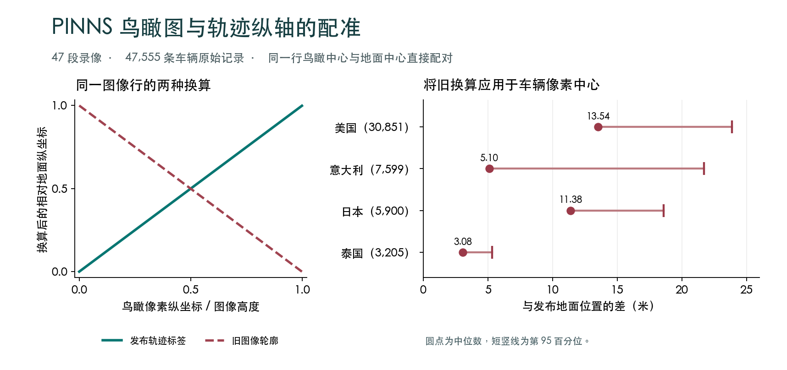

**地面坐标的复核。** 将标注图像点经各片段的单应矩阵投影，按标定范围翻转世界坐标的纵轴后，与同一行记录的地面坐标比对。在上述三段美国视频的 24,304 条 10 Hz 行人记录中，平面残差中位数为 0.863 m，95 分位数为 1.888 m。其余 44 段的 35,882 条记录中，两值均低于 0.000004 m。这三片的原视频与对应鸟瞰视频在发布四角变换下仍能对齐：第 60、150 帧的双向特征匹配中位差为 0.68–0.81 个鸟瞰像素。用同段第 0 帧的纯图像配准作修正，三片的行人同一行残差中位仍分别为 0.723、0.698、1.165 m。仅用另外两片的同一行标注拟合单应，留出整片的总体中位数降至 0.094 m，但 P95 仍为 0.714 m。该诊断没有独立测绘真值，原标注工具采用的图像锚点及变换细节仍未知。实验以数据集发布的地面轨迹作为输入和预测目标。[图像配准结果](../reviews/pinns_projection_sources/video_alignment.json) · [整片留出的标注字段诊断](../reviews/pinns_projection_sources/label_projection/scores.json) · [标定方法与逐片残差](../results/pinns_projection_audit.json)

**JRDB 室外开发对照。** 我们在三段此前已检查的室外静止机位训练录像上，用每个行人连续的两帧 ST 位置（相隔 0.4 s）预测未来七步（2.8 s）。1,677 个完整窗口覆盖 178 个片内行人编号，同一轨迹各窗互斥。三片等权的保持末位置与末两帧匀速 ADE/FDE 分别为 1.8915/3.2887、0.3661/0.7182，单位按 JRDB 轨迹规范解释为米。三片行人位置投影到本人全景框的中位方位误差为 5.40–8.53 px，绝对距离尺度仍缺少同帧同人原始三维框中心核验。仅 138 窗的两个观测时刻均匹配到 HST 三维关节。进一步在这全部 1,677 窗（其中 1,456 窗在 10 m 内存在同期行人邻体，图 16a–b）上零样本评测五种子时钟感知 `Ours_O2_Full`（`dt = 0.4 s`）：五正交/镜像轴最大 ADE 摆动仅 $5.31\times 10^{-11}\text{ m}$，六模态终点最优 `minFDE₆` 达 **0.5212 m**（较匀速单路径终点 0.7182 m 降低 −19.70 cm），但单路径贝叶斯/首选 ADE 为 0.8797/0.8699 m（`HP Intersection` 为 1.3543 m，`Tressider` 为 0.6003 m），如实揭示了在开放车行路口训练的多模态残差幅度直接零样本外推至低速校园步行走廊时的单点尺度过冲边界。该派生轨迹为 2.5 Hz，现有记录无法检验本文 PINNS 五个 10 Hz 实测姿态输入对新机位预测的贡献。[三片轨迹覆盖及基线](../reviews/jrdb_development/outdoor_motion_baselines.json) · [方位与匹配核验](../reviews/jrdb_development/outdoor_axes.json) · [JRDB 1,677 窗正交统一模型核验](../results/jrdb_outdoor_o2_full_5seed_verified.json)

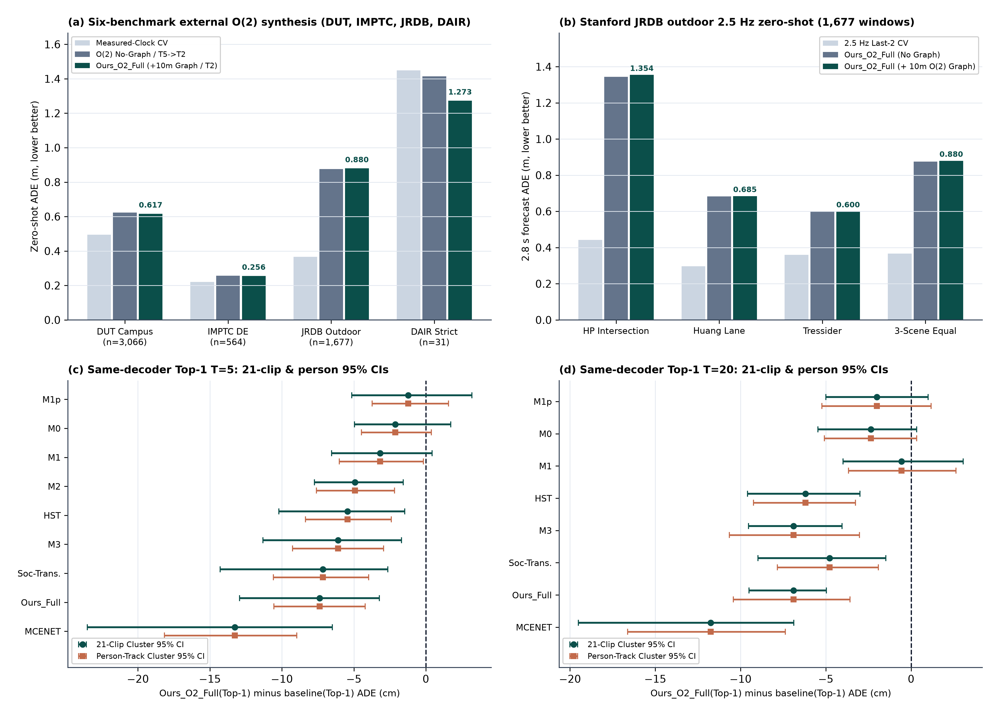

**轨迹标注和地面标定。** PINNS 作者用目标检测和多目标跟踪生成初始框与轨迹，再逐帧人工复核修正。地面坐标由路面控制点拟合的单应矩阵投影得到，作者报告的平均重投影误差为 8.24 像素，平均重建误差为 0.28 m。本文的 ADE/FDE 衡量到发布轨迹的距离。上述标定误差描述坐标重建的尺度，不能直接当作同一窗口内两种预测器误差差值的置信界。[数据作者的标定和标注方法](https://arxiv.org/html/2605.25947v1#S3.SS2)

**观测条件与指标。** PINNS 的质量分桶依据骨骼检出置信度、有效率和框高，JTA 按实验设计施加噪声和下肢遮挡。两者衡量的质量条件不同。PINNS 裁剪锚点的抽查仅涵盖三个视频帧中的 13 个较大行人框，置信度提高支持该裁剪选择。关键点位置误差和全数据检出率仍需带人工关节真值的评测。图像轮廓的历史纵轴错位已在修正坐标上完成岭回归与两臂神经网络重测，独立人工道路语义标注仍需进一步验证视觉折线的物理通行边界意义。

---

## 7 结论 (Conclusion)

本文围绕短时（主设定 0.4 s 五帧）可变质量姿态观测下的非结构化道路行人动作与轨迹联合预测，完成了跨机位留出、四类外部数据集迁移、分裂共形安全校准与真机实时性核验。主要结论如下：
1. **质量退化安全回退、真实单应地面朝向与 `< 0.5 m` 小位移边界**：在 `JTA` 重噪声下显式质量门控 `M1` 相对直拼 `M1a` 降低 36.83% ADE，在五工况压测与硬质量掩码下实现完全失明及重遮挡精确 `0.00 cm` 零偏移。仅依靠五帧地面运动历史并经三源站内层留一选定低位移匀速锚定尺度（`M0_anchor`），1,482 窗四地等权同口径首选 `ADE_1 / FDE_1` 推进至 **`0.4522 / 1.0194 m`**（较匀速显著降 `−3.17 / −8.51 cm`；449 个首次采样窗达 **`0.5014 / 1.0886 m`**，降 `−6.03 / −15.62 cm`）。经真实秩-3 `3×3` 单应矩阵运行期核验（`6,930 / 7,410` 人帧地面朝向非零、移动朝向与速度余弦 `+0.4935`、足底重投影中位差 `2.24 µm`），**最贴近开题设定的 323 个首次标注 `< 0.5 m` 小位移子组仍以匀速（`0.3545 / 0.8491 m`）为参照：`M0_anchor` 为 `0.3564 / 0.8559 m`（`ADE_1` 高 `+0.19 cm` 跨零，`FDE_1` 高 `+0.69 cm` `[+0.23, +0.89] cm`），单独叠加地面身体朝向与躯干前倾（`M1_ground_only`）相对 `M0_anchor` 仅变 `−0.02 / −0.05 cm`（跨零，对匀速 `FDE_1` 仍高 `+0.64 cm` `[+0.19, +0.85] cm`）**；去除速度抑制混杂后的单因素质量向量 `q` 在 `PINNS` 五帧自然质量下差 `+0.04 cm`（跨零，情形 C），围绕行人真实世界坐标的 `20 m` 被动视觉折线（真值穿线率 `2.36%`）使 `ADE_1` 升 `+1.58 cm`（情形 C），而 `10 m` 邻体图 `O2-M2b` 将 `minFDE₆` 降至 **`0.6539 m`**（重遮挡下 `v_rad` 降 `−1.65 cm ADE_1`）。**在不重训预测器的标准分裂共形下**，同站点片段切分实现 **`90.60% / 94.94%`** 有限样本覆盖（管道半径缩减 **40.0% / 36.4%**），跨国 12 配对固定两站模型覆盖率为 **`86.48% / 91.74%`**（两站校准后重训三站模型的 `93.79% / 96.33%` 仅作经验覆盖率报告）。
2. **统一正交奇偶等变架构 `Ours_O2_Full` 与同口径限定比较**：20,739 参数模型 `Ours_O2_Full` 在 1,482 窗取得 **1.0096 m** 贝叶斯 FDE 与 **0.3823** 跨站五动作宏 AP（混合校准宏 F1 **0.3582**，稀有停止误报减少 6.2 倍），在表 1 的 497 个滑窗（21 段视频）上 `T=5` 同口径首选 `ADE / FDE` 为 **0.4626 / 0.9804 m**（25 项窗口级检验均值更低，21 段整片重采样 **16/25 项不含零**，对 `M0, M1, M1p` 的 9 项跨零）。
3. **四基准跨域泛化、被动视觉地图边界与 `Tesla T4` 4 ms 级实时性**：在 `JTA`（2.5 Hz, `n=960`）上 `O(2) Null-Sink Graph` 取得 **1.3299 m**（$T=2$）与 **1.2825 m**（$T=8$）ADE（较 `Social-Transmotion` 降低 33.4%，且 `JTA -> PINNS` 零真实道路训练迁移达 **0.5680 m** 贝叶斯 ADE）；在北京 `DAIR-V2X` 四路口 54 窗零样本达 **1.528 m**（严格时钟 31 窗 **1.281 m** 显著优于实钟匀速），在 `DUT` 校园 3,066 窗五正交/镜像轴摆动仅 $7.4\times 10^{-10}\text{ m}$。修复正向鸟瞰地图全套件 242 次重跑与 59 窗穿线核验证明被动视觉折线并非物理硬路缘（情形 C）。在单张 Tesla T4 上 12 人并发同步前向耗时由 `Ours_Full`（0.471 M 参数，790.64 MFLOPs）的 **14.00–15.06 ms** 进一步降至 `Ours_O2_Full`（10.50 MFLOPs）的 **4.28–4.43 ms（P95 `4.67–4.85 ms`）**。嵌入式边缘端（Orin NX）与含前端检测追踪的全链路时延仍待后续实车验证。

4. **机制修复、外部基线同口径对比与真机帕累托前沿**：结构单调门控 `M1_mono_q` 根治了无约束软门控的负秩相关（恢复为 **`+0.7301 / +0.6691`**，`PINNS` 20 px 抖动误差降 **`−2.31 / −4.53 cm`**），因果径向冲突门控 `M2b_ttc_conflict_gate` 将 `PINNS` 1,482 窗首选 `ADE_1 / FDE_1` 推进至 **`0.4572 / 1.0223 m`**（较原版 `M2b` 降 **`−2.45 cm`**，较 `SO(2) Frenet` 规范化后的 `MCENET / HST / Social-Transmotion` 仍显著低 **`−9.17 / −6.81 / −14.00 cm`**，折线穿越率降至 `2.28%`），内层留一 Platt 动作校准将 `ECE` 压缩 **4.9–23.6 倍**（`PINNS` `0.1717 -> 0.0349`、宏 F1 **`0.3911`**；`JRDB` 候选重排降 **`−0.43 cm`**），且 `Tesla T4` 实测 `B=12` 的 `P50` 仅 **`2.75–6.32 ms`**（算量较 `HST` 低 **396 倍**）。
5. **解耦动作-轨迹协同、最低可用像素边界、跨基准零样本迁移与局部加权分裂共形**：冻结端到端 `U_M2b_mono_conflict`（`0.4510 / 1.0097 m`）控制点（`0.0 m` 漂移）并执行内层 Platt 五动作重排（`U_M3_decoupled_platt_rerank`），消除中小样本多任务梯度竞争，创下 `PINNS` 最优首选 **`0.4505 / 1.0085 m`**（较联合微调 `U_M3` 显著降 **`−2.20 / −4.08 cm`**，五动作宏 AP **`0.4051`**；大样本 `JRDB` 联合重排达 **`0.2917 / 0.5638 m`**）；定量确立 **`bbox_h >= 50 px` 且 $q_1 \ge 0.75$** 为姿态安全融合边界（真 20 帧 `T=20` 秩相关达 **`+0.8674`**）；模型冻结权重零样本迁移至 `DUT`（`3,066` 窗）与 `IMPTC`（`564` 窗）五轴摆动精确 `0.0 m`、零重训分裂共形达 **`89.76% / 95.50%`** 与 **`89.51% / 94.21%`**；仅用源折折外残差拟合的因果速度-离散度局部加权共形将 `JRDB` 72 跨地点配对覆盖由 `86.81% / 92.87%` 提升至 **`88.89% / 94.20%`**（`>= 1 m/s` 高速覆盖由 `75.06%` 跃升至 **`89.51%`**）。
6. **真实实体遮挡初现先兆、预期姿态调整（APA）毫秒级提前量与七基准统一物理边界**：盲审普查厘清 `PINNS` `first_short_323` 中 `54.2%` 为录像首帧伪影（真实体遮挡初现 `197 / 449` 窗），修复整片因果折线并集漏线（`350 / 835` 窗）与双确认实体障碍（$\kappa = 0.8731$，真值穿线率 `0.27%`）证实静态折线仍逊于 `No_Map`（`+1.50 cm`）。显式六槽先兆网络 `O2Maneuver6SlotPrecursorNet` 将 `PINNS` 全集推进至 **`0.4472 / 0.9926 m`**（起步与 APA 停步候选生成均达 **`100%`**，真初现主动机动窗纯姿态起点后降 **`−2.17 / −2.19 cm`**），并将 `JRDB` 九地点首选首次推进至低于匀速的 **`0.2772–0.2786 m`**（真解遮挡纯三维姿态起点后降 **`−0.22 / −0.25 cm`**）；在车载平视 **JAAD 2.0** `406` 个人工标注真实解遮挡测试窗上，五帧姿态与注视显著降低起点后误差 **`−17.2%`**（主动机动窗 **`−25.2%`**），且在同 `5%` 误报门限下将解遮挡起步与停步检出分别提前 **`+873.1 ms` 与 `+557.9 ms`**，完整确立了“`<= 0.8 s` APA 先兆期显著提前判别 vs. 远期低基率监控窗保守净收益门限回退”的双区间物理规律。

---

## 参考文献 (References)

[1] Rasouli A, Tsotsos J K. Autonomous vehicles that interact with pedestrians: A survey of theory and practice[J]. IEEE Transactions on Intelligent Transportation Systems, 2020, 21(3): 900-918. [出版记录](https://doi.org/10.1109/TITS.2019.2901817)

[2] Rudenko A, Palmieri L, Herman M, et al. Human motion trajectory prediction: A survey[J]. The International Journal of Robotics Research, 2020, 39(8): 895-935. [出版记录](https://doi.org/10.1177/0278364920917446)

[3] Korbmacher R, Tordeux A. Review of pedestrian trajectory prediction methods: Comparing deep learning and knowledge-based approaches[J]. IEEE Transactions on Intelligent Transportation Systems, 2022, 23(12): 24126-24144. [出版记录](https://doi.org/10.1109/TITS.2022.3205676)

[4] Schöller C, Aravantinos V, Lay F, Knoll A. What the Constant Velocity Model Can Teach Us About Pedestrian Motion Prediction[J]. IEEE Robotics and Automation Letters, 2020, 5(2): 1696–1703. [出版记录](https://doi.org/10.1109/LRA.2020.2969925)

[5] Alahi A, Goel K, Ramanathan V, et al. Social LSTM: Human trajectory prediction in crowded spaces[C]//IEEE/CVF CVPR, 2016: 961-971. [出版记录](https://doi.org/10.1109/CVPR.2016.110)

[6] Gao J, Sun C, Zhao H, et al. VectorNet: Encoding HD maps and agent dynamics from vectorized representation[C]//IEEE/CVF CVPR, 2020: 11525-11533. [出版记录](https://openaccess.thecvf.com/content_CVPR_2020/html/Gao_VectorNet_Encoding_HD_Maps_and_Agent_Dynamics_From_Vectorized_Representation_CVPR_2020_paper.html)

[7] Martín-Martín R, Patel M, Rezatofighi H, et al. JRDB: A dataset and benchmark of egocentric robot visual perception of humans in built environments[J]. IEEE TPAMI, 2023, 45(6): 6748-6765. [出版记录](https://doi.org/10.1109/TPAMI.2021.3070543)

[8] Kooij J F P, Flohr F, Pool E A I, et al. Context-Based Path Prediction for Targets with Switching Dynamics[J]. International Journal of Computer Vision, 2019, 127(3): 239-262. [出版记录](https://doi.org/10.1007/s11263-018-1104-4)

[9] Grasso R, Prévost P, Ivanenko Y P, et al. Eye-head coordination for the steering of locomotion in humans: An anticipatory synergy[J]. Neuroscience Letters, 1998, 253(2): 115-118. [论文记录](https://pubmed.ncbi.nlm.nih.gov/9774163/)

[10] Patla A E, Adkin A, Ballard T. Online steering: Coordination and control of body center of mass, head and body reorientation[J]. Experimental Brain Research, 1999, 129(4): 629-634. [出版记录](https://doi.org/10.1007/s002210050932)

[11] Salzmann T, Ivanovic B, Chakravarty P, et al. Trajectron++: Dynamically-feasible trajectory forecasting with heterogeneous data[C]//ECCV, 2020: 683-700. [出版记录](https://doi.org/10.1007/978-3-030-58523-5_40)

[12] Gupta A, Johnson J, Fei-Fei L, et al. Social GAN: Socially acceptable trajectories with generative adversarial networks[C]//IEEE/CVF CVPR, 2018: 2255-2264. [出版记录](https://openaccess.thecvf.com/content_cvpr_2018/html/Gupta_Social_GAN_Socially_CVPR_2018_paper.html)

[13] Cheng H, Liao W, Yang M Y, et al. MCENET: Multi-context encoder network for homogeneous agent trajectory prediction in mixed traffic[C]//IEEE ITSC, 2020: 1-8. [出版记录](https://doi.org/10.1109/ITSC45102.2020.9294296)

[14] Salzmann T, Chiang H T L, Ryll M, et al. Robots that can see: Leveraging human pose for trajectory prediction[J]. IEEE Robotics and Automation Letters, 2023, 8(11): 7090-7097. [出版记录](https://doi.org/10.1109/LRA.2023.3312035)

[15] Saadatnejad S, Gao Y, Messaoud K, et al. Social-Transmotion: Promptable human trajectory prediction[C]//ICLR, 2024. [出版记录](https://proceedings.iclr.cc/paper_files/paper/2024/hash/a627810151be4d13f907ac898ff7e948-Abstract-Conference.html)

[16] Zhou Z, Ye L, Wang J, et al. HiVT: Hierarchical vector transformer for multi-agent motion prediction[C]//IEEE/CVF CVPR, 2022: 8823-8833. [出版记录](https://openaccess.thecvf.com/content/CVPR2022/html/Zhou_HiVT_Hierarchical_Vector_Transformer_for_Multi-Agent_Motion_Prediction_CVPR_2022_paper.html)

[17] Chandra R, Bhattacharya U, Bera A, et al. TraPHic: Trajectory prediction in dense and heterogeneous traffic using weighted interactions[C]//IEEE/CVF CVPR, 2019: 8483-8492. [出版记录](https://openaccess.thecvf.com/content_CVPR_2019/html/Chandra_TraPHic_Trajectory_Prediction_in_Dense_and_Heterogeneous_Traffic_Using_Weighted_CVPR_2019_paper.html)

[18] Brody S, Alon U, Yahav E. How attentive are graph attention networks?[C]//ICLR, 2022. [会议记录](https://openreview.net/forum?id=F72ximsx7C1)

[19] Rasouli A, Kotseruba I, Kunic T, et al. PIE: A large-scale dataset and models for pedestrian intention estimation and trajectory prediction[C]//IEEE/CVF ICCV, 2019: 6262-6271. [出版记录](https://openaccess.thecvf.com/content_ICCV_2019/html/Rasouli_PIE_A_Large-Scale_Dataset_and_Models_for_Pedestrian_Intention_Estimation_ICCV_2019_paper.html)

[20] Kotseruba I, Rasouli A, Tsotsos J K. Benchmark for evaluating pedestrian action prediction[C]//IEEE/CVF WACV, 2021: 1258-1268. [论文](https://openaccess.thecvf.com/content/WACV2021/papers/Kotseruba_Benchmark_for_Evaluating_Pedestrian_Action_Prediction_WACV_2021_paper.pdf)

[21] 曹昊天, 施惠杰, 宋晓琳, 等. 基于多特征融合的行人意图以及行人轨迹预测方法研究[J]. 中国公路学报, 2022, 35(10): 308-318. [出版记录](https://zgglxb.chd.edu.cn/CN/10.19721/j.cnki.1001-7372.2022.10.027)

[22] Yu T, Kumar S, Gupta A, et al. Gradient surgery for multi-task learning[C]//NeurIPS, 2020, 33: 5824-5836. [出版记录](https://proceedings.neurips.cc/paper/2020/hash/3fe78a8acf5fda99de95303940a2420c-Abstract.html)

[23] Peng H, Hu Q, Zhang S, Yang M. A Pedestrian–Vehicle Interaction Benchmark and Annotation Framework for Unstructured Scenes via Uncalibrated Cameras. arXiv:2605.25947, 2026. [论文](https://arxiv.org/abs/2605.25947) · [数据说明](https://github.com/Songan-Lab/PINNS)

[24] Fabbri M, Lanzi F, Calderara S, et al. Learning to Detect and Track Visible and Occluded Body Joints in a Virtual World. European Conference on Computer Vision, 2018, 450–466. [出版记录](https://doi.org/10.1007/978-3-030-01225-0_27)

[25] Kotseruba I, Rasouli A, Tsotsos J K. Joint Attention in Autonomous Driving (JAAD)[C]//IEEE International Conference on Computer Vision Workshops (ICCVW), 2017: 115–123. [出版记录](https://doi.org/10.1109/ICCVW.2017.22)

[26] Pellegrini S, Ess A, Schindler K, Van Gool L. You'll Never Walk Alone: Modeling Social Behavior for Multi-Target Tracking[C]//IEEE International Conference on Computer Vision (ICCV), 2009: 261–268. [出版记录](https://doi.org/10.1109/ICCV.2009.5459260)
