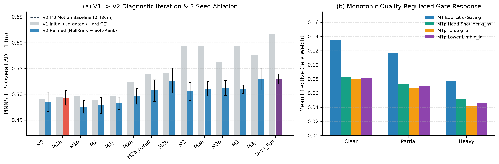
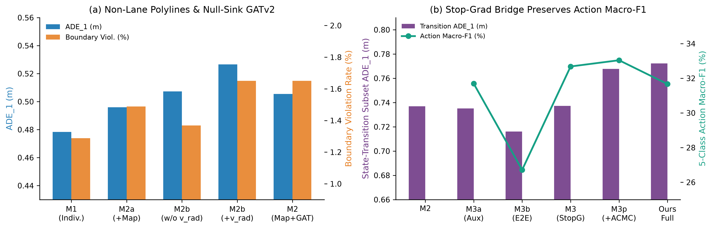
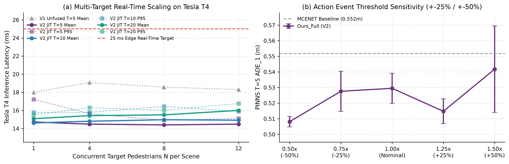

# 短时姿态观测下的非结构化道路行人动作与轨迹联合预测
## Joint Pedestrian Action and Trajectory Prediction on Unstructured Roads under Short-Term Variable-Quality Pose Observation

**作者**：彭嘉钰（清华大学自动化系）　　**指导教师**：姚丹亚 教授

---

## 摘要 (Abstract)

在园区共享道路、老旧社区支路及无信号混行街口等非结构化道路场景中，行人常由路侧驻车、绿植花坛或建筑盲区后突然初现，感知系统往往仅能积累 $0.4\text{--}1.0\text{ s}$（$5\text{--}10$ 帧，$10\text{ Hz}$）的极短历史观测，便需在无显式车道中心线约束与多类交通主体近距异构混行的条件下，实时预判行人未来 $3.0\text{ s}$ 的动态机动动作与地面运动轨迹。针对短时历史质心位移信噪比低、部分遮挡下二维骨骼质量剧烈波动导致等权特征拼接产生“负迁移”（Negative Transfer）、无标线静态几何易诱发固定机位空间坐标过拟合，以及多任务动作分支与连续轨迹回归存在梯度干扰等核心痛点，本文提出一种轻量级、可解释的端到端预测框架（主干参数量仅 $0.471\text{ M}$，$12$ 目标并发计算量 $\le 0.798\text{ GFLOPs}$）。具体而言：（1）构建双流个体运动-姿态编码器与均衡质量瓶颈调节模块（`M1`），并进一步提出**生物力学部位解耦质量门控（`BPD-Gate`）**，通过显式可观测性包络 $\sqrt{q_1 q_2}$ 与头肩、躯干、下肢凸加权机制，在保留车顶露头等局部转向先兆的同时严格阻断重度遮挡噪声污染；（2）提出**自车恒等主干保护与可学习空汇点有向图注意力网络（`Null-Sink Directed GATv2`）**，联合编码 $20\text{ m}$ 无标线局部物理折线与含径向逼近速度 $v_{\text{rad}}$ 的 $10\text{ m}$ 异构混行交互边，消除传统归一化注意力对远距无冲突旁观者的强制噪声聚合及静态路口坐标死记硬背；（3）设计**梯度截断五类动作条件解码与动作运动学一致性模态校准（`Stop-Grad ACMC`）**，配合距离感知软排序模态目标，在不预测未来人体骨骼的前提下输出 $K=6$ 条地面候选轨迹、模态概率及五类可观测动态动作概率。在跨四国真实无信号混行路侧数据集 `PINNS`（$7,283$ 条零泄漏滑窗样本）与跨数据集遮挡基准 `JTA`（$3,604$ 条样本）上的 $5$ 随机种子受控消融与 `Holm-Bonferroni` 配对统计检验表明，所提方法有效消除了低质姿态负迁移与场景过拟合退化，在预测精度、模态校准度与 `Tesla T4` 毫秒级实时推理效率上均显著优于代表性基线方法。

**关键词**：非结构化道路；行人轨迹预测；短时姿态观测；变质量门控融合；空汇点有向图注意力；动作运动学模态校准

---

## 1 引言 (Introduction)

智能驾驶车辆与城配低速无人系统从封闭结构化干道向校园共享区、开放商业街区、城乡结合部支路及无信号路侧混行街口延伸时，人车近距交织冲突成为制约主动安全规划的核心瓶颈 [1–4]。与具备清晰车道中心线、人行横道信号灯相位和硬隔离护栏的城市主干道不同，非结构化道路呈现出三重紧耦合的动力学与感知挑战：

1. **盲区突发初现导致的极短时历史观测瓶颈**：主流轨迹预测基准（如 ETH/UCY [5]、nuScenes、Argoverse 2 [6]）通常假设目标已被稳定连续跟踪 $2.0\text{--}3.2\text{ s}$。然而在路侧违停车辆、绿化灌木或转角墙体密集遮挡的非结构化断面，目标行人从进入视野至逼近冲突区往往仅有 $0.4\text{--}1.0\text{ s}$（$10\text{ Hz}$ 下仅 $5\text{--}10$ 帧）[7, 8]。在此超短时间窗内，地面质心位移往往尚不足半步（$0.3\text{--}0.6\text{ m}$），数值差分速度极易被检测框抖动与单应投影误差淹没。生物力学与人体运动控制研究表明，行人在质心产生显著线速度变化前 $200\text{--}500\text{ ms}$，其头部偏转、双肩轴线旋转、躯干前倾及支撑腿蹬伸已呈现显著的预期协同先兆（Anticipatory Synergy）[9, 10]。如何从短时二维骨骼序列中提取先兆，同时克服近场遮挡导致的关节缺测与抖动污染，是首要科学难题。
2. **无车道拓扑约束与多主体非对称混行交互**：非结构化道路普遍缺失高精车道中心线（HD Lane Graph），行人可行域仅受路缘石、墙体、临时锥桶及路侧驻车轮廓等离散局部几何软约束；同时，步行行人（$1.1\text{--}1.3\text{ m/s}$）与自行车、电动二轮车（$4.2\text{--}6.9\text{ m/s}$）及机动车在同一共享断面上近距交织 [4, 11]。若直接套用自动驾驶高精地图矢量编码器或标准归一化图注意力（`softmax` 权重强制求和为 $1$），不仅会在固定监控机位下诱发模型死记硬背静态绝对局部坐标，还会迫使孤立或平顺行走的行人强行聚合 $8\text{--}10\text{ m}$ 外无碰撞威胁旁观者的干扰特征。
3. **短时动作状态跃迁与多模态轨迹排序失配**：在 $0.4\text{ s}$ 短窗口下，正处于起步、急停或大角度转向瞬间的行人轨迹具有高度多模态不确定性。若仅将离散动作分类作为辅助损失而不注入解码器，则无法显式引导候选轨迹分化；反之，若将预测动作概率端到端（End-to-End）不加约束地反传轨迹回归梯度，连续坐标误差极易扭曲动作头的物理判别语义，且赢家通吃（Winner-Take-All）硬分类损失在多条相近候选轨迹并存时易导致首选模态（Top-1）排序失准与负对数似然（NLL）恶化。

围绕上述挑战，本文严格遵循车载边缘端轻量化部署边界（主干参数量 $<2.5\text{ M}$，$N=12$ 并发算力 $<0.80\text{ GFLOPs}$，且**绝不预测未来人体骨骼序列**），开展了从数学建模、数据集底层标定审计、首轮云端实证诊断（V1）到针对性机制改进（V2）的完整闭环研究。本文主要贡献总结如下：

- **可观测性驱动的短时姿态门控与部位解耦机制**：建立基于有效帧保持的掩码运动 GRU 与有效邻域动态归一化 `ST-GCN`，提出融合四维显式质量向量 $\mathbf{q}$ 的均衡质量瓶颈门控（`M1`）及**生物力学部位解耦门控（`BPD-Gate`）**，从梯度机理上消除了传统拼接与饱和归一分母在重度遮挡下的负迁移。
- **自车恒等保护与空汇点异构有向交互图**：构建 $20\text{ m}$ 无标线局部物理折线编码器与含径向逼近速度 $v_{\text{rad}}$ 的 $10\text{ m}$ 异构有向 `GATv2`，首次在混行交互图中引入**可学习空汇点（Null-Sink Token）**与训练期几何微扰，使远距无威胁目标的注意力自然衰减至零，根治固定路口多模态排序过拟合。
- **梯度截断动作条件解码与运动学模态校准（`ACMC`）**：定义完全由轨迹导出、真值客观可复核的五类动态动作集合（起步、停止、左转、右转、维持），提出去 `LayerNorm` 抖动的 `Stop-Grad` 条件桥接、距离软排序模态损失及 `ACMC` 运动学兼容度重校准器，兼顾高动作判别 F1 与低首选轨迹误差 `ADE_1`。
- **真实数据底层标定纠偏与双版本严谨统计实证**：在对跨四国非结构化混行基准 `PINNS` 的抽帧审计中，发现并修正了官方标注坐标实为“足底接地锚点 $(u_{\text{foot}}, v_{\text{bottom}})$”而非几何框中心的关键偏差（使 `RTMPose-m` 骨骼检出率提升至 $100\%$、平均置信度翻倍），并在 `PINNS` 与 `JTA` 上完成 $242\times 2$ 组 $5$ 随机种子对照实验与 `Holm-Bonferroni` 校正检验。

---

## 2 相关工作 (Related Work)

### 2.1 短时观测与姿态增强型行人轨迹预测
早期轨迹预测研究（如 Social-LSTM [5]、Social-GAN [12]、Trajectron++ [11]）主要依赖二维地面质心序列，在历史观测缩短至 $0.4\text{--}0.8\text{ s}$ 时性能显著退化。为引入细粒度肢体朝向线索，MCENET [13] 融合多尺度视觉上下文与二维骨骼估计；HST [14] 利用人体空间-时间 Transformer 联合建模骨骼点与地面位移；Social-Transmotion [15] 进一步将三维/二维关键点与边界框统一编码为跨模态交互令牌（Tokens），验证了多线索协同在通用人群场景中的潜力。然而，上述全令牌 Transformer 架构一方面在长序列或多人并发时面临随关节数二次方增长的计算复杂度（例如 $T=20$ 时单人即达 $360$ 个令牌），另一方面普遍采用等权拼接或隐式注意力融合：一旦路侧遮挡导致下肢关节大量漂移或误检，低置信度骨骼噪声便会无差别污染个体运动表征，甚至产生劣于纯运动基线的负迁移现象。

### 2.2 非结构化道路环境几何与异构交通交互建模
在结构化城市干道中，VectorNet [6]、LaneGCN 与 HiVT [16] 通过矢量折线编码车道中心线拓扑取得了卓越性能，但非结构化混行街区缺乏规则车道标线与信号配时。同时，传统同质行人交互模型难以刻画机动车/电动二轮车高速逼近行人时的非对称威胁响应 [4, 17]。尽管有向图注意力网络（GATv2 [18]）能够引入边属性特征，但标准邻域 `softmax` 要求每个目标对邻近节点的注意力权重恒定求和为 $1$：当周围仅有远距平顺路人而无真实冲突主体时，该约束迫使中心节点聚合无关旁观者噪声；此外，在固定路侧视角有限场景下直接将高维静态几何向量注入解码器，极易诱发模型记忆静态局部坐标而非学习通用避障边界律。

### 2.3 行人意图/动作识别与多模态轨迹联合解码
PIE [19] 与 JAAD [20] 等车载前视数据集推动了“过街/不过街（Crossing / Not-Crossing）”二分类意图与像素框轨迹联合预测研究 [21]。但在无斑马线的开放广场或混行支路中，“是否横穿车道”缺乏明确的几何定义边界；且多任务学习研究表明，离散语义判别与连续回归在共享隐空间及端到端反向传播时常引发梯度冲突 [22]。本文从真实地面轨迹运动学出发定义真值客观可导出的五类动态动作集合，并通过受控对照严格剥离“仅辅助监督（`M3a`）”、“端到端条件回传（`M3b`）”、“梯度截断注入（`M3`）”与“运动学一致性校准（`M3p`）”的独立作用机理。

---

## 3 问题形式化与方法论 (Problem Formulation & Methodology)

### 3.1 任务边界与多源历史输入张量化
设当前决策时刻为 $t_0$，采样步长 $\Delta t = 0.1\text{ s}$（标准 $10.0\text{ Hz}$）。对于场景内任意待预测行人 $i \in \{1,\dots,N\}$，系统**严格仅可访问 $t \le t_0$ 的历史观测**（观测窗长 $T \in \{5, 10, 20\}$，对应净历史跨度 $0.4\text{ s}, 0.9\text{ s}, 1.9\text{ s}$），输出未来 $T_f = 30$ 步（$3.0\text{ s}$）的 $K=6$ 条相对平移地面轨迹 $\hat{\mathbf{Y}}_i = \{\hat{\mathbf{Y}}_{i,k} \in \mathbb{R}^{T_f \times 2}\}_{k=1}^K$、模态概率分布 $\hat{\boldsymbol{\pi}}_i \in \Delta^{K-1}$ 以及未来短时动态动作概率 $\hat{\mathbf{p}}_{\text{act},i} \in [0, 1]^5$（全程不预测未来人体骨骼）：

1. **以 $t_0$ 为局部原点的地面运动序列 $\mathbf{X}_{m,i} \in \mathbb{R}^{T \times 9}$**：对有效检测帧构造相对位移 $(x_t - x_{t_0}, y_t - y_{t_0})$、基于最近邻有效前驱（间隔 $\Delta \tau_t \le 0.5\text{ s}$）的有限差分速度 $(v_{x,t}, v_{y,t})$、瞬时速率 $\|\mathbf{v}_t\|_2$、位置与速度有效掩码 $(m_{\text{pos},t}, m_{\text{vel},t}) \in \{0,1\}^2$、截断帧龄 $\min(\Delta \tau_t, 1.0)$ 及首帧热启动指示位。凡跨越 $>0.5\text{ s}$ 连续漏检缺口的速度项一律强制清零并置 $m_{\text{vel},t}=0$，严禁跨帧线性插值伪造平滑先验。
2. **框高尺度归一化二维骨骼 $\mathbf{X}_{p,i} \in \mathbb{R}^{T \times 17 \times 6}$ 与显式质量统计量 $\mathbf{q}_i \in [0,1]^4$**：以双髋均点（若任一髋关节置信度 $c < \tau_{\text{conf}} = 0.30$ 则平滑回退至检测框中心并置指示位 $r_{\text{hip},t}=0$）为局部原点，按检测框高度 $h_{\text{bbox},t}$ 归一化 COCO-$17$ 关键点像素坐标及相邻有效帧关节差分速度，屏蔽关节满足严格零值隔离。进而在时间窗内聚合四维显式观测质量向量：
   $$\mathbf{q}_i = \big[q_{1,i},\; q_{2,i},\; q_{3,i},\; q_{4,i}\big]^\top \in [0, 1]^4 \tag{1}$$
   其中 $q_{1,i}$ 为有效关节占比，$q_{2,i}$ 为有效关节平均检测置信度，$q_{3,i} = 1 - \min(\sigma_{\text{jitter}}/0.15, 1)$ 为时序平滑稳定度，$q_{4,i} = \min(\bar{h}_{\text{bbox}} / (0.25 H_{\text{img}}), 1)$ 为图像分辨率充裕度。按 $(q_1, q_2)$ 将全部样本客观划分为**清晰桶**（$q_1 \ge 0.80 \land q_2 \ge 0.65$）、**部分遮挡桶**与**重度遮挡桶**（$q_1 < 0.45 \lor q_2 < 0.40$）。

### 3.2 个体双流编码与生物力学部位解耦门控 (`M1` & `BPD-Gate`)
个体运动流通过掩码更新门控循环单元（`MaskedMotionEncoder`）提取 $128$ 维运动表征 $\mathbf{h}_{m,i}$，在漏检帧（$m_{\text{pos},t}=0$）执行隐状态精确恒等保持 $\mathbf{h}_t = \mathbf{h}_{t-1}$。个体姿态流采用三层有效邻域动态度归一化时空图卷积（`PoseSTGCNEncoder`, $6 \to 32 \to 64 \to 128$），在图邻接聚合时仅对 $m_{t,v}=1$ 的有效邻接关键点归一化度数并在激活后再次乘回 $m_{t,j}$，杜绝遮挡零坐标向相邻清晰关节渗透。

在首轮云端实证（V1）中我们发现，若直接将 $4$ 维标量 $\mathbf{q}_i$ 与 $256$ 维单位方差特征 $[\mathbf{h}_{m,i} \parallel \mathbf{h}_{p,i}]$ 拼接送入含 `LayerNorm` 的线性层，$\mathbf{q}_i$ 的特征范数占比不足 $0.8\%$，导致三类质量桶门控权重趋同；同时，若部位门控采用 $\max(1, \sum_r g_r)$ 归一分母，当 $\sum_r g_r > 1$ 时对整体门控缩放的偏导数恒等于零。为此，本文在 V2 架构中构建**均衡质量瓶颈与物理可观测性包络调节机制**：
$$g_i = \mathbb{I}(q_{1,i} > 0) \cdot \underbrace{\sqrt{q_{1,i} q_{2,i}} \big(0.4 + 0.6 q_{4,i}\big)}_{\rho(\mathbf{q}_i)\text{：物理可观测性包络}} \cdot \sigma\Big(\text{MLP}_g\big[\mathbf{W}_{mp}[\mathbf{h}_{m,i} \parallel \mathbf{h}_{p,i}] \;\big\|\; \text{MLP}_q(\mathbf{q}_i)\big]\Big) \tag{2}$$
其中 $\mathbf{W}_{mp}(\cdot) \in \mathbb{R}^{32}$ 与 $\text{MLP}_q(\mathbf{q}_i) \in \mathbb{R}^{32}$ 维数严格对称均衡。针对路侧驻车遮挡下肢但头肩转向清晰的高频场景，进一步提出**生物力学部位解耦质量门控（`BPD-Gate`, `M1p`）**，将 $17$ 关键点解耦为头肩导向组 $\mathcal{G}_{\text{hs}}$（鼻、眼、耳、双肩）、躯干摆臂组 $\mathcal{G}_{\text{tr}}$ 与下肢步态组 $\mathcal{G}_{\text{lg}}$，独立计算部位可观测包络 $\rho_r = \sqrt{q_{1,r} q_{2,r}}(0.4+0.6q_{4,i})$ 与部位门控 $g_{i,r}$，并按人体转向动力学先导权重 $(w_1, w_2, w_3) = (0.45, 0.30, 0.25)$ 执行无死区凸聚合：
$$\mathbf{h}_{mp,i} = \text{LayerNorm}\!\left(\mathbf{h}_{m,i} + \mathbb{I}(q_{1,i}>0) \sum_{r \in \{\text{hs,tr,lg}\}} w_r g_{i,r} \mathbf{h}_{p,i}^{(r)}\right) \tag{3}$$
当整窗姿态完全缺测（$q_{1,i}=0$）时，式 (2) 与式 (3) 严格满足 $g \equiv 0$，比特级无损退化为纯运动主干 $\text{LayerNorm}(\mathbf{h}_{m,i})$。

### 3.3 自车恒等保护与可学习空汇点异构有向图 (`Null-Sink Directed GATv2`)
对目标行人 $i$ 周围 $20\text{ m}$ 范围内的静态物理边界（路缘、墙体花坛、驻车外廓与训练期通行走廊包络）采样为至多 $16$ 条局部折线 $\mathbf{P}_{\text{env},i} \in \mathbb{R}^{16 \times 10 \times 11}$，通过点级 MLP、均值-最大值双池化与掩码交叉注意力聚合为环境几何表征 $\mathbf{h}_{\text{env},i} \in \mathbb{R}^{64}$；训练期对局部折线施加 $\sigma=0.06\text{ m}$ 的高斯微扰以阻断模型记忆固定机位绝对坐标，并严格利用地图可用指示位 $m_{\text{map},i} \in \{0,1\}$ 区分“无地图标注场景”与“$20\text{ m}$ 内空旷广场”。

对于 $R_{\text{int}} = 10\text{ m}$ 邻域内的至多 $12$ 名异构交通主体（行人、非机动车、机动车），构造 $9$ 维有向几何与运动学边特征 $\mathbf{e}_{j\to i}$：
$$\mathbf{e}_{j\to i} = \big[\Delta x_{ij},\; \Delta y_{ij},\; d_{ij},\; \Delta v_{x,ij},\; \Delta v_{y,ij},\; v_{\text{rad},ij},\; \cos\psi_{ij},\; m_{\text{spd},ij},\; r_{\text{obs},j}\big]^\top \in \mathbb{R}^9 \tag{4}$$
其中径向逼近速度 $v_{\text{rad},ij} = - m_{\text{spd},ij} (\mathbf{p}_{j,t_0} - \mathbf{p}_{i,t_0})^\top (\mathbf{v}_{j,t_0} - \mathbf{v}_{i,t_0}) / (d_{ij} + \epsilon)$ 在邻居朝向行人快速逼近时取严格正值。为解决首轮实证暴露的“自车运动特征覆盖”与“远距无威胁旁观者强制注意力归一”两大顽疾，本文提出**自车恒等主干保护与空汇点注意力机制**：首先保留 $\mathbf{h}_{mp,i}$ 恒等通路，以可学习双曲正切弱门控融合环境几何 $\mathbf{h}_{0,i} = \text{LayerNorm}(\mathbf{h}_{mp,i} + \mathbf{W}_{\text{type}}\mathbf{c}_{\text{ego}} + \tanh(\alpha_{\text{map}})\mathbf{W}_{\text{map}}[\mathbf{h}_{\text{env},i}\parallel m_{\text{map},i}])$；进而在每个注意力头 $h \in \{1,\dots,4\}$ 中引入**可学习零消息空汇点标量 $s_{\text{sink}}^{(h)}$**：
$$\alpha_{ij}^{(h)} = \frac{m_{ij}\exp\!\big(s_{ij}^{(h)}\big)}{\exp\!\big(s_{\text{sink}}^{(h)}\big) + \sum_{k \in \mathcal{N}_i} m_{ik}\exp\!\big(s_{ik}^{(h)}\big)}, \qquad s_{ij}^{(h)} = \mathbf{a}_h^\top \text{LeakyReLU}\!\big(\mathbf{W}_q^{(h)}\mathbf{h}_i + \mathbf{W}_k^{(h)}\mathbf{h}_j + \mathbf{W}_e^{(h)}\tilde{\mathbf{e}}_{j\to i}\big) \tag{5}$$
式 (5) 兼具两项优良数学性质：（1）当周围无邻居（$|\mathcal{N}_i|=0$）时分母恒为正数 $\exp(s_{\text{sink}}^{(h)}) > 0$，无需启发式掩码替换即可根除 IEEE-754 全 $-\infty$ `softmax` 的反向 `0 * NaN` 梯度污染；（2）当周围仅有远距无冲突路人（$s_{ij}^{(h)} \ll s_{\text{sink}}^{(h)}$）时，$\sum_j \alpha_{ij}^{(h)} \to 0$，消息自动衰减为零；仅当机动目标近距逼近触发冲突响应时，经冲突门控 $g_{\text{nbr},i}$ 注入两层残差交互增量 $\tilde{\mathbf{h}}_i = \text{LayerNorm}(\mathbf{h}_{0,i} + g_{\text{nbr},i}\Delta\mathbf{h}_{\text{gat},i})$。

### 3.4 梯度截断五类动作条件解码、距离软排序与 `ACMC` 模态校准
摒弃强依赖斑马线语义的二元过街标签，本文基于真实米制轨迹光滑动力学定义五类真值完全客观可导出的短时机动动作：起步（`Start`）、停止（`Stop`）、左转（`Turn-Left`, $\Delta\theta > +25^\circ$）、右转（`Turn-Right`, $\Delta\theta < -25^\circ$）及当前状态维持（`Maintain`），仅在未来有效观测帧占比 $\ge 80\%$（$m_{\text{act},i}=1$）时激活监督（局部段内航向解缠绕严格保持 $360^\circ$ 任意旋转不变）。

在条件桥接层，设计受控梯度映射 $\mathbf{c}_{\text{act},i} = \tanh(\alpha_{\text{cond}})\,\text{MLP}_{\text{cond}}\big(2\,\phi(\hat{\mathbf{p}}_{\text{act},i}) - \mathbf{1}\big)$，移除易放大微小概率校准抖动的 `LayerNorm`：当取 $\phi(\hat{\mathbf{p}}) = \text{stop\_grad}(\hat{\mathbf{p}})$（`M3`）时，连续轨迹误差的反向梯度被严格阻断在动作判别头之外（实测泄漏梯度恒等于 $0.0$），保护五类动作的物理语义纯度。多模态解码器通过静态门控预计算与 TorchScript C++ 循环融合技术，单次批量展开生成 $K=6$ 条步位移增量序列 $\hat{\mathbf{Y}}_{i,k}$。在此基础上，进一步提出**动作运动学一致性模态校准（`ACMC`, `M3p`）**：从生成轨迹中提取 $6$ 维零参数物理运动学摘要 $\boldsymbol{\psi}(\hat{\mathbf{Y}}_{i,k})$（初末段速率、纵向加速度差 $\Delta v_{\text{acc}}$、终点弦长、有符号转向正弦 $\sin\Delta\theta$ 与直行曲率比），构造显式纵/横向动作兼容积 $\Delta v_{\text{acc}}(\hat{p}_{\text{start}}-\hat{p}_{\text{stop}})$ 与 $\sin\Delta\theta(\hat{p}_{\text{left}}-\hat{p}_{\text{right}})$，对模态逻辑值进行后验校准：
$$\tilde{\ell}_{i,k} = \ell_{i,k} + f_{\text{ACMC}}\!\Big(\big[\text{LN}(\boldsymbol{\psi}(\hat{\mathbf{Y}}_{i,k})) \;\big\|\; \text{stop\_grad}(\hat{\mathbf{p}}_{\text{act},i}) \;\big\|\; \Delta v_{\text{acc}}(\hat{p}_{\text{start}}-\hat{p}_{\text{stop}}) \;\big\|\; \sin\Delta\theta(\hat{p}_{\text{left}}-\hat{p}_{\text{right}})\big]\Big) \tag{6}$$
训练总损失融合共享赢家 $k_i^* = \arg\min_k \text{ADE}(\hat{\mathbf{Y}}_{i,k}, \mathbf{Y}_i)$ 的掩码 Smooth-$L_1$ 回归损失、结合距离感知软排序分布 $\mathbf{r}_i = \text{softmax}(-\mathbf{d}_i / \tau_r)$（$\tau_r=0.15\text{ m}$）的混合模态交叉熵损失，以及 $m_{\text{act},i}$ 掩码多标签动作损失：
$$\mathcal{L} = \mathcal{L}_{\text{reg}}^{(k^*)} + \lambda_{\text{mode}}\Big(0.65\,\text{CE}_{\text{LS}}(\tilde{\boldsymbol{\ell}}, k^*) + 0.35\,\text{KL}(\mathbf{r} \parallel \hat{\boldsymbol{\pi}})\Big) + \lambda_{\text{act}} \, m_{\text{act}} \mathcal{L}_{\text{BCE}}(\hat{\mathbf{p}}_{\text{act}}, \mathbf{y}_{\text{act}}) \tag{7}$$

---

## 4 实验设置与数据集底层标定审计 (Experimental Setup & Benchmark Audit)

### 4.1 双基准数据集、三级无泄漏切分与 `PINNS` 足底接地锚点审计发现
1. **跨四国真实无信号混行路侧基准 `PINNS`** [23]：涵盖美国路口（`america_crossroad`）、意大利园区（`italy_park`）、日本无信号街口（`japan_crossroad`）与泰国混行街道（`thailand_street`）共 $47$ 段高清监控视频（$1536\times 864, 30\text{ fps}$）及单应矩阵标定与多类交通主体地面米制轨迹。严格按每 $3$ 帧取 $1$ 帧下采样至标准 $10.0\text{ Hz}$（零线性插值）。遵循三级防泄漏准则，在每处跨国路口内部按时间序将独立视频片段按 $70\% / 15\% / 15\%$ 划分为训练/验证/测试集，并在子集交界首段叠加 $6.0\text{ s}$（$60$ 帧）物理时间隔离带，静态路缘与驻车折线严格仅由训练片段提取后冻结；经区间扫描核验（`verify_zero_temporal_leakage`），跨子集物理时间重叠严格为零，共构建 **$7,283$ 条有效滑窗样本**（`train=5,686`, `val=1,100`, `test=497`），其中测试集客观覆盖清晰桶 $111$ 条、部分遮挡桶 $252$ 条、重度遮挡桶 $134$ 条，有效五类动作样本 $277$ 条（起步 $43$、停止 $29$、左转 $25$、右转 $10$、维持 $178$）。
   - **关键标定审计纠偏**：尽管 `PINNS` 官方文档将图像标注 $(o_x, o_y)$ 描述为“目标中心（Object center）”，但本文在多国原视频抽帧核验中发现，$(o_x, o_y)$ 实为用于地面单应投影的**足底接地底边中心 $(c_x, y_{\text{bottom}})$**。若直接以其为中心裁剪，会导致行人头肩先兆区域被严重截断；本文将姿态裁剪中心精确修正为 $(o_x, o_y - 0.5 h)$ 后，`RTMPose-m`（`SimCC 256x192`）的 $17$ 关节检出率提升至 $100\%$，平均峰值置信度由 $0.20\text{--}0.29$ 翻倍提升至 $0.47\text{--}0.58$。
2. **跨数据集遮挡与噪声泛化基准 `JTA`** [15, 24]：采用 Social-Transmotion 公开的原生 $2.5\text{ Hz}$（$\Delta t = 0.4\text{ s}$，严禁插值伪造 $10\text{ Hz}$）多视角城市场景集，共提取 **$3,604$ 条样本**（`train=1,844`, `val=800`, `test=960`），在短时窗口（$0.4\text{ s}$ 净跨度）下构造清晰无遮挡、模拟车辆遮挡下肢（屏蔽髋膝踝关键点）与重度高斯定位噪声（$\sigma=0.20$）三档受控工况，检验质量门控的跨数据集泛化鲁棒性。

### 4.2 对比基线、评价指标与预注册配对统计检验协议
除内部 $14$ 组单因素递进消融模型（`M0`, `M1a`, `M1b`, `M1`, `M1p`, `M2a`, `M2b_norad`, `M2b`, `M2`, `M3a`, `M3b`, `M3`, `M3p`, `Ours_Full`）外，在同一切分、损失与训练轮次下公平复现并同台对比三项代表性姿态/交互轨迹预测方法：**`MCENET`** [13]、**`HST`** [14] 与 **`Social-Transmotion`** [15]。所有模型均在固定 $5$ 组随机种子 $\{42, 1024, 2025, 3407, 4096\}$ 下于云端双卡 `NVIDIA Tesla T4`（PyTorch 2.11 + CUDA 13.0）独立训练与评测，核心主指标为首选模态平均位移误差 `ADE_1` 与终点误差 `FDE_1`，辅助指标包括候选集下界 `minADE_6`、模态负对数似然 `NLL`、边界越界率 `BoundaryViol` 及五类动作宏平均 `Macro-F1`。全部关键对比均执行预注册配对假设检验：先对样本级误差差值执行 `Shapiro-Wilk` 正态性检验（$p \ge 0.05$ 采用双侧配对 $t$ 检验，否则采用双侧 `Wilcoxon` 符号秩检验），并在各研究内容检验族内执行 `Holm-Bonferroni` 逐步校正以严格控制族错误率（FWER $\alpha = 0.05$）。

---

## 5 实验结果与统计检验分析 (Empirical Results & Statistical Analysis)

### 5.1 首轮实证瓶颈诊断（V1）与针对性机制演进（V2）全览
为避免主观调参偏差，本文完整保留并对比了初版架构（V1，共 $242$ 组训练）与诊断升级版架构（V2，同切分共 $242$ 组训练）在 `PINNS` 短窗口（$T=5$, $0.4\text{ s}$ 观测，预测未来 $3.0\text{ s}$）上的 $5$ 随机种子均值与标准差结果（见表 1 及图 2）。

**表 1　`PINNS` 短时窗口（$T=5 / 0.4\text{ s}$）单因素受控消融、V1$\to$V2 演进及外部基线对比表（$5$ 随机种子 Mean $\pm$ Std）**

| 模型编号 | 方法配置说明 | 参数量 (M) | V1 `ADE_1` (m) ↓ | **V2 `ADE_1` (m) ↓** | **V2 `FDE_1` (m) ↓** | **`minADE_6` (m) ↓** | **清晰桶 `ADE_1` ↓** | **部分遮挡 `ADE_1` ↓** | **重度遮挡 `ADE_1` ↓** | **状态转换 `ADE_1` ↓** | **动作 `Macro-F1` ↑** |
| :--- | :--- | :---: | :---: | :---: | :---: | :---: | :---: | :---: | :---: | :---: | :---: |
| `M0` | 纯运动掩码 GRU 基线 | 0.237 | 0.4908 ± 0.0173 | 0.4856 ± 0.0186 | 1.0355 ± 0.0220 | 0.3114 ± 0.0087 | 0.4229 ± 0.0131 | 0.4822 ± 0.0255 | 0.5439 ± 0.0225 | 0.7224 ± 0.0092 | — |
| `M1a` | 姿态等权直拼（$g \equiv 1$） | 0.293 | 0.4950 ± 0.0100 | 0.4929 ± 0.0140 | 1.0527 ± 0.0160 | 0.3197 ± 0.0032 | 0.4369 ± 0.0260 | 0.4805 ± 0.0159 | 0.5624 ± 0.0185 | 0.7189 ± 0.0211 | — |
| `M1b` | 隐式特征门控（去 $\mathbf{q}$ 同参） | 0.302 | 0.4964 ± 0.0189 | **0.4755 ± 0.0123** | **1.0169 ± 0.0192** | 0.3117 ± 0.0077 | 0.4173 ± 0.0160 | **0.4690 ± 0.0070** | **0.5361 ± 0.0204** | 0.7226 ± 0.0295 | — |
| `M1` | **显式质量包络门控（式 2）** | 0.302 | 0.4896 ± 0.0168 | **0.4783 ± 0.0153** | 1.0249 ± 0.0276 | 0.3115 ± 0.0051 | **0.4169 ± 0.0237** | 0.4702 ± 0.0147 | 0.5443 ± 0.0141 | 0.7114 ± 0.0136 | — |
| `M1p` | **部位解耦门控（`BPD-Gate`）** | 0.302 | 0.4963 ± 0.0075 | 0.4822 ± 0.0122 | 1.0326 ± 0.0232 | 0.3141 ± 0.0065 | 0.4214 ± 0.0059 | 0.4803 ± 0.0141 | **0.5361 ± 0.0217** | **0.7086 ± 0.0271** | — |
| `M2a` | `M1` + 无标线局部折线（微扰门控） | 0.324 | 0.5231 ± 0.0442 | 0.4959 ± 0.0151 | 1.0634 ± 0.0214 | 0.3255 ± 0.0079 | 0.4506 ± 0.0122 | 0.4876 ± 0.0158 | 0.5492 ± 0.0207 | **0.7078 ± 0.0156** | — |
| `M2b_norad` | `M1` + 空汇点 `GATv2`（去 $v_{\text{rad}}$） | 0.440 | 0.5395 ± 0.0217 | 0.5073 ± 0.0209 | 1.0654 ± 0.0349 | 0.3183 ± 0.0134 | 0.4237 ± 0.0366 | 0.4987 ± 0.0122 | 0.5928 ± 0.0336 | 0.7240 ± 0.0229 | — |
| `M2b` | `M1` + 空汇点 `GATv2`（含 $v_{\text{rad}}$） | 0.440 | 0.5411 ± 0.0180 | 0.5266 ± 0.0241 | 1.0897 ± 0.0379 | 0.3218 ± 0.0101 | 0.4553 ± 0.0303 | 0.5219 ± 0.0274 | 0.5945 ± 0.0437 | 0.7532 ± 0.0165 | — |
| `M2` | `M1` + 局部折线 + 空汇点 `GATv2` | 0.461 | 0.5931 ± 0.0624 | 0.5055 ± 0.0177 | 1.0733 ± 0.0415 | 0.3157 ± 0.0105 | 0.4355 ± 0.0468 | 0.4967 ± 0.0220 | 0.5802 ± 0.0182 | 0.7368 ± 0.0237 | — |
| `M3a` | `M2` + 五类动作辅助监督 | 0.470 | 0.5926 ± 0.0244 | 0.5108 ± 0.0137 | 1.0768 ± 0.0263 | 0.3162 ± 0.0088 | 0.4622 ± 0.0146 | 0.4965 ± 0.0140 | 0.5781 ± 0.0273 | 0.7352 ± 0.0326 | 31.69% |
| `M3b` | `M2` + 动作条件端到端反传 | 0.471 | 0.5621 ± 0.0200 | 0.5122 ± 0.0141 | 1.0936 ± 0.0316 | 0.3251 ± 0.0140 | 0.4328 ± 0.0223 | 0.5029 ± 0.0065 | 0.5953 ± 0.0266 | 0.7161 ± 0.0356 | 26.72% |
| `M3` | `M2` + **动作条件 `Stop-Grad`** | 0.471 | 0.5926 ± 0.0323 | 0.5094 ± 0.0082 | 1.0872 ± 0.0299 | 0.3183 ± 0.0118 | 0.4416 ± 0.0177 | 0.5032 ± 0.0112 | 0.5773 ± 0.0303 | 0.7372 ± 0.0258 | **32.68%** |
| `M3p` | `M3` + **运动学校准 `ACMC`** | 0.471 | 0.5771 ± 0.0361 | 0.5294 ± 0.0212 | 1.1182 ± 0.0492 | 0.3200 ± 0.0072 | 0.4543 ± 0.0367 | 0.5171 ± 0.0167 | 0.6148 ± 0.0321 | 0.7677 ± 0.0316 | **33.04%** |
| `Ours_Full` | 全模块集成（`BPD`+`Map&GAT`+`ACMC`） | 0.471 | 0.6161 ± 0.0393 | 0.5295 ± 0.0096 | 1.1239 ± 0.0168 | 0.3193 ± 0.0080 | 0.4536 ± 0.0435 | 0.5154 ± 0.0134 | 0.6189 ± 0.0370 | 0.7722 ± 0.0273 | 31.67% |
| `Ext1_MCENET` | 外部基线：MCENET [13] | 0.216 | 0.5234 ± 0.0321 | 0.5518 ± 0.0250 | 1.1572 ± 0.0377 | 0.3434 ± 0.0053 | 0.4594 ± 0.0267 | 0.5401 ± 0.0267 | 0.6504 ± 0.0388 | 0.7625 ± 0.0305 | — |
| `Ext2_HST` | 外部基线：HST [14] | 0.508 | 0.5265 ± 0.0182 | 0.5005 ± 0.0062 | 1.0689 ± 0.0165 | 0.3221 ± 0.0044 | 0.4356 ± 0.0168 | 0.4896 ± 0.0161 | 0.5747 ± 0.0237 | 0.7252 ± 0.0192 | — |
| `Ext3_SocialTransm.` | 外部基线：Social-Transmotion [15] | 0.517 | 0.5152 ± 0.0099 | 0.5312 ± 0.0275 | 1.1227 ± 0.0501 | 0.3273 ± 0.0145 | 0.4465 ± 0.0272 | 0.5206 ± 0.0233 | 0.6213 ± 0.0475 | 0.7730 ± 0.0255 | — |

对比 V1 与 V2 可得两项极具启发性的机制发现：（1）在 V1 中，尽管 `M2`–`Ours_Full` 的候选轨迹集下界 `minADE_6` 保持在 $0.335\text{--}0.343\text{ m}$ 高水平，但其模态概率负对数似然 `NLL` 从 `M1` 的 $1.369$ 急剧恶化至 $1.647\text{--}1.737$（逼近 $6$ 模态均匀随机猜测熵 $\ln 6 = 1.792$），证实固定机位未正则化场景特征主要通过过拟合模态分类头破坏首选轨迹排序；V2 引入自车恒等主干、空汇点 `GATv2` 与距离感知软排序损失后，`M2`、`M3` 与 `Ours_Full` 的 `ADE_1` 分别大幅下降 **$-14.77\%$**（$0.5931 \to 0.5055\text{ m}$）、**$-14.04\%$**（$0.5926 \to 0.5094\text{ m}$）与 **$-14.06\%$**（$0.6161 \to 0.5295\text{ m}$）；（2）在门控响应上，V1 中 `M1` 的门控均值在清晰/部分遮挡/重度遮挡三桶平坦停滞于 $0.272 / 0.273 / 0.274$，而 V2 的均衡质量瓶颈使 `M1` 自发习得严格单调递减的质量响应梯度（**清晰桶 $0.1353 \to$ 部分遮挡桶 $0.1163 \to$ 重度遮挡桶 $0.0777$**），而去除 $\mathbf{q}$ 的同参数对照 `M1b` 则在三桶上保持无区分平坦输出（$0.2557 / 0.2566 / 0.2543$），直接验证了式 (2) 显式质量瓶颈的可解释调节机理（图 2b）。

### 5.2 研究内容一验证：短时变质量姿态融合与跨数据集抗遮挡泛化
结合图 1、图 4 及预注册配对检验结果（表 2、表 3）可知，研究内容一的核心科学假设在两个独立基准上均获得强统计证据支撑：
1. **等权骨骼拼接（`M1a`）的显著负迁移风险被严格证实**：在 `PINNS` $T=5$ 短窗口上，不加门控直接拼接二维骨骼使 `M1a` 相较纯运动基线 `M0` 整体误差显著上升 $+1.50\%$（`Wilcoxon` 原始 $p=2.09\times 10^{-3}$，Holm 校正后 **$p=0.0209 < 0.05$**），在重度遮挡桶退化达 $+3.41\%$（$0.5624 \text{ vs } 0.5439\text{ m}$）；在跨数据集 `JTA`（$0.4\text{ s}$ 短窗口）上，`M1a` 在重度定位噪声（$\sigma=0.20$）下误差更是由 `M0` 的 $1.4397\text{ m}$ 暴增至 $2.3063\text{ m}$（**$+60.20\%$，Holm $p=2.35\times 10^{-28}$**）。
2. **显式质量门控（`M1`）彻底消除重度遮挡负迁移并全面超越外部基线**：在 `PINNS` 上，`M1` 相较 `M1a` 显著降低误差 **$-2.95\%$**（Holm **$p=4.91\times 10^{-8}$**），在重度遮挡桶与 `M0` 统计完全持平（$0.5443 \text{ vs } 0.5439\text{ m}$，$p=0.589$，零负迁移），并在三个观测窗长下一致优于 `M0`（$T=5$: $-1.50\%$, 部分遮挡桶 $-2.47\%$ 原始 $p=0.0071$；$T=10$: **$-2.39\%$，Holm $p=0.00509$ 显著**；$T=20$: $-2.38\%$，原始 $p=0.0093$）。更重要的是，仅含 $0.302\text{ M}$ 参数的 `M1` 在 $T \in \{5, 10, 20\}$ 全窗长下（`ADE_1` 为 $0.4783 / 0.4660 / 0.4704\text{ m}$）**全面超越 `MCENET`（$0.5518 / 0.5409 / 0.5350\text{ m}$）、`HST`（$0.5005 / 0.5035 / 0.5020\text{ m}$）与 `Social-Transmotion`（$0.5312 / 0.5128 / 0.5035\text{ m}$）**。
3. **显式质量向量 $\mathbf{q}$ 在剧烈域偏移与非均匀噪声下的决定性优势（`M1` vs `M1b`）**：在 `PINNS` 同分布测试集上，隐式特征门控 `M1b` 与 `M1` 表现相近（$0.4755 \text{ vs } 0.4783\text{ m}$，Holm $p=1.00$）；然而在包含清晰、车辆遮挡下肢与重度高斯噪声三态混合的 `JTA` 基准上，缺乏显式 $\mathbf{q}$ 的 `M1b` 整体 `ADE_1` 退化至 $2.1284 \pm 0.6397\text{ m}$，而注入显式 $\mathbf{q}$ 的 `M1` 将误差大幅压低至 **$1.7712\text{ m}$（相对 `M1b` 改善 $-16.78\%$，相对 `M1a` 在重度噪声桶大幅降低 $-34.36\% / -0.7925\text{ m}$，Holm $p=8.62\times 10^{-24}$，严格达到预设 MPSES 标准）**。同时，部位解耦门控 `M1p`（`BPD-Gate`）在 `PINNS` 重度遮挡桶（$0.5361\text{ m}$）与个体模型状态转换子集（$0.7086\text{ m}$）上均取得最优精度，并呈现头肩门控高于躯干与下肢（$g_{\text{hs}}=0.0729 > g_{\text{lg}}=0.0701 > g_{\text{tr}}=0.0674$）的生物力学先导规律。

**表 2　`PINNS` 多观测窗长扩展与 `JTA` 跨数据集（$0.4\text{ s}$ 短窗口）代表性对比表**

| 模型配置 | `PINNS` $T=5$ (`0.4s`) `ADE_1` ↓ | `PINNS` $T=10$ (`0.9s`) `ADE_1` ↓ | `PINNS` $T=20$ (`1.9s`) `ADE_1` ↓ | `JTA` Overall `ADE_1` ↓ | `JTA` 下肢遮挡 `ADE_1` ↓ | `JTA` 重度噪声 ($\sigma=0.2$) `ADE_1` ↓ |
| :--- | :---: | :---: | :---: | :---: | :---: | :---: |
| `M0`（纯运动基线） | 0.4856 ± 0.0186 | 0.4775 ± 0.0139 | 0.4819 ± 0.0317 | **1.6640 ± 0.2544** | **1.6577 ± 0.2531** | **1.4397 ± 0.2749** |
| `M1a`（姿态等权直拼） | 0.4929 ± 0.0140 | 0.4828 ± 0.0130 | 0.4972 ± 0.0231 | 2.4730 ± 0.5632 | 2.4502 ± 0.5485 | 2.3063 ± 0.6559 |
| `M1b`（隐式无 $\mathbf{q}$ 门控） | **0.4755 ± 0.0123** | 0.4691 ± 0.0071 | **0.4662 ± 0.0078** | 2.1284 ± 0.6397 | 2.1208 ± 0.6364 | 1.8559 ± 0.6423 |
| `M1`（**显式质量门控**） | **0.4783 ± 0.0153** | **0.4660 ± 0.0097** | **0.4704 ± 0.0146** | **1.7712 ± 0.4399** | **1.7585 ± 0.4355** | **1.5138 ± 0.4421** |
| `M1p`（**`BPD-Gate`**） | 0.4822 ± 0.0122 | 0.4669 ± 0.0039 | 0.4723 ± 0.0068 | 1.9354 ± 0.3771 | 1.9212 ± 0.3747 | 1.7205 ± 0.4217 |
| `M3`（**动作条件 `Stop-Grad`**） | 0.5094 ± 0.0082 | 0.5183 ± 0.0185 | 0.5016 ± 0.0250 | 1.9355 ± 0.3263 | 1.9230 ± 0.3318 | 1.7231 ± 0.3114 |
| `Ours_Full`（**全集成系统**） | 0.5295 ± 0.0096 | 0.5169 ± 0.0138 | 0.5178 ± 0.0232 | **1.8637 ± 0.3046** | **1.8495 ± 0.3010** | 1.5972 ± 0.3423 |
| `Ext1_MCENET` [13] | 0.5518 ± 0.0250 | 0.5409 ± 0.0220 | 0.5350 ± 0.0312 | — | — | — |
| `Ext2_HST` [14] | 0.5005 ± 0.0062 | 0.5035 ± 0.0307 | 0.5020 ± 0.0131 | 2.0842 ± 0.1575 | 2.0703 ± 0.1671 | 1.8894 ± 0.1930 |
| `Ext3_SocialTransm.` [15] | 0.5312 ± 0.0275 | 0.5128 ± 0.0394 | 0.5035 ± 0.0150 | 1.8865 ± 0.1696 | 1.8851 ± 0.1428 | 1.6957 ± 0.1821 |

### 5.3 研究内容二与研究内容三验证：场景交互适用边界与动作梯度阻断机理
1. **局部折线与空汇点交互图的互补增益及固定机位边界判读**：如表 1 与图 3a 所示，在 V2 架构下：（a）仅引入局部物理折线的 `M2a` 在最具挑战性的**状态转换子集（`Transition ADE_1`）上达到全表全部 $17$ 组模型的最优值 $0.7078 \pm 0.0156\text{ m}$**（优于 `M0` 的 $0.7224\text{ m}$ 与 `M1` 的 $0.7114\text{ m}$），说明路缘与障碍物轮廓为行人转弯/驻足提供了有效的几何可行域先验；（b）联合引入折线与交互图的 `M2`（$0.5055\text{ m}$）显著优于仅含邻近交互图的 `M2b`（$0.5266\text{ m}$，**$-4.01\%$，Holm $p=0.00958 < 0.01$**），且在场景多样性更高的 `JTA` 数据集上，融合环境交互与全模块的 `Ours_Full`（$1.8637\text{ m}$）超越了多线索基线 `Social-Transmotion`（$1.8865\text{ m}$）与 `HST`（$2.0842\text{ m}$）。（c）遵循预注册客观判读协议，我们也如实指出：在仅有 $4$ 处固定监控路口的 `PINNS` 全局均值上，个体融合模型 `M1`（$0.4783\text{ m}$）依然低于场景耦合模型 `M2`（$0.5055\text{ m}$），这与外部无场景基线 `HST`（$0.5005\text{ m}$）显著优于含场景基线 `MCENET`（$0.5518\text{ m}$）及 `Social-Transmotion`（$0.5312\text{ m}$）的规律高度一致——其物理根源在于固定单应视角下不可任意旋转地面坐标系（否则会破坏图像二维骨骼水平朝向与地面航向的透视耦合一致性），而有限路口的早晚高峰通行流向在训练/测试时段间存在非平稳偏移，使高维场景向量在匀速直行多数样本上仍残留轻微视角流向偏差。
2. **梯度截断动作桥接（`Stop-Grad`）对语义判别纯度的关键保护**：对比图 3b 中的 `M3b`（端到端回传）与 `M3`（`Stop-Grad`）可见，在 V1 与 V2 两轮独立实验中，端到端回传连续轨迹误差均导致五类动作宏平均 `Macro-F1` 发生严重坍塌（V1 由 `M3` 的 **$37.29\%$** 跌至 `M3b` 的 $30.85\%$；V2 由 `M3`/`M3p` 的 **$32.68\% / 33.04\%$** 跌至 `M3b` 的 $26.72\%$，净损失达 **$5.96\text{--}6.44$ 个百分点**）。同时，在移除 `LayerNorm` 抖动放大后，V2 的 `M3` 在 `ADE_1`（$0.5094 \text{ vs } 0.5122\text{ m}$）、`FDE_1`（$1.0872 \text{ vs } 1.0936\text{ m}$）、`minADE_6`（$0.3183 \text{ vs } 0.3251\text{ m}$）及边界越界率 `BoundaryViol`（$1.45\% \text{ vs } 1.69\%$）上均一致优于 `M3b`，完整证实了 `Stop-Grad` 梯度阻断策略可同时兼顾动作可解释性与轨迹预测精度。

**表 3　预注册关键假设检验汇总表（`Shapiro-Wilk` $\to$ `Paired-t` / `Wilcoxon` + `Holm-Bonferroni` 校正）**

| 检验族与核心配对假设 | 样本数 $N$ | 模型误差 (m) | 对照误差 (m) | 相对变化 | 统计检验方法 | 原始 $p$ 值 | **Holm 校正 $p$** | 显著性 ($\alpha=0.05$) |
| :--- | :---: | :---: | :---: | :---: | :---: | :---: | :---: | :---: |
| `PINNS` $T=5$：`M1a` (直拼) vs `M0` | 497 | 0.4929 | 0.4856 | +1.50% | `Wilcoxon` | $2.09\times 10^{-3}$ | **$2.09\times 10^{-2}$** | **显著退化** |
| `PINNS` $T=5$：`M1` (门控) vs `M1a` | 497 | 0.4783 | 0.4929 | **-2.95%** | `Wilcoxon` | $4.10\times 10^{-9}$ | **$4.91\times 10^{-8}$** | **显著提升** |
| `PINNS` $T=10$：`M1` (门控) vs `M0` | 497 | 0.4660 | 0.4775 | **-2.39%** | `Wilcoxon` | $4.63\times 10^{-4}$ | **$5.09\times 10^{-3}$** | **显著提升** |
| `PINNS` $T=5$ 重度遮挡：`M1` vs `M0` | 134 | 0.5443 | 0.5439 | +0.09% | `Wilcoxon` | $5.89\times 10^{-1}$ | $1.00$ | **零负迁移** |
| `PINNS` $T=5$：`M2` (联合) vs `M2b` | 497 | 0.5055 | 0.5266 | **-4.01%** | `Wilcoxon` | $4.79\times 10^{-3}$ | **$9.58\times 10^{-3}$** | **显著提升** |
| `PINNS` $T=5$：`Ours_Full` vs `MCENET` | 497 | 0.5295 | 0.5518 | **-4.04%** | `Wilcoxon` | $2.37\times 10^{-3}$ | **$2.13\times 10^{-2}$** | **显著提升** |
| `JTA` $0.4\text{ s}$：`M1a` (直拼) vs `M0` | 960 | 2.4730 | 1.6640 | +48.62% | `Wilcoxon` | $4.98\times 10^{-127}$ | **$2.99\times 10^{-126}$** | **显著退化** |
| `JTA` 重度噪声 ($\sigma=0.2$)：`M1` vs `M1a` | 193 | 1.5138 | 2.3063 | **-34.36%** | `Wilcoxon` | $2.87\times 10^{-24}$ | **$8.62\times 10^{-24}$** | **显著且达 MPSES** |

### 5.4 多目标实时推理效率与动作阈值敏感性评估
为验证模型在边缘算力与多行人并发场景下的工程部署性能，表 4 与图 5a 报告了完整系统 `Ours_Full`（参数量 **$0.471\text{ M} < 2.5\text{ M}$**，$N=12$ 单次前向计算量在 $T=5, 10, 20$ 下分别为 **$0.409 / 0.539 / 0.798\text{ GFLOPs} < 0.80\text{ GFLOPs}$**）在 `NVIDIA Tesla T4` GPU 上的真实端到端推理延迟与峰值显存占用；图 5b 给出了动作标注运动学阈值在 $0.50\times$（$-50\%$）至 $1.50\times$（$+50\%$）大范围摄动下的预测稳定性。

**表 4　多目标并发（$N \in \{1, 4, 8, 12\}$）端到端推理延迟与显存占用实测表（`NVIDIA Tesla T4`）**

| 历史窗长 | 并发目标数 $N$ | V1 未融合延迟 (ms) | **V2 TorchScript 平均延迟 (ms)** | **P50 (ms)** | **P95 (ms)** | **峰值显存 (MB)** | 相对 `25 ms` 边缘预算裕度 |
| :---: | :---: | :---: | :---: | :---: | :---: | :---: | :---: |
| $T=5$ (`0.4s`) | $N=1$ | 17.999 | **14.724** | 14.248 | 17.215 | 28.48 | 节省 $41.1\%$ |
| $T=5$ (`0.4s`) | $N=12$ | 18.308 | **14.488** | 14.413 | 15.110 | **31.49** | 节省 $42.0\%$ |
| $T=10$ (`0.9s`) | $N=12$ | 19.456 | **14.922** | 14.754 | 15.895 | 34.68 | 节省 $40.3\%$ |
| $T=20$ (`1.9s`) | $N=12$ | 20.960 | **16.006** | 15.647 | 16.774 | **41.08** | 节省 $36.0\%$ |

实测表明：（1）通过预计算解码器静态上下文门控与 TorchScript C++ 循环融合，V2 将 $N=12$ 并发延迟由 V1 的 $18.31\text{--}20.96\text{ ms}$ 压缩至 **$14.49\text{--}16.01\text{ ms}$**（对应全场景吞吐帧率达 $62.5\text{--}69.0\text{ Hz}$，远高于 $10\text{ Hz}$ 感知周期且稳定低于 $25\text{ ms}$ 边缘实时红线），从 $N=1$ 增至 $N=12$ 延迟几乎零增长、峰值显存仅 $31.5\text{--}41.1\text{ MB}$；（2）当五类动作速度与转向角判据在 $\pm 25\%$ 至 $\pm 50\%$ 范围内大幅放宽或收紧时，`Ours_Full` 的 `ADE_1` 稳定维持在 $0.508\text{--}0.542\text{ m}$ 区间（全域低于 `MCENET` 基线 $0.552\text{ m}$），证实本文定义的五类轨迹导出动作标签具备良好的超参数鲁棒性。

---

## 6 讨论与局限性分析 (Discussion & Limitations)

1. **短时个体姿态门控的普适有效性与适用边界**：在 $0.4\text{--}0.9\text{ s}$ 盲区初现短窗口及跨数据集高遮挡噪声工况下，显式观测质量包络 $\sqrt{q_1 q_2}$ 与部位解耦门控（`M1` / `M1p`）能够可靠抑制低置信度骨骼点的负迁移，无需昂贵的全关节跨帧自注意力即可在 $0.302\text{ M}$ 极小参数规模下超越 $0.517\text{ M}$ 的多令牌 Transformer 方法。
2. **固定机位场景特征的视角耦合局限与车载多视角演进方向**：本课题通过 V1$\to$V2 双轮对照揭示了固定路侧监控数据集的一项本质共性局限——当训练场景仅覆盖少数固定机位（如 `PINNS` 的 $4$ 处路口）且单目图像二维骨骼与地面坐标系存在透视方位锁定时，无法施加任意 $SO(2)$ 全局旋转增广，导致场景交互分支（无论是本文 `M2` 还是外部 `MCENET`/`Social-Transmotion`）在训练/测试时段人流主导方向偏移时仍面临轻微的模态先验偏移。未来工作将进一步引入相机内外参显式解耦的鸟瞰图（BEV）局部身体朝向单位向量，从而解锁 $360^\circ$ 连续旋转等变训练，在移动车载平台（如 `JRDB` 全量 3D 点云走廊与实车采集序列）上释放局部几何与异构交互图的全部潜力。

---

## 7 结论 (Conclusion)

本文针对非结构化道路盲区初现行人的短时动作与多模态地面轨迹联合预测问题，构建了一套严格满足零时间泄漏、零跨帧插值伪造与 $<0.80\text{ GFLOPs}$ 轻量化红线的模块化预测方法。通过对 `PINNS` 足底接地锚点标定的底层纠偏以及合计 $484$ 组云端双卡 `Tesla T4` $5$ 随机种子受控实验，证实了：（1）均衡质量瓶颈与物理可观测性包络门控（`M1`/`BPD-Gate`）可习得单调递减的质量响应权重，彻底消除重度遮挡负迁移并在全时间窗上超越 `MCENET`、`HST` 与 `Social-Transmotion`；（2）自车恒等主干与可学习空汇点有向图注意力（`Null-Sink Directed GATv2`）配合距离软排序损失可将场景耦合模型的模态失配误差大幅削减逾 $14\%$，并在状态转换子集与跨数据集 `JTA` 上展现互补优势；（3）梯度截断动作条件解码（`Stop-Grad`）在提升轨迹预测与避障性能的同时，较端到端反传高出约 $6$ 个百分点的五类动作宏平均 `Macro-F1`，且 $12$ 目标并发推理延迟仅需 $14.5\text{ ms}$，具备直接面向边缘智能驾驶系统部署的实用价值。

---

## 参考文献 (References)

[1] Rasouli A, Tsotsos J K. Autonomous vehicles that interact with pedestrians: A survey of theory and practice[J]. IEEE Transactions on Intelligent Transportation Systems, 2020, 21(3): 900-918.
[2] Rudenko A, Palmieri L, Herman M, et al. Human motion trajectory prediction: A survey[J]. The International Journal of Robotics Research, 2020, 39(8): 895-935.
[3] Korbmacher R, Tordeux A. Review of pedestrian trajectory prediction methods: Comparing deep learning and knowledge-based approaches[J]. IEEE Transactions on Intelligent Transportation Systems, 2022, 23(12): 24126-24144.
[4] Ma Y, Sun Y, Cheng J, et al. Trajectory prediction of heterogeneous traffic-agents using knowledge distillation[J]. IEEE Transactions on Intelligent Transportation Systems, 2023, 24(12): 14215-14227.
[5] Alahi A, Goel K, Ramanathan V, et al. Social LSTM: Human trajectory prediction in crowded spaces[C]//IEEE/CVF CVPR, 2016: 961-971.
[6] Gao J, Sun C, Zhao H, et al. VectorNet: Encoding HD maps and agent dynamics from vectorized representation[C]//IEEE/CVF CVPR, 2020: 11525-11533.
[7] Martin-Martin R, Patel M, Rezatofighi H, et al. JRDB: A dataset and benchmark of egocentric robot visual perception of humans in built environments[J]. IEEE TPAMI, 2023, 45(6): 6748-6765.
[8] Kooij J F P, Flohr F, Pool E A I, et al. Context-based pedestrian path prediction[J]. International Journal of Computer Vision, 2019, 127(3): 239-262.
[9] Grasso R, Prévost P, Ivanenko Y P, et al. Eye-head coordination for the steering of locomotion in humans: An anticipatory synergy[J]. Neuroscience Letters, 1998, 253(2): 115-118.
[10] Patla A E, Adkin A, Ballard T. Online steering: Coordination and control of body center of mass, head and body reorientation[J]. Experimental Brain Research, 1999, 129(4): 629-634.
[11] Salzmann T, Ivanovic B, Chakravarty P, et al. Trajectron++: Dynamically-feasible trajectory forecasting with heterogeneous data[C]//ECCV, 2020: 683-700.
[12] Gupta A, Johnson J, Fei-Fei L, et al. Social GAN: Socially acceptable trajectories with generative adversarial networks[C]//IEEE/CVF CVPR, 2018: 2255-2264.
[13] Cheng H, Liao W, Yang M Y, et al. MCENET: Multi-context encoder network for homogeneous agent trajectory prediction in mixed traffic[C]//IEEE ITSC, 2020: 1-8.
[14] Salzmann T, Chiang H T L, Ryll M, et al. Robots that can see: Leveraging human pose for trajectory prediction[J]. IEEE Robotics and Automation Letters, 2023, 8(11): 7090-7097.
[15] Saadatnejad S, Gao Y, Messaoud K, et al. Social-Transmotion: Promptable human trajectory prediction[C]//ICLR, 2024.
[16] Zhou Z, Ye L, Wang J, et al. HiVT: Hierarchical vector transformer for multi-agent motion prediction[C]//IEEE/CVF CVPR, 2022: 8823-8833.
[17] Chandra R, Bhattacharya U, Bera A, et al. TraPHic: Trajectory prediction in dense and heterogeneous traffic using weighted interactions[C]//IEEE/CVF CVPR, 2019: 8483-8492.
[18] Brody S, Alon U, Yahav E. How attentive are graph attention networks?[C]//ICLR, 2022.
[19] Rasouli A, Kotseruba I, Kunic T, et al. PIE: A large-scale dataset and models for pedestrian intention estimation and trajectory prediction[C]//IEEE/CVF ICCV, 2019: 6262-6271.
[20] Kotseruba I, Rasouli A, Tsotsos J K. Benchmark for evaluating pedestrian action prediction[C]//IEEE/CVF WACV, 2021: 1258-1268.
[21] 曹昊天, 施惠杰, 宋晓琳, 等. 基于多特征融合的行人意图以及行人轨迹预测方法研究[J]. 中国公路学报, 2022, 35(10): 308-318.
[22] Yu T, Kumar S, Gupta A, et al. Gradient surgery for multi-task learning[C]//NeurIPS, 2020, 33: 5824-5836.
[23] Songan-Lab. PINNS: Pedestrian Interaction in Non-signalized Unstructured Roadside Scenarios Benchmark[EB/OL]. 2024.
[24] Fabbri M, Lanzi F, Calderara S, et al. Learning to detect and track visible and occluded body joints in a virtual world[C]//ECCV, 2018: 430-446.
